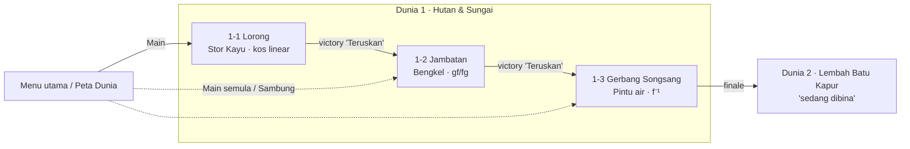
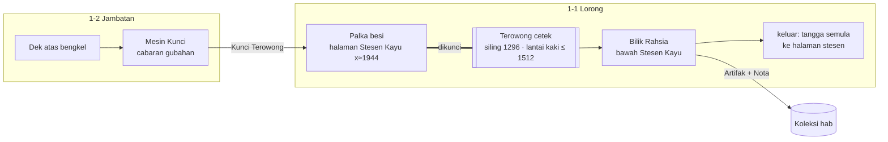
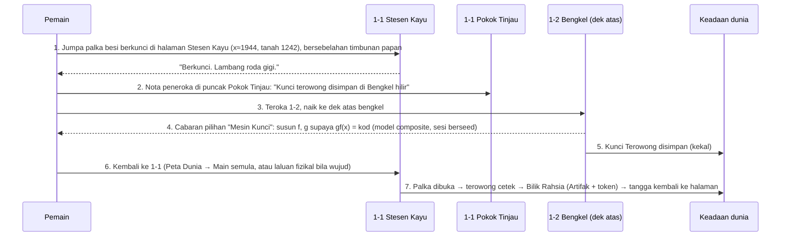

# DENAI — World Design Masterplan (Day 06 · audit baca sahaja)

> **Status:** cadangan sahaja. Tiada kod permainan, peta, prop, simpanan atau UI diubah dalam Day 06. Semua yang ditanda **[WUJUD]** disahkan dalam kod pada commit `da139a0`. Semua yang ditanda **[CADANGAN]** belum dibina.

---

## 1. Ringkasan eksekutif

**Kedudukan semasa:** DENAI hari ini ialah **tiga level platformer mendatar yang linear** (Dunia 1: 1-1 → 1-2 → 1-3). Setiap level ialah scene Phaser berasingan dengan kunci simpanan sendiri. Level hanya bersambung melalui **menu / Peta Dunia** dan butang "Teruskan" selepas menang, bukan melalui laluan fizikal. Setiap level mempunyai satu misi AddMath yang tertanam dalam dunia:
- 1-1: kos linear di Stor Kayu;
- 1-2: gubahan fungsi di bengkel;
- 1-3: fungsi songsang di pintu air.

Asas yang kukuh sudah ada:
- lapisan puzzle berseed dengan sesi kekal (Day 03–04);
- Jurnal, pin objektif dan dialog;
- checkpoint dan respawn tanpa hukuman;
- rahsia (nota teks), syiling, satu cabaran pilihan berganjaran (injap gua 1-3 → peti dengan 2 syiling + tablet);
- satu kunci dunia yang sebenar (kunci pondok → pintu Stor Kayu 1-1).

**Jurang utama untuk "Modern Adventure":**
1. Tiada laluan fizikal antara kawasan.
2. Tiada inventori atau keadaan dunia merentas level (kunci, artifak).
3. Ganjaran rahsia hanya teks.
4. Ruang bawah tanah yang luas tidak digunakan.
5. Tiada aset seni untuk penempatan moden atau kafe.
6. Tiada NPC.

**Cadangan teras:** jangan bina satu peta terbuka gergasi. Sebaliknya bina **"hab + wilayah bersambung"**:
- satu scene hab **Kampung Denai** (penempatan dan kafe) disambung secara fizikal (pintu, terowong, jambatan) kepada wilayah sedia ada dan akan datang;
- wilayah dipetakan kepada nama dunia yang **sudah dirancang** dalam Peta Dunia: Hutan & Sungai, Lembah Batu Kapur, Kilang & Lombong, Tanah Tinggi Ladang;
- satu stor **keadaan dunia** baharu yang aditif untuk kunci, artifak, nota dan token.

Ini memberi rasa separa-terbuka tanpa memecahkan seni bina scene, simpanan atau ujian sedia ada.

**Langkah pertama yang disyorkan (Day 07–08):** asas data (stor dunia + registri koleksi), kemudian **satu kepingan menegak** di Dunia 1: palka di Stesen Kayu 1-1 → kunci dari cabaran gubahan 1-2 → bilik rahsia cetek di bawah stesen.
- Semuanya muat dalam had respawn dan kamera sedia ada.
- Ruang bawah tanah yang benar-benar besar hanya ada di 1-3 (7–10 jubin).

---

## 2. Pengesahan Git

| Perkara | Keputusan |
|---|---|
| Branch asal | `claude/denai-day05-gameplay`, HEAD `da139a0` = `origin/claude/denai-day05-gameplay` |
| `da139a0` boleh dicapai | Ya (`git merge-base --is-ancestor`) |
| Remote | `origin` → `github.com/Azza-arch/azza-arch` |
| Working tree | bersih; hanya `?? app/addmath/denai/design/trailer/` (dilindungi, tidak dibaca/disentuh) |
| Branch baharu | `claude/denai-day06-world-design` dicipta daripada `da139a0` |
| Branch Day 05 | tidak diubah |
| Push / merge / deploy | tiada (audit) |

---

## 3. Inventori dunia semasa [WUJUD]

| Level | Scene | Saiz dunia (px) | Rupa bumi | Dek / tangga | Checkpoint | Syiling | Rahsia | Misi AddMath |
|---|---|---|---|---|---|---|---|---|
| 1-1 Jejak Taman Fungsi | `Lorong` (`game.js`, `level.js`) | 5940 × 1600, lantai 1566 | 17 pepejal + 3 slab | 9 dek, 3 tangga, 4 dinding | 6 | 15 | 2 | Kos linear C(x) = px + d (Stor Kayu) |
| 1-2 Jambatan Berkembar | `Jambatan` (`twin-scene.js`, `twin-world.js`) | 4860 × 1600 | 10 | 4 dek, 3 tangga, 2 tiang | 6 | 15 | 2 | Gubahan gf / fg (Bengkel Kayu) |
| 1-3 Gerbang Songsang | `GerbangSongsang` (`inverse-scene.js`, `inverse-world.js`) | 5616 × **2200** | 9 (5 batu) | 7 dek, 5 tangga | 5 | 22 (2 dalam gua) | 3 (1 dalam gua) | Songsang f⁻¹ (pintu air) + injap gua pilihan |

**Zon bernama:**
- **1-1:** 6 bilik/zon (`ROOMS`/`ZONES`): 01 Taman Permulaan, 02 Laluan Akar, 03 Stesen Kayu, 04 Tebing Berliku, 05 Pokok Tinjau, 06 Destinasi Terakhir.
- **1-2:** 5 kawasan HUD: Jejak Masuk, Gudang, Batu Loncatan, Laluan Rahsia, Bengkel Dua Mesin.
- **1-3:** 5 kawasan HUD: Jejak Sungai, Runtuhan Bertingkat, Halaman Mesin, Air Terjun, Gerbang Utama.
- **Jumlah: 16 zon dalam 3 peta.**

**Peta Dunia** (`menu/progress.js` `WORLDS`):
- 4 dunia: W1 Hutan & Sungai (boleh main), W2 Lembah Batu Kapur (dalam pembangunan; level 2-1 … 2-3 dinamakan sahaja), W3 Kilang & Lombong (akan datang), W4 Tanah Tinggi Ladang (akan datang).
- Gambar `assets/world-map/world-map.png` sudah menunjukkan hutan, industri (kren, paip), rumah hijau dan salji.

---

## 4. Struktur peta semasa [WUJUD]

Gambaran keseluruhan setiap peta (kamera dizum keluar, Chromium headless) disimpan di luar repo (scratchpad audit) dan dilampirkan dalam laporan sesi. Ketiga-tiganya ialah **jalur mendatar** dengan satu jalur tanah dan satu atau dua tingkat dek di atas.



**Pintu masuk dan keluar:**
- Setiap level bermula di `SPAWN` di hujung kiri dan tamat di `GOAL` di hujung kanan: 1-1 plinth x = 5751; 1-2 gerbang TAMAT x = 4698; 1-3 gerbang batu x = 5292.
- Penamat hanya aktif selepas misi selesai.
- Tiada pintu antara level di dalam dunia permainan.

**Laluan utama dan alternatif:**
- **1-1:**
  - laluan atas gerbang akar ke pondok kunci, dengan "jalan pintas" turun ke Stor Kayu (pencapaian `jalan-pintas`);
  - laluan bawah akar (rahsia `tower-whisper`);
  - jeti nelayan (tangga ke syiling `pier-high`);
  - Pokok Tinjau (dek tinggi, nota rahsia);
  - teka-teki peti di permulaan (tolak peti ke plat → tebing dengan 3 syiling).
- **1-2:**
  - dek atas (tuas susunan mesin, rahsia `twin-observation`);
  - kanopi/tinjau (rahsia `canopy-observation`);
  - "Laluan Rahsia" (tebing rahsia dengan checkpoint).
- **1-3:**
  - runtuhan bertingkat (galeri bawah/atas, tinjau);
  - halaman mesin;
  - jalan gerbang atas dengan injap gua → peti tersembunyi (pilihan).

**Ruang yang tidak digunakan (peluang terbesar):**

| Level | Paras tanah utama | Had respawn (jatuh) | Ruang bawah tanah **yang boleh dimain** |
|---|---|---|---|
| 1-1 | y ≈ 1242–1404 | `player.y > 1510`, iaitu kaki ≈ 1540 (`game.js:964`); kamera dihadkan berhampiran air sehingga bawah pandangan ≈ `WATER_Y + 40` = 1552 (`core/player-motion.js:115`) | **cetek**: kira-kira 4 jubin di bawah Stesen Kayu (lantai terowong pada kaki ≤ 1512, siling 1296); bawah Laluan Akar (tanah 1404) terlalu cetek |
| 1-2 | y ≈ 1242–1296 | `body.bottom > 1525` (`twin-scene.js:101`) | ≈ 3–4 jubin, mengikut syarat yang sama |
| 1-3 | y ≈ 1566–1728 | `WORLD.floor − 8` = 2098 (`inverse-scene.js:186`) | **≈ 7–10 jubin (370–530 px)**: tinggi dunia 2200 tetapi rupa bumi berhenti pada ~1728; calon terbaik untuk rangkaian bawah tanah |

Mengubah had respawn atau had kamera ialah perubahan gameplay (fizik dan keselamatan jatuh), jadi ia **perlu kelulusan** (§17, keputusan 10).

---

## 5. Audit persekitaran

| Kategori | 1-1 | 1-2 | 1-3 |
|---|---|---|---|
| Tema | hutan, rumah kampung atas tiang (spawn), stor kayu, kilang papan (hiasan), jeti | hutan sungai, gudang, bengkel dua mesin dengan konveyor | runtuhan batu, halaman mesin, paip dan meter, air terjun, gerbang istana batu |
| Landmark kuat | Pokok Tinjau (gergasi), Stor Kayu, jambatan rosak | Bengkel Kayu (mesin A/B, tuas dek atas), gerbang TAMAT | Paip biru + meter + roda injap, pintu air, gerbang batu |
| Papan tanda | rumah, keluar (anak panah) | "Bengkel di hilir", "← Dek atas", "Dek atas ↑", "Ke Lembah Sungai →" | "Awas!", "PINTU AIR", "TETAPAN", "TANDA ASAL n" |
| NPC | **tiada** | **tiada** | **tiada** |

- Sistem dialog menyokong potret NPC (`{npc: url}` dalam `ui/v4-ui.js`), tetapi tiada seni NPC.
- **Aset:**
  - Kenney Pixel Platformer (180 bingkai, 89 digunakan; lihat `KENNEY-ASSET-AUDIT.md`) dan Chill Boy (pemain).
  - Bingkai yang berguna dan **belum digunakan**: kunci (27), blok berkunci (28), blok soalan/syiling (10/11), anak panah besar (87/88), paip tambahan (113/114/132/134), digit besar (170–179, sebahagian kini digunakan oleh meter 1-3).
  - **Pintu tiada bingkai terbuka.**
  - Tiada bangunan moden, kafe, kaunter, kerusi, tingkap kedai, lampu jalan atau makmal.
- **Kesimpulan seni:** gaya semasa ialah *hutan + industri ringan + runtuhan*. "Penempatan moden / kafe / makmal penyelidikan" **tidak boleh** dibina dengan aset sedia ada tanpa seni baharu (lihat §15, R1).

---

## 6. Audit navigasi

| Aspek | Keadaan [WUJUD] | Isu untuk dunia separa-terbuka |
|---|---|---|
| Arah | kiri → kanan; reben zon; pin objektif; papan tanda | tiada konsep "kembali ke kawasan lain" |
| Peralihan | `scene.start` dari menu / Peta Dunia / butang victory | tiada pintu fizikal; `SPAWN` tunggal setiap level (tiada titik masuk berbilang) |
| Checkpoint | bendera; R kembali ke checkpoint; respawn tanpa hukuman | backtracking jauh di telefon memenatkan (1-1 ≈ 5900 px) |
| Kawalan telefon | ← → ↑ ↓, Guna, Lompat, Jurnal, Jeda; zoom kamera ikut viewport | laluan berliku dan pencarian lama sukar dengan butang sentuh |
| Peta dalam permainan | tiada (Peta Dunia hanya di menu) | dunia bersambung memerlukan peta mini atau peta Jurnal |

---

## 7. Sistem gameplay sedia ada [WUJUD]

| Sistem | Lokasi | Nota untuk masterplan |
|---|---|---|
| Lapisan puzzle (definisi, model, penjana, pengesah, sesi berseed) | `src/v14/puzzles/` | boleh digunakan semula untuk cabaran pilihan dan pintu berkunci tanpa sistem baharu |
| Sesi puzzle kekal | `quest.puzzle` / `workshop.puzzle` / `sluice.puzzle` | corak "simpan params + sahkan semula semasa muat" sesuai untuk kunci dan cabaran baharu |
| Quest 1-1 (jumpa → kunci → pintu → beli → pasang) | `levels/supply-quest.js` | **satu-satunya rantai kunci-pintu**; kunci ialah boolean dalam quest, bukan inventori |
| Jurnal + pin + petunjuk 3 peringkat + "Lihat cara kira" | `ui/v4-ui.js` + tracker setiap level | Jurnal ialah satu panel per level; belum ada tab koleksi |
| Dialog potret, cop "Misi selesai", toast ganjaran | `ui/v4-ui.js` | sesuai untuk nota peneroka dan penemuan artifak |
| Syiling dan rahsia | data per level; profil (1-1 sahaja), `denai-campaign-v1` (1-2), `denai-l3-campaign-v1` (1-3) | **pengumpulan berpecah 3 tempat**; pencapaian koleksi hanya untuk 1-1 |
| Pencapaian | `progress.js` `ACHIEVEMENTS` (jejak-pertama, bajet-cermat, pemburu-syiling, penjejak-rahsia, jalan-pintas) | semuanya terikat kepada 1-1 |
| Leaderboard (PlayFab) | `leaderboard/` | hanya larian 1-1 yang layak berperingkat; penerokaan mesti tidak menjejaskan masa larian |
| Kod legasi | `mechanisms.js` (621 baris), `lift-panel.js`, `missions.js`, `composition.js`, `inverse.js`, `STATIONS` / `TERMINALS` | masih dimuat untuk migrasi simpanan; menambah kerumitan bila level diubah |

---

## 8. Hala tuju seni "Modern Adventure"

**Prinsip:**
- Dunia moden-kampung yang boleh dipercayai: hutan dan sungai, kemudian **penempatan kecil** dengan kafe dan bengkel, **kawasan industri**, **terowong** dan akhirnya **stesen penyelidikan**.
- Setiap prop mesti mempunyai fungsi (laluan, petunjuk, ganjaran atau landmark). Tiada hiasan rawak.

| Kawasan | Rupa | Aset sedia ada | Aset baharu diperlukan |
|---|---|---|---|
| Kampung Denai (hab) | rumah papan moden, kafe "Kafe Jejak", papan notis, stesen basikal | rumah atas tiang (1-1), papan tanda, pagar | dinding kedai, kanopi kafe, tingkap, meja/kerusi, papan menu, lampu jalan |
| Hutan & Sungai (W1) | sedia ada | lengkap | tiada |
| Lembah Batu Kapur (W2) | tebing kapur, gua, kolam | jubin batu (1-3), air terjun | jubin kapur/gua, stalaktit |
| Kilang & Lombong (W3) | bengkel, konveyor, kren, terowong lombong | paip, tuas, peti, konveyor (1-2) | rel lombong, kereta lombong, lampu terowong |
| Stesen Penyelidikan (W4 Tanah Tinggi) | makmal kecil, rumah hijau, antena | (gambar Peta Dunia sahaja) | dinding makmal, skrin, pintu automatik |

Peraturan sedia ada dikekalkan:
- persamaan sentiasa teks yang boleh dibaca (`KENNEY-ASSET-AUDIT.md`: tiada glif + − = dalam atlas);
- tiada sistem nyawa atau hukuman untuk matematik.

---

## 9. Susun atur dunia dicadangkan [CADANGAN]

**Penilaian lima zon yang dicadangkan pemilik:**

| Zon dicadangkan | Penilaian | Cadangan struktur |
|---|---|---|
| Settlement | perlu, tetapi tiada aset | **Hab "Kampung Denai"** sebagai scene baharu kecil (~2500 px): pusat koleksi (Kafe = muzium artifak + papan nota), pintu ke setiap wilayah |
| Forest Trail | **sudah wujud** (W1, 3 level) | kekalkan; tambah laluan pilihan dan bilik rahsia (cetek di 1-1/1-2, lebih dalam di 1-3) |
| Workshop District | separuh wujud (bengkel 1-2, halaman mesin 1-3) | jadikan teras **W3 Kilang & Lombong**; jangan cipta dunia keempat yang bertindih |
| Underground Network | **tiada**, tetapi ruang tersedia (terbesar di 1-3) | **rangkaian terowong penghubung**, bukan dunia berasingan: bilik cetek di W1, terowong lebih dalam di bawah 1-3, kemudian gua W2 (Lembah Batu Kapur) dan lombong W3 |
| Research Outpost | tiada | wilayah akhir (selaras **W4 Tanah Tinggi**); destinasi naratif untuk nota peneroka |

**Struktur yang disyorkan:** hab-dan-wilayah, setiap wilayah = satu atau lebih scene yang sedia ada atau baharu, disambung oleh pintu fizikal yang membawa ke titik masuk bernama (`entry`) di scene sasaran.

```mermaid
flowchart TB
  HUB((Kampung Denai<br/>hab · Kafe Jejak<br/>[CADANGAN]))
  subgraph W1[W1 Hutan & Sungai · WUJUD]
    A11[1-1 Lorong] --- A12[1-2 Jambatan] --- A13[1-3 Gerbang Songsang]
    T1[[Bilik cetek<br/>bawah Stesen Kayu 1-1 · CADANGAN]]
    T3[[Terowong dalam<br/>bawah 1-3 · CADANGAN]]
  end
  subgraph W2[W2 Lembah Batu Kapur · dalam pembangunan]
    C2[Gua kapur<br/>pintu masuk Underground]
  end
  subgraph W3[W3 Kilang & Lombong · akan datang]
    K3[Daerah Bengkel] --- M3[[Lombong]]
  end
  subgraph W4[W4 Tanah Tinggi · akan datang]
    R4[Stesen Penyelidikan]
  end
  HUB -- jalan kampung --> A11
  A13 -- gerbang batu --> C2
  HUB -- jambatan sungai --> K3
  C2 -. terowong .- M3
  M3 -. lif lombong .- R4
  HUB -- jalan bukit<br/>dikunci --> R4
  T1 -. palka .- A11
  T3 -. pintu besi .- A13
  T3 -. terowong .- C2
```

**Laluan utama vs pilihan:**
- **Utama:** urutan level sedia ada (kurikulum Bab 1 → 2 → 3 → 4).
- **Pilihan:** terowong, bilik rahsia dan cabaran berkunci. Tidak pernah diperlukan untuk menamatkan level, supaya leaderboard dan kurikulum tidak terjejas.

---

## 10. Rajah sambungan zon

**Jenis sambungan:**
- pintu (Kenney 130/150, tiada bingkai terbuka, jadi animasi perlu dipalsukan seperti pintu Stor Kayu);
- palka / terowong (baharu);
- jambatan (corak "papan jatuh" sedia ada);
- laluan bertangga (sedia ada);
- lif lombong / pintu teknologi (baharu, W3/W4).



**Peralihan antara scene [CADANGAN]:** `scene.start(key, {entry:'tunnel-east'})`. Setiap dunia mentakrif `ENTRIES` (x, feet, arah) sebagai tambahan kepada `SPAWN`. Pada masa ini setiap scene hanya membaca `SPAWN` atau checkpoint tersimpan, jadi titik masuk bernama mesti ditambah dengan teliti tanpa mengubah tingkah laku "Sambung".

---

## 11. Reka bentuk koleksi & Easter egg [CADANGAN]

| Kategori | Fungsi | Contoh lokasi (berdasarkan peta sebenar) | Ganjaran |
|---|---|---|---|
| **Trail Tokens** | penanda penerokaan kecil (≈ 5–8 setiap level), disimpan seumur hayat | atas Pokok Tinjau (1-1, x≈4446), bawah akar (1-1 x≈1124 y 1404), kanopi 1-2 (x≈2916–3132 y 1080), galeri atas 1-3 (x≈1566–1890 y 1296), jalan gerbang 1-3 (x≈4320–4806 y 1242) | lencana peratus penerokaan; buka kosmetik kecil di hab |
| **Artifacts** | objek unik bercerita (1–2 setiap wilayah), dipamerkan di Kafe | peti injap gua 1-3 (sudah memberi "serpihan batu kapur" dalam teks → jadikan artifak sebenar); Bilik Rahsia di bawah Stesen Kayu (1-1); peti 1-2 Laluan Rahsia | slot pameran di hab + nota sejarah |
| **Special Keys** | buka laluan atau bilik (kunci kekal dalam keadaan dunia) | Kunci Terowong (cabaran 1-2), Kunci Lombong (W2), Kad Akses Makmal (W3) | laluan baharu, jalan pintas, kawasan pilihan |
| **Explorer Notes** | petunjuk naratif + AddMath | **naik taraf daripada 7 rahsia teks sedia ada** (2 + 2 + 3) | petunjuk ke kunci dan pintu; koleksi bacaan dalam Jurnal |

**Easter egg yang bermakna:**
- **Laluan pemain veteran:** jalan pintas akar 1-1 (sudah ada pencapaian) membuka token tersembunyi.
- **"Nombor kegemaran":** jika sesi puzzle memberi jawapan tepat (contohnya beli tepat 5 papan, `bajet-cermat`), satu token bonus muncul.
- **Siri nota peneroka:** nota bersambung dari W1 ke W4 tentang "Stesen Penyelidikan lama", sebagai sebab untuk meneroka semula.

**Sebab melawat semula:**
1. Kunci dari wilayah kemudian membuka bilik di wilayah awal (backtracking bermakna).
2. Peratus penerokaan per wilayah dalam Jurnal.
3. Pameran artifak di hab.
4. Sesi puzzle berseed memberi nombor baharu semasa main semula.

---

## 12. Progresi kunci & kunci-pintu [CADANGAN]

**Contoh lengkap (Dunia 1, hanya ruang dan mekanik sedia ada):**



**Keperluan backtracking:**
- **Fasa awal:** kembali melalui Peta Dunia, kerana tiada laluan fizikal lagi.
- **Fasa hab:** pintu fizikal dari Kampung Denai ke setiap wilayah, dengan titik masuk bernama.
- **Telefon:** sediakan jalan pintas (terowong) supaya perjalanan balik tidak melebihi kira-kira 1 skrin dari checkpoint.

**Nota teknikal contoh:**
- Bilik di 1-1 mesti kekal di atas had respawn (kaki ≤ 1512) dan dalam had kamera berhampiran air. Ia muat (4 jubin) tanpa mengubah fizik.
- Rangkaian bawah tanah yang lebih besar paling sesuai di 1-3 (7–10 jubin) dan W2.

**Peraturan:**
- Kunci khas tidak pernah diperlukan untuk misi kurikulum.
- Pintu berkunci mesti menunjukkan petunjuk ke mana kunci berada (pin dan Jurnal).

---

## 13. Integrasi AddMath

Matematik kekal dalam objek dunia, bukan kuiz. Kandungan topik hanya kod dan tajuk DSKP (hak cipta KPM).

| Wilayah | Topik (Peta Dunia sedia ada) | Mekanik dunia dicadangkan | Model puzzle |
|---|---|---|---|
| W1 Hutan & Sungai | Fungsi | sedia ada: kos linear, gubahan, songsang; **cabaran pilihan:** Mesin Kunci (gubahan), injap gua (songsang, wujud) | `linear-cost`, `composite-order`, `inverse-linear` (wujud) |
| W2 Lembah Batu Kapur | Fungsi Kuadratik | lontaran/jambatan lengkung ikut paksi simetri, titik maksimum pada semburan air gua | model baharu (kuadratik), corak yang sama |
| W3 Kilang & Lombong | Sistem Persamaan | dua konveyor / dua troli lombong mesti seimbang | model baharu (persamaan linear serentak) |
| W4 Tanah Tinggi | Indeks, Surd & Logaritma | pertumbuhan tanaman di rumah hijau, kunci makmal ikut log | model baharu |
| Hab | semua | papan cabaran kafe: ulang sesi berseed dari wilayah yang sudah ditamatkan (latihan) | semula guna penjana berseed |

**Kunci & AddMath:**
- Setiap Kunci Khas diperoleh melalui cabaran pilihan yang mengguna semula model wilayahnya, dengan sesi berseed disimpan (corak Day 04).
- Jawapan salah memberi maklum balas tanpa hukuman (corak sedia ada).

---

## 14. Keperluan simpanan & kegigihan [CADANGAN]

**Keadaan semasa [WUJUD]:**

| Kunci | Pemilik | Kandungan |
|---|---|---|
| `denai-save-v14` | 1-1 | larian |
| `denai-profile-v1` | 1-1 | profil, syiling/rahsia seumur hayat, pencapaian |
| `denai-campaign-v1` | 1-2 | larian + seumur hayat |
| `denai-l3-campaign-v1` | 1-3 | larian + seumur hayat |
| `denai-l1-last-variant` | 1-1 | putaran varian |
| `denai-lb-*` | leaderboard | — |

Semuanya sudah disanitasi dan mempunyai migrasi.

**Cadangan:** satu kunci baharu **`denai-world-v1`** yang aditif. Kunci sedia ada tidak diubah.

```js
{ schemaVersion: 1,
  keys: ['tunnel-key'],                  // Special Keys (kekal)
  unlocked: ['l11-station-hatch'],          // pintu/palka yang sudah dibuka (kekal)
  artifacts: ['limestone-shard'],
  notes: ['note-w1-01'],
  tokens: { 'w1-l1': ['tok-tinjau'], ... },
  challenges: { 'w1.l2.keymachine': { puzzle: {v:1,id,seed,difficulty,params}, solved: true } } }
```

- Disanitasi seperti stor lain: hanya id yang dikenali registri; kunci dan unlock hanya jika cabaran berkaitan benar-benar diselesaikan.
- **Keputusan diperlukan:** adakah koleksi seumur hayat (disyorkan) atau per larian? Larian semula dan leaderboard tidak menyentuh keadaan dunia.
- Migrasi: pemain lama bermula dengan keadaan dunia kosong. Opsyen: rahsia yang sudah ditemui dalam profil atau kunci kempen boleh dikira sebagai Explorer Notes.
- **Ujian wajib:** simpan/muat, rosak, versi lebih baharu, larian semula tidak mengunci semula, dan keserasian dengan semua ujian Day 04/05.

---

## 15. Risiko teknikal

| # | Risiko | Kesan | Mitigasi |
|---|---|---|---|
| R1 | **Tiada aset moden** (kafe, kedai, makmal, NPC) dalam Kenney; larangan kandungan AI placeholder | hab "Modern Adventure" tidak boleh dibina dengan kualiti visual | putuskan sumber aset (pek berlesen / artis) sebelum Day 10; mula dengan wilayah bawah tanah yang boleh guna jubin sedia ada |
| R2 | Scene level tidak berkongsi rangka asas (1-1 dalam `game.js` 1557 baris + legasi; 1-2/1-3 corak sendiri) | setiap wilayah baharu menyalin kod | Day 07: ekstrak "region scene" kecil (pintu, titik masuk, keadaan dunia) tanpa ubah fizik |
| R3 | Ujian bergantung pada koordinat (teleport x tetap) | mengubah peta memecahkan ujian | hanya tambah di ruang kosong (bawah tanah); kemas kini ujian bersama |
| R4 | Simpanan berpecah 5+ kunci | koleksi merentas wilayah sukar | kunci `denai-world-v1` aditif; jangan cantum kunci lama |
| R5 | Prestasi telefon dengan peta lebih besar / tinggi | FPS jatuh | `view-cull` sedia ada; bilik bawah tanah sebagai kawasan kecil; ukur sebelum dan selepas |
| R6 | Backtracking di telefon | penat, berhenti main | jalan pintas, titik masuk berhampiran, peta Jurnal |
| R7 | Leaderboard 1-1 (larian berperingkat) | penerokaan menambah masa | laluan pilihan sahaja; masa larian berperingkat tidak dikira semasa di bilik pilihan (keputusan) |
| R8 | Kod legasi (`mechanisms.js`, `STATIONS`, `TERMINALS`) | perubahan 1-1 berisiko | tidak disentuh dalam kepingan menegak; pembersihan berasingan |
| R9 | Pintu Kenney tiada bingkai terbuka | animasi pintu terhad | ikut corak Stor Kayu (pintu naik + pudar) |
| R10 | Pemain lama tanpa keadaan dunia | kekeliruan | keadaan kosong + mesej "baharu" di Jurnal |
| R11 | Had respawn dan had kamera tetap (1-1 kaki ≈ 1540; 1-2 1525; kamera dekat air ≈ 1552) | bawah tanah 1-1/1-2 terhad kepada kira-kira 4 jubin | reka bentuk dalam had; jika mahu lebih dalam, ubah had per kawasan dengan ujian (perlu kelulusan) |

---

## 16. Pelan jalan Day 07–11 [CADANGAN]

| Hari | Fokus | Hasil boleh diuji | Tidak termasuk |
|---|---|---|---|
| **D07** | Asas data | stor `denai-world-v1` (sanitasi + ujian unit); registri koleksi (Tokens/Artifacts/Keys/Notes) sebagai data; helper `ENTRIES` + peralihan scene bernama (tanpa pintu di peta) | perubahan peta, UI baharu |
| **D08** | Kepingan menegak W1 | palka 1-1 + terowong cetek + Bilik Rahsia di bawah Stesen Kayu (dalam had respawn/kamera sedia ada); cabaran Mesin Kunci 1-2 (model composite, sesi berseed); nota Pokok Tinjau sebagai petunjuk; ujian playthrough baharu | hab, aset baharu |
| **D09** | Koleksi W1 | Trail Tokens di laluan pilihan sedia ada; 7 rahsia → Explorer Notes; artifak injap gua; tab "Koleksi" dalam Jurnal; semakan mudah alih 11 viewport | wilayah baharu |
| **D10** | Prototaip hab (graybox) | scene Kampung Denai dengan jubin sedia ada; pintu ke W1 dan pintu berkunci ke W2; Kafe sebagai pameran artifak; *bergantung pada keputusan aset (R1)* | seni akhir |
| **D11** | Penggilapan & ujian | prestasi telefon, regresi penuh, laporan ujian main, pelan W2 (gua kapur = mula Underground) | pelancaran |

---

## 17. Keputusan yang memerlukan kelulusan

1. **Struktur:** hab-dan-wilayah (disyorkan) berbanding satu peta terbuka besar.
2. **Pemetaan zon:** gunakan nama dunia sedia ada (W1–W4) dengan Settlement = hab, Workshop = W3, Underground = rangkaian penghubung (W1 bawah tanah → W2 gua → W3 lombong), Research = W4. Atau namakan semula dunia?
3. **Sumber aset** untuk penempatan moden, kafe, makmal dan NPC (R1): pek berlesen, artis, atau tangguh hab dan mula dengan bawah tanah.
4. **Kegigihan koleksi:** seumur hayat (disyorkan) atau per larian; adakah main semula level mengekalkan pintu yang sudah dibuka?
5. **Kunci baharu `denai-world-v1`** (aditif), atau perluasan profil sedia ada.
6. **Syiling sedia ada:** kekal (disyorkan) atau digantikan oleh Trail Tokens?
7. **7 rahsia teks sedia ada** dinaik taraf menjadi Explorer Notes (teks dikekalkan)?
8. **Leaderboard:** laluan pilihan dikecualikan daripada larian berperingkat 1-1?
9. **Kepingan menegak pertama:** contoh palka 1-1 → Mesin Kunci 1-2 → Bilik Rahsia (cetek, tanpa ubah fizik) seperti dalam §12? Atau mulakan di 1-3, yang mempunyai ruang bawah tanah lebih besar?
10. **Had respawn / kamera:** kekal (disyorkan untuk D08), atau benarkan perubahan per kawasan untuk terowong yang lebih dalam?
11. **Skop Day 07:** asas data sahaja (disyorkan), atau terus ke kepingan menegak?

---

### Ujian yang dijalankan (Day 06, kod `da139a0` tanpa perubahan)
Dijalankan pada branch `claude/denai-day06-world-design` (HEAD `da139a0`, tiada perubahan kod). `rc=$?` diambil sejurus selepas setiap arahan. Chromium headless sahaja; tiada peranti sebenar. PlayFab di-stub dan hosnya disekat.

| Ujian | Kod keluar | Nota |
|---|---|---|
| 10 ujian unit (`tests/*.test.mjs`) | 0 ×10 | analytics 5, inverse 1, progress-course 4, puzzle-session 10, puzzles 8, sluice 1, supply-quest 4, twins 1, workshop-v3 1, workshop 1 — 0 gagal |
| `puzzle-reload-check` | 0 | 15 s |
| `day05-gameplay-check` | 0 | 136 s |
| `l1-playthrough` / `l2-playthrough` / `l3-playthrough` | 0 / 0 / 0 | 76 / 75 / 114 s |
| `w1-progression` | 0 | 312 s |
| `w1-mobile-check` | 0 | 306 s, 11 viewport × 3 level |
| `rc-check` / `menu-check` | 0 / 0 | 64 / 30 s |
| `l1-v3-check` / `l2-check` / `l3-check` | 0 / 0 / 0 | 56 / 44 / 81 s |

**Ralat konsol / halaman:** semua 63 senarai `errs`/`errors` dalam output ujian kosong.

**Gangguan yang direkod dengan jujur:**
- Larian suite **pertama** terputus kerana pelayan ujian tempatan (`python3 -m http.server 8790`) dihentikan oleh had masa latar belakang (2 jam) di tengah suite.
- Selepas itu ujian gagal dengan `net::ERR_CONNECTION_REFUSED` (exit 1 dalam 0–1 s). Ini masalah infrastruktur, bukan permainan.
- Pelayan dihidupkan semula dan **keseluruhan suite dijalankan semula dari awal**. Jadual di atas ialah keputusan larian kedua yang lengkap.

**Diagnostik tambahan (baca sahaja):** gambaran keseluruhan peta 1-1, 1-2 dan 1-3 (kamera dizum keluar), disimpan di luar repo.
