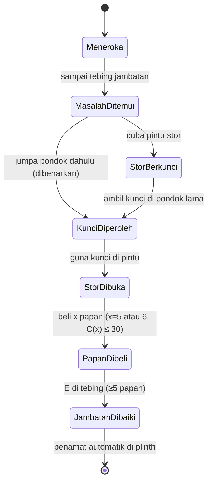
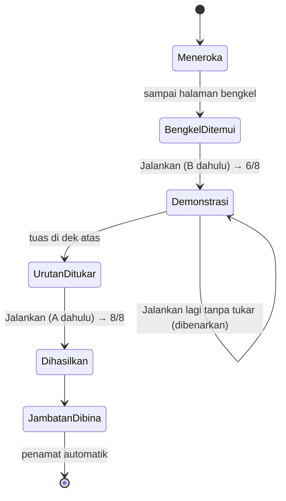
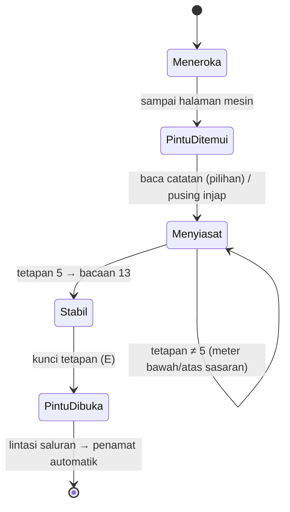

# DENAI · World 1 V3 — Audit (Fasa A) & Pelan Tindakan (Fasa B)

Status: **reka bentuk untuk semakan. Tiada kod permainan diubah.**
Branch: `claude/denai-w1-v3-design` dari `origin/main` **ef9c3b5** (16 Nov 2026).
Imej dalam folder ini: `sebelum-misi.png` (binaan sebenar), `blueprint-1-1/1-2/1-3.png`
(peta sebenar + penanda cadangan), `mockup-misi.png` (mockup UI, bukan tangkapan permainan).

---

## A1. Keadaan repositori yang disahkan

| Perkara | Keadaan |
|---|---|
| `origin/main` | ef9c3b5 — PR #14 (soalan lebih jelas) di atas #13 (penamat seragam, no-cache), #12 (RC1, Engagement V1, Game Feel V2, Growth, kiraan landing) |
| Branch DENAI dengan `ahead=0` | rc1, engagement-v1, game-feel-v2, growth-30d, landing-count, level-endings, puzzle-clarity, menu-ux, landing, landing-v2, leaderboard-v2, menu-camera — semua sudah dalam `main` |
| `ahead>0` tetapi kandungan sudah dalam `main` | bg-forest (BG_THEMES ada), w1-environment, l1-redesign (sawmill.js ada) — dibawa melalui cherry-pick dengan resolusi berbeza, jadi `git cherry` tunjuk `+` |
| `ahead>0`, sengaja tidak dikeluarkan | w2-slice (Dunia 2), map-masterplan-v2 & master-plan (dokumen + pek industri/ladang) |
| Lapuk (14 Nov) | add-denai-game, denai-leaderboard — digantikan oleh garis keturunan semasa |
| Ujian | unit 13/13 lulus pada ef9c3b5; ujian pelayar terakhir (rc, engagement, feel, analytics, menu, playthrough, puzzle-clarity) lulus semasa PR #14 |
| Integrasi sedia ada | Menu MAIN/SAMBUNG + Peta Dunia; PlayFab (login tanpa nama, `denai_l1_time` arkib, `denai_l1_time_v2` belum dicipta, `denai_players` dicipta); analitik (dimatikan); panel kemenangan seragam; game feel (syiling, checkpoint, jambatan) |
| Aset | `tilemap_packed.png` 18 px × 180 bingkai — audit penuh dalam `../../KENNEY-ASSET-AUDIT.md`. Berguna untuk V3: papan 48/49/50, kotak 9/26/29, tanda 84–88, pintu 130/150 (tiada bingkai terbuka), kunci 27, blok berkunci 28, tuas 64/65/66, paip 93–95/113–115/132–135, air 33/53/73 |

## A2. Audit permainan semasa

| | 1-1 Jejak Taman Fungsi | 1-2 Jambatan Berkembar | 1-3 Gerbang Songsang |
|---|---|---|---|
| Dunia | 5940 × 1600, 6 zon | 4860 × 1600 | 5616 × 2200 |
| Interaksi matematik | Mesin "pengangkat" f(x)=2x+1 → 7 papan; 12 variasi (cari input / cari mesin / corak); terminal "probe"; kilang papan pilihan g(b)=3b−1 | Dua stesen hampir sama: (9, 25) dan (19, 49) dengan f=2x+1, g=x² | Mesin songsang f=2x+3, domain {0…6}; 3 meterai 13/7/15; jambatan muncul |
| Masalah utama | Panel "BANTUAN PENGANGKAT" penuh teks; matematik sebagai kata laluan untuk jambatan; dua soalan matematik dalam satu level | Dua stesen berulang; peta rata "blok tanah + jurang air" berulang; label teks terapung (`f(g(x))·9`) | 3 meterai berturut-turut terasa seperti kuiz; jambatan "muncul" tanpa sebab fizikal; tiang/tali panjang tanpa sokongan di x≈4700 |
| Kekalkan | Pergerakan, kamera, laluan akar, gerbang akar, kotak + plet, Tebing Berliku, Pokok Tinjau, plinth penamat, rahsia & syiling, banner kawasan | Laluan bertingkat (kanopi, dek tinjau, tangga), rahsia, penamat | Runtuhan menegak, paip + air terjun, gerbang batu, tablet rahsia |
| Ganti | Mesin pengangkat + probe → stor kayu & papan belian; soalan kilang papan | Dua stesen → satu bengkel dua mesin; lintasan pertama jadi traversal | 3 meterai → satu injap + meter; jambatan → pintu air yang menyurutkan air |

Pepijat/risiko diperhatikan: panel bantuan 1-1 (`#mechanism`) ialah DOM global — jika dibuka kemudian scene ditukar secara paksa, ia kekal (berlaku dalam skrip ujian; laluan pemain biasa belum disahkan). Kad "TAMAT" 1-2 dan label meterai 1-3 bergantung pada teks Arial terapung.

## A3. Kesesuaian kurikulum (sumber projek: `app/addmath/src/content/notes/t4-1`)

| Level | Standard pembelajaran yang disentuh secara jujur | Tidak didakwa |
|---|---|---|
| 1-1 | 1.1.1 objek, imej, tatatanda fungsi · 1.1.3 mencari imej (C(5)) dan objek (C(x)=26) · 1.1.2 domain (bilangan bulat 1–8) | Ketaksamaan linear (konteks bajet sahaja) |
| 1-2 | 1.2.1 maksud gubahan · 1.2.3 imej fungsi gubahan | 1.2.4 cari fungsi tidak diketahui, 1.2.5 fⁿ |
| 1-3 | 1.3.1 maksud songsangan · 1.3.2 (satu dengan satu pada domain) · sebahagian 1.3.3 (undur operasi) | Graf/pantulan y = x |

**Notasi KSSM:** fg(x) = f(g(x)) (g dahulu). Semua plat mesin & ringkasan memaparkan kedua-dua bentuk: "gf(5) = g(f(5))".

---

## B0. Naratif World 1 (satu perjalanan)

Kampung tepi sungai → **1-1** jambatan kampung kurang papan (beli bekalan) → **1-2** bengkel kayu
di hilir menghasilkan komponen untuk lintasan seterusnya (urutan proses) → **1-3** pintu air lama
mengawal sungai; pulihkan tetapan injap untuk menyurutkan air dan membuka lembah. Di hujung 1-3,
tebing batu kapur kelihatan (prop batu, satu tema latar hutan kekal).

| Level | Matematik | Interaksi unik | Traversal utama |
|---|---|---|---|
| 1-1 | Fungsi & kos C(x)=4x+6 | Cari kunci → beli papan → pasang | Laluan akar + gerbang akar (tangga, lompat) |
| 1-2 | Gubahan gf vs fg | Ubah urutan dua mesin secara fizikal | Bengkel bertingkat: dek atas ↔ lantai |
| 1-3 | Songsang f⁻¹(y)=(y−3)/2 | Pusing injap, baca meter | Runtuhan menegak + saluran air |

---

## B1. Level 1-1 — Bekalan untuk Jambatan Kampung (`blueprint-1-1.png`)

| # | Lokasi (x, kaki) | Peranan |
|---|---|---|
| 1 | Mula 60,1296 | Taman Permulaan (kekal) |
| 2 | Kotak + plet 216→405 | Pilihan: tebing syiling (kekal) |
| 3 | 1124,1404 | Rahsia "Jejak di Akar" (kekal) |
| 4 | cp-rise1 1700,1296 | Checkpoint sebelum stor |
| 5 | Stor Kayu ≈2150–2500 @1242 | Ganti pondok mesin; pintu (bingkai 130/150) + papan tanda "Stor Kayu" |
| 6 | 2490,1242 | **Pencetus misi** apabila pemain sampai tebing: "Jambatan ni kurang 5 papan." |
| 7 | Jurang 2538–2862 | Jambatan: 1 papan kekal (2538–2592), **5 tempat kosong** kelihatan |
| 8–9 | Tangga akar 1215 → atas gerbang akar 1242–1620 @1080 | **Pondok lama + kunci** (bingkai 27) di atas gerbang — kelihatan dari laluan bawah semasa lalu |
| 10 | Hujung timur gerbang 1620 | Turun ke root-step-2 (1296) → halaman stor: jalan pulang ±10 s |
| 11 | Dalam stor | Papan belian C(x)=4x+6, bajet RM30 |
| 12 | Tebing 2538 | "E · Pasang papan" → papan dipasang satu demi satu (planksDrop) |
| 13 | cp-gate 2940 | Checkpoint selepas jambatan (requires `bridge`) |
| 14 | Kilang papan 3060 | **Keputusan D1**: buang soalan g(b)=3b−1; jeti jadi laluan syiling biasa |
| 15–17 | Tebing Berliku → Pokok Tinjau → plinth | Kekal; penamat automatik |

**Aliran misi (rajah keadaan)**

**Papan belian:** butang −/+ (x = 1…8, stok 8), jumlah dikemas kini serta-merta, resit `C(x) = 4x + 6`.
x < 5 → "Belum cukup untuk 5 lubang"; C(x) > 30 → "Melebihi bajet"; Beli aktif hanya untuk x = 5
(RM26, baki RM4) atau x = 6 (RM30, lebih 1 papan). Satu pembelian sahaja → tiada keadaan terkandas.
Bajet misi RM30 berasingan daripada syiling koleksi.

**Petunjuk berperingkat (pilihan, butang "?"):** 1) "Stor kayu di belakang anda." 2) "Setiap papan
RM4, hantaran RM6 sekali." 3) "Cuba kira C(5) = 4(5) + 6." — jawapan tidak diberi terus.

**Selepas pasang:** "Fungsi membantu kita merancang kos berdasarkan kuantiti." + pautan pilihan
"Lihat cara kira" → C(5) = 4(5) + 6 = 26.

Anggaran kali pertama: 5–8 minit (hipotesis; bot semasa tamatkan laluan dalam 33 s).

## B2. Level 1-2 — Aliran Bengkel Dua Mesin (`blueprint-1-2.png`)

| # | Lokasi | Peranan |
|---|---|---|
| 1 | Mula 108,1296 | Jejak Masuk |
| 2 | 1404 | Stesen "Dua Mesin" **dibuang**; jadi gudang bahan: 5 kotak komponen (kelihatan) untuk bengkel |
| 3 | Air 1836–2160 | Lintasan pertama: batu loncatan / kayu hanyut (traversal, tiada matematik) — **Keputusan D4** |
| 4 | cp beyond-twins 2214 | Checkpoint |
| 5 | Kanopi 2916 @1080 | Rahsia + syiling (kekal) |
| 6 | Dek tinjau 3186 @1026 | **Tuas pengalih** (bingkai 64/65/66): memilih mesin mana menerima bahan dahulu |
| 7–8 | Halaman akhir 3456–3888 @1242 | Mesin A `f(x)=2x` (gandaan, guna bahan mentah bengkel) & Mesin B `g(x)=x−2` (buang 2 rosak; perlu ≥2 unit) di atas penghantar |
| 9 | Papan penyelenggaraan | Pilihan: gf(x) = 2x − 2, fg(x) = 2x − 4 |
| 10 | 3470 | Tuas "Jalankan" di lantai |
| 11 | 3870 | Penerima: perlu ≥ 8 komponen |
| 12 | 3888–4212 | Jambatan dibina daripada komponen (6 papan + 2 tiang) |
| 13–14 | 4266 → 4698 | Checkpoint keluar → penamat automatik |

**Ramalan, bukan tekaan:** bengkel bermula dengan tuas pada **"B dahulu"** (tetapan rosak). Larian
pertama ialah demonstrasi: 5 → B → 3 → A → **6**, penerima "6 / 8 — belum cukup", komponen kembali
ke gudang (tiada hukuman). Mandur: "Hasil 6. Mungkin urutan mesin silap?" Pemain naik ke dek, tukar
ke "A dahulu", turun, jalankan: 5 → A → 10 → B → **8** ✓. Nilai perantaraan dipaparkan di atas
penghantar setiap kali.

Ringkasan: "Susunan fungsi boleh mengubah hasil." · "Lihat cara kira": gf(5) = g(f(5)) = 8;
fg(5) = f(g(5)) = 6; maka gf ≠ fg untuk contoh ini. Anggaran: 6–9 minit.

## B3. Level 1-3 — Pulihkan Pintu Air Lama (`blueprint-1-3.png`)

| # | Lokasi | Peranan |
|---|---|---|
| 1–3 | Mula, runtuhan, checkpoint 1998 | Kekal (traversal menegak + rahsia inskripsi) |
| 4 | cp machine 2592 | Checkpoint |
| 5 | 2700 @1620 | **Catatan penyelenggaraan koyak**: "bacaan = tetapan ×2, kemudian +3 …" |
| 6 | 2850 | **Roda injap** (pusing dengan E/Guna: kiri/kanan, 0–6, satu takuk = animasi 0.4 s) |
| 7 | Paip 2990 | **Meter** dengan tanda sasaran 13; bawah/atas sasaran ditunjuk dengan warna & jarum |
| 8 | Saluran 3240–3456 | Pintu air: apabila stabil 13 dan dikunci, air surut 54 px → laluan batu yang tenggelam muncul (menggantikan "jambatan muncul") |
| 9 | 3024 | Tablet domain (pilihan) |
| 10 | cp 3564 | Checkpoint tebing air terjun |
| 11 | 4590 @1242 | Tablet songsang (pilihan) |
| 12 | Gerbang 4860–5292 | 3 meterai **dibuang**. **Keputusan D3**: injap kedua dengan meter rosak (sasaran 15 → kira 6 dahulu) sebagai cabaran pilihan/wajib/tiada |
| 13 | 5480 | Prop batu kapur — petunjuk Dunia 2 |
| 14 | 5292 | Penamat automatik |

Soalan dunia: "Apakah tetapan asal yang boleh menghasilkan bacaan 13?" (bukan "kira f⁻¹(13)").

Ringkasan: "Fungsi songsang membantu mencari semula input daripada output." · langkah: 13 − 3 = 10,
10 ÷ 2 = 5. Anggaran: 6–10 minit.

---

## B4. Pengesahan model matematik

| | Model | Pemboleh ubah & unit | Domain / julat | Jawapan sah | Catatan |
|---|---|---|---|---|---|
| 1-1 | C(x) = 4x + 6 | x papan (integer), C ringgit | x ∈ {1,…,8}; julat {10,14,…,38} | x = 5 (RM26) **atau** 6 (RM30) | Satu pembelian = satu yuran hantaran; RM30 ialah bajet misi, bukan syiling |
| 1-2 | f(x) = 2x, g(x) = x − 2 | unit komponen | f: integer ≥ 1; g: integer ≥ 2 | gf(5) = 8 ✓, fg(5) = 6 | f model ringkas: bahan mentah bengkel ditunjuk berkurang (tiada bahan "dari udara") |
| 1-3 | f(x) = 2x + 3 | x tetapan injap, f bacaan meter (unit permainan) | x ∈ {0,…,6}; julat {3,5,…,15}; satu dengan satu | f⁻¹(13) = 5 | Model kalibrasi permainan, bukan hukum fizik aliran air |

Cuba-jaya: 1-1 (8 pilihan) dan 1-3 (7 tetapan) boleh dicuba satu-satu. Itu diterima kerana jumlah
dipaparkan langsung (pemain melihat pemetaan input → output). Pemahaman diperkukuh oleh ringkasan,
petunjuk berperingkat, dan (pilihan) injap kedua 1-3 tanpa meter langsung.

## B5. UI (lihat `mockup-misi.png`)

Tiada panel matematik penuh skrin. Komponen: gelembung dialog pendek, penjejak misi kecil (penjuru
kanan atas, maks. 2 baris), panel kompak di sebelah objek (stor/bengkel/injap), roti bakar ringkasan
dengan pautan "Lihat cara kira", butang "?" untuk petunjuk berperingkat. Notasi hanya pada resit,
plat mesin, catatan penyelenggaraan.

## B6. Simpanan (penilaian migrasi)

| Kunci | Perubahan | Pemain sedia ada |
|---|---|---|
| `denai-save-v14` (1-1 run) | schemaVersion 3: `quest:{found,key,doorOpen,bought:{x,cost}|null,planks,bridge}`; `missions.lift` disimpan tetapi tidak digunakan | Simpanan v2 dengan `lift` selesai → `bridge:true` (tiada regresi); belum selesai → misi bermula di penemuan; syiling/rahsia/checkpoint kekal |
| `denai-profile-v1` | Tiada perubahan skema; pencapaian dipetakan (D2), yang sudah diperoleh kekal | Rekod terbaik kursus lain → `classicBest` (mekanisme sedia ada) |
| `denai-campaign-v1` (1-2) | `run.workshop:{order,runs,delivered}` | `final` selesai → jambatan terbina; lain-lain bermula semula di bengkel, syiling/rahsia kekal |
| `denai-l3-campaign-v1` | `run.valve:{setting,locked,exit}` | Semua meterai → pintu terbuka; lain-lain bermula semula |

Sambung = teruskan keadaan misi; Main semula = reset keadaan misi level itu sahaja; pencapaian,
syiling sepanjang hayat dan penyelesaian kekal. Kunci, belian, papan dan pintu tidak boleh
digandakan (setiap satu bendera sekali).

## B7. Papan pendahulu

Kursus 1-1 berubah lagi → **jangan cipta `denai_l1_time_v2`** (belum ada data). Keluarkan V3 sebagai
`L1_COURSE='v3'` + papan `denai_l1_time_v3` (Min, Ascending). Rekod tempatan kursus v2 automatik
jadi "kursus lama". `denai_l1_time` kekal arkib. 1-2/1-3 belum ada papan.

## B8. Ujian yang akan dijalankan setiap fasa

Unit: model kos (x 1…8, bajet), bengkel (dua urutan, domain g), injap (0…6, songsang), migrasi
simpanan. Pelayar: pencetus misi, kunci kekal selepas mati/checkpoint/reload, pintu, belian sekali,
inventori, pasang jambatan, perlanggaran jambatan, main semula reset, penamat automatik, telefon
(sentuh), papan kekunci, 0 ralat konsol, 0 tulisan ke papan produksi, larian penuh Menu → 1-1 → 1-2
→ 1-3 dengan masa diukur (bot, bukan pelajar).

## B9. Protokol ujian main pelajar (cadangan — belum dijalankan)

5–8 pelajar Tingkatan 4 dengan kebenaran sekolah/ibu bapa; tiada data peribadi direkod. Fikir
kuat semasa bermain; pemerhati mencatat: masa untuk faham masalah, penggunaan petunjuk, titik
keliru. Selepas setiap level, satu soalan lisan: "Kenapa 5 papan?" / "Kenapa urutan penting?" /
"Bagaimana anda tahu tetapan 5?". Ukuran: kejayaan tanpa bantuan, kualiti penjelasan, keseronokan
(skala 1–5). Ubah dunia (bukan tambah teks) bagi titik keliru berulang.

## B10. Keputusan diperlukan sebelum Fasa C

| ID | Soalan | Cadangan |
|---|---|---|
| D1 | Kilang papan 1-1 (g(b)=3b−1) | Buang soalan; jeti kekal sebagai laluan syiling pilihan |
| D2 | Pencapaian "Tepat Sekali" & "Tiga Cara Berfikir" bergantung pada mesin lama | Ganti dengan "Bajet Cermat" (beli tepat 5) dan "Jalan Pintas" (guna laluan turun gerbang akar); yang sudah diperoleh kekal |
| D3 | Injap kedua 1-3 (meter rosak, sasaran 15) | Pilihan (cabaran + syiling), bukan wajib |
| D4 | Lintasan pertama 1-2 | Batu loncatan (traversal sahaja) |
| D5 | Papan pendahulu | Langkau v2; keluarkan V3 dengan `denai_l1_time_v3` |
| D6 | 12 variasi misi 1-1 dibuang | Untuk main semula: 3 set harga/bajet yang disahkan (cth. RM4+6/30, RM3+9/25, RM5+5/32), semua dengan jawapan sah ≥ 1 |

Anggaran kerja: Fasa C (1-1) terbesar — stor, kunci, belian, inventori, jambatan, simpanan v3,
ujian. Fasa D dan E masing-masing sederhana. Setiap fasa: branch, ujian, tangkapan skrin, PR untuk
semakan; tiada merge tanpa kelulusan.
