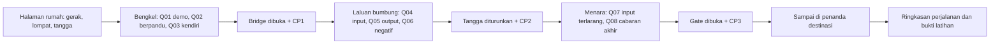
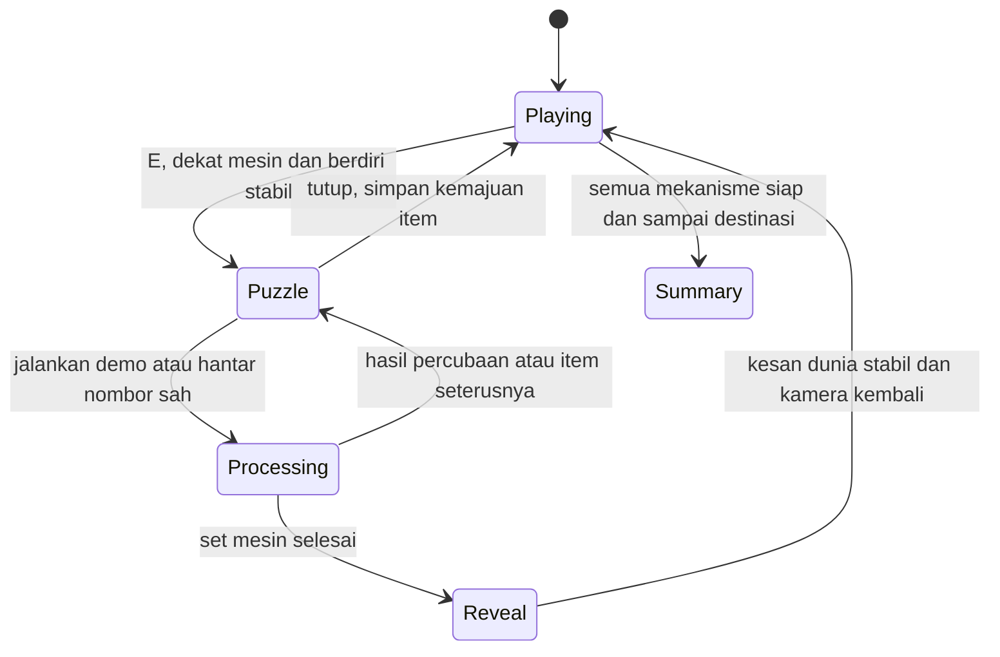

# Lorong Atas Bumbung — Level Design Document V1.0

**Status: cadangan reka bentuk untuk semakan, bukan spesifikasi yang sudah dilaksanakan.**
Tarikh audit: 9 November 2026. Asas: Game Design Blueprint V1.0 daripada pemilik projek.
Platform: Phaser 3 + JavaScript, web desktop. Satu level sahaja.

Dokumen berkaitan: [Bank interaksi, jawapan dan hint](QUESTION-BANK-V1.md) · [Pelan ujian pelajar](PLAYTEST-PLAN-V1.md).
Dokumentasi prototaip sedia ada: [README](../README.md) · [sistem visual yang sedang digunakan](../DESIGN.md).

## 1. Janji pengalaman dan sempadan

**Satu lorong. Banyak misteri matematik.** Pemain membantu Chill Boy membuka semula laluan ke Menara Fungsi. Tindakan matematik mengubah mesin dan akses fizikal dalam dunia yang sama.

Level ini dinamakan **1.1A: Asas Fungsi** untuk tujuan organisasi produk; “1.1A” bukan kod standard rasmi KPM. Fokusnya tatatanda, objek/input, imej/output, penggantian nilai, mencari objek bagi fungsi linear dan satu pengenalan input tidak tertakrif. Ia tidak meliputi keseluruhan 1.1.

Kekalkan Chill Boy, aset kampung monokrom, pergerakan asas, collision berasingan dan permainan tanpa hukuman. Jangan bina fungsi gubahan, fungsi songsang, level tambahan, akaun, leaderboard, mata wang, boss atau artwork baharu dalam kerja ini.

Sasaran masa 8–12 minit dan nisbah 35% penerokaan / 45% matematik / 20% penerangan ialah hipotesis reka bentuk. Jangan memanjangkan berjalan, melambatkan watak atau memaksa masa menunggu untuk mencapainya. Tujuh soalan pendek dalam peta kecil mungkin selesai lebih cepat oleh pelajar berpengalaman; ukur dahulu.

## 2. Audit source sebenar: apa yang sudah ada

Audit ini membaca source dan rekod ujian sedia ada. Tiada kod runtime diubah, dan ujian prototaip lama tidak dianggap sebagai pengesahan mekanik V1 yang dicadangkan.

| Sistem | Bukti source / keadaan sekarang | Keputusan V1 |
| --- | --- | --- |
| Runtime | `vendor/phaser-3.90.0.min.js`; satu scene `Rooftop` dalam `src/game.js` | Kekalkan Phaser dan laluan `/app/addmath/rooftop/` |
| Fizik | `src/level.js`: larian 280 px/s, graviti 1400 px/s², lompatan 520 px/s, badan 28×60 | Bekukan baseline semasa penyusunan level; jangan tulis semula controller |
| Respons input | Pecutan 2100, brek 2500, coyote 110 ms, buffer 130 ms; tap pendek dilatch | Kekalkan dan regresikan selepas perubahan |
| Tangga | Tiga zon, kelajuan 150 px/s; graviti ditutup semasa memanjat; keluar atas/bawah dan lompat keluar | Guna mekanik ini; satu tangga menjadi laluan yang diaktifkan oleh M2 |
| Arah watak | `setFlipX` mengikut tanda halaju horizontal sebenar | Kekalkan; jangan tukar arah daripada kedudukan kamera |
| Collision | Street solid; deck sehala menggunakan posisi kaki sebelumnya; dekorasi tiada collider | Kekalkan pemisahan art/fizik; tambah gate yang benar-benar solid |
| Kamera | Bounds; follow `.14/.16`, offset `(-85,60)`; reduced motion | Kekalkan feel asas; tambah fokus singkat pada mekanisme sahaja |
| Matematik | `evaluateInput(raw)` menerima nombor, hanya `3` betul; formula tetap `2x+1` | Gantikan konfigurasi satu soalan dengan bank semantik yang disemak, bukan rawak bebas |
| Mesin | Satu terminal pada `(1570,650)`, idle/active; tiada processing state | Tiga instance dengan kemajuan dan kesan dunia tersendiri |
| Hint | Satu petunjuk automatik selepas dua jawapan salah | Tukar kepada tiga tahap sukarela bagi setiap item |
| Checkpoint | `(1380,650)`, diaktifkan melalui kedudukan pemain **sebelum** mesin | CP utama selepas setiap mesin; tambah titik pemulihan traversal berasingan |
| Simpanan | Semua state rooftop dalam memori; reload/replay mengosongkan run | Simpan rooftop dalam namespace localStorage sendiri |
| Simpanan nota | `../src/utils/storage.js` menggunakan `addmath-progress-v1` untuk lokasi nota | Jangan baca/tulis semula key ini sebagai progress game |
| UI | Kad welcome, HUD, route footer, senarai keyboard dan label dunia serentak | Tunjuk arahan kontekstual; bantuan penuh berada dalam Jeda/Bantuan |
| Pengakhiran | Satu formula tetap dan masa daripada `elapsed += delta` ketika bermain | Ringkasan berdasarkan rekod sebenar; masa puzzle perlu dikira secara berasingan |
| Audio | `audio: { noAudio: true }`; tiada audio dalam manifest | Belum ada. Audit sumber bunyi dahulu; jangan mendakwa tersedia |
| Touch | Kawalan dan emulasi telefon sudah wujud | Kekalkan tanpa menjadikan pengoptimuman telefon skop utama V1 |

Rekod `tests/artifacts/browser-results.json` menyatakan playthrough keyboard, bridge, checkpoint, goal/replay, pause, emulasi touch, asset failure dan laluan nota lulus. `edge-results.json` merekodkan animasi idle, tangga turun dan lompat keluar. Ini bukti prototaip terdahulu; bukan playtest pelajar atau bukti keberkesanan pembelajaran.

### Perkara audit yang mesti dibawa ke implementasi kemudian

- `function_machine_idle.png` sudah mengandungi formula/target; `function_machine_active.png` mengandungi angka `3` dan `7`. Paparan itu mesti dilapisi skrin dinamik yang sepadan dengan item semasa. Kekalkan rangka mesin dan fail PNG asal; jangan hanya menukar teks dialog sambil dunia menunjukkan formula berlainan.
- Manifest mengandungi 64 PNG. Foreground menggunakan `Untitled (6).zip`, lima background daripada set lama diasingkan. Jangan tukar house/tile kepada versi sketch tanpa sengaja.
- `puzzle_gate_closed.png` dan `puzzle_gate_open.png` memang wujud dalam inventori ZIP `(6)`, masing-masing 56×131; **belum diimport dalam manifest runtime**. Import terpilih hanya pada fasa implementasi.
- Tiada sprite gear bergerak atau animasi climb khusus dalam manifest. Processing V1 boleh menggunakan aliran nombor, penunjuk sedia ada dan perubahan lampu. Jangan menjanjikan gear beranimasi yang asetnya belum ada.
- Sesetengah rumah penuh mempunyai tangga/pelantar terbina dalam artwork. Bagi rumah interaktif, gunakan komponen modular atau padankan tangga yang kelihatan dengan laluan sebenar. Elakkan tangga hiasan yang nampak boleh digunakan tetapi tidak berfungsi.
- Trigger jatuh sekarang mengandungi syarat global `x > 1160 && feet > 900`. Ia perlu diaudit semula mengikut kawasan selamat; jangan biarkan checkpoint atau susunan baharu berada di dalam zon respawn tidak sengaja.

## 3. Objektif pembelajaran dan batas dakwaan

Selepas pengalaman ini, pemain diberi peluang untuk:

1. Membezakan input/objek dengan output/imej dalam tatatanda `f(x)`.
2. Menggantikan input ke dalam peraturan dan mengira imej, termasuk input negatif.
3. Mencari input bagi output diberi dalam fungsi linear yang digunakan di level.
4. Menjelaskan bahawa input yang menjadikan penyebut sifar tidak menghasilkan output yang tertakrif.

Suatu input **yang sah** dipadankan kepada satu output. Jangan mengajar bahawa setiap output sentiasa mempunyai tepat satu input; item linear kita mempunyai penyelesaian tunggal kerana pekalinya bukan sifar, bukan kerana semua fungsi bersifat satu-dengan-satu.

Pemetaan kurikulum: SP 1.1.1 merangkumi tatatanda dan perwakilan grafik; 1.1.2 merangkumi domain/julat; 1.1.3 melibatkan imej dan objek, termasuk nilai mutlak. Level ini menyentuh sebahagian 1.1.1/1.1.3 dan contoh input terlarang sahaja. Graf, domain/kodomain/julat yang lengkap, fungsi diskret/selanjar dan nilai mutlak masih belum diliputi. Rujukan: [DSKP KPM, edisi Bahasa Inggeris, halaman bercetak 32–33](https://asiemodel.net/wp-content/uploads/2022/08/DSKP-Additional-Mathematics-Form-4-and-5-DLP-dated-29092020.pdf#page=46), salinan hos pihak ketiga.

Ringkasan tidak boleh melabel “menguasai 1.1”, menetapkan TP PBD atau mendakwa keberkesanan umum berdasarkan tamat level. Cadangan hint sukarela mengambil inspirasi daripada bukti sokongan instruksional; bentuk tiga tahap ini sendiri masih perlu diuji. Meta-analisis [Wouters & van Oostendorp](https://www.sciencedirect.com/science/article/pii/S0360131512001984) menyokong nilai sokongan dalam game-based learning, bukan nisbah masa atau bilangan hint khusus kita. [Belland et al.](https://pmc.ncbi.nlm.nih.gov/articles/PMC5347356/) pula meliputi scaffolding STEM merentas konteks; ia bukan kajian khusus game ini.

## 4. Aliran lengkap yang dicadangkan

Semua level yang sudah diterbitkan boleh dipilih bebas kelak. Dalam versi ini, hanya Level 1 mempunyai butang Main. Taman Domain, Kilang Dua Mesin dan Menara Songsang boleh disebut sebagai **Dirancang**, tanpa butang play, progress palsu atau ikon kunci yang menyiratkan perlu membuka akses.

## 5. Peta konseptual: guna ruang sedia ada dahulu

Koordinat berikut ialah **cadangan blockout**, bukan collision akhir atau ukuran art baharu. Paksi x meningkat ke kanan, y ke bawah; y platform ialah permukaan tempat kaki berdiri. Dunia kekal 3072×1152 untuk percubaan awal. Kawasan boleh berkongsi julat x pada aras y berlainan.

| Kawasan / unsur | Koordinat atau julat cadangan | Fungsi |
| --- | --- | --- |
| A: halaman | x 0–896, y kaki 1000 → 824 | Selamat mencuba gerak, lompat, tangga |
| Spawn | `(156,1000)` | Guna spawn sekarang |
| Jalan terhalang | gate/fence solid sekitar x 1088, y 850–1000 | Sebab visual memilih bumbung; tidak menyekat tangga pertama |
| Porch P1 | x 512–896, y 824 | Pendaratan tangga L1 |
| L1 | x 640, y 824–1000 | Guna zon sedia ada |
| B: akses bengkel | x 800–1664, y 824 → 650 | Landmark tangki, lompat mudah, M1 |
| P2 / L2 | P2 x 800–1152, y 650; L2 x 856, y 650–824 | Guna geometri asas sekarang |
| J1 | x 1152–1280, aras sama y 650 | Satu lompat bermakna, gap 128 px; kurangkan ke 96 px jika bacaan pendaratan lemah |
| Titik pemulihan T1 | `(1100,650)`, selepas benar-benar mendarat di P2 | Gagal J1 tidak memaksa ulang kedua-dua tangga |
| P3 / M1 | P3 x 1280–1664, y 650; M1 `(1570,650)` | Bengkel pertama; tapak terminal stabil |
| G1 / CP1 | bridge x 1664–2208, y 650; CP1 `(1480,650)` | Bridge hanya selepas M1; spawn di sisi selamat, bukan di atas bridge |
| C: rumah seberang | x 2208–2592, y 650 | Laluan jelas menuju M2 |
| M2 / CP2 | M2 `(2352,650)`; CP2 `(2280,650)` | Tiga soalan; mengaktifkan L3 |
| G2 / L3 | x 2456, y 470–650 | Tangga tersimpan sebelum M2; visual dan zon climb muncul serentak apabila stabil |
| D: menara | x 2400–2912, y 470 | M3, pintu keluar dan destinasi |
| M3 / CP3 | M3 `(2592,470)`; CP3 `(2512,470)` | Selamat berdiri sebelum gate |
| G3 | footprint sekitar x 2688–2774, y 270–470 | Gate solid setinggi 200 px; guna sprite gate sedia ada pada skala seragam sekitar 1.53 |
| Destinasi | `(2840,470)` | Penanda akhir di sebelah kanan G3, di bawah hut/struktur sedia ada |

M3 dan hut mungkin perlu dialih sedikit mengikut lebar sebenar sprite dan label. Tapak akhir masih mempunyai sekurang-kurangnya 72 px selepas pusat destinasi. Tiada collider tersembunyi tanpa permukaan/halangan visual sepadan.

Pilihan ini mengekalkan geometri yang sudah berfungsi sambil memberi tiga akibat dunia yang berbeza. Ia bukan keputusan untuk membina seluruh kampung atau memanjangkan dunia semata-mata kerana ada tiga mesin.

### Semakan kebolehcapaian atas kertas

- Kenaikan lompatan nominal: `520² / (2 × 1400) ≈ 96.6 px`.
- Masa kembali ke aras asal: `2 × 520 / 1400 ≈ 0.743 s`.
- Jarak nominal pada halaju penuh: `280 × 0.743 ≈ 208 px`. Ini bukan jaminan jarak dari keadaan berhenti dan tidak boleh dijadikan sasaran gap maksimum.
- J1 128 px mempunyai ruang berlari di kedua-dua sisi; margin teorinya kira-kira 80 px tanpa mengambil kredit lebar badan/coyote.
- G1 544 px jauh melebihi jarak lompatan. Tiada platform dekorasi atau laluan bawah yang membenarkan bypass.
- Naik dari P4 y650 ke P5 y470 ialah 180 px. Ia melebihi kenaikan nominal, maka L3 mesti diaktifkan oleh M2.
- G3 200 px melebihi kenaikan nominal. Permukaan hut, railing dan dekorasi di sisinya tidak boleh menjadi batu loncatan tidak sengaja. Laluan bawah gate tidak boleh mencapai goal melalui platform sehala.
- T1 hanya muncul selepas sampai ke P2. Ia tidak boleh ditawarkan sebagai teleport untuk melangkau tangga. CP1/2/3 bergantung pada mesin selesai, bukan semata-mata proximity.

Semua ini masih perlu dicuba dengan kamera bergerak, input sebenar dan frame rate berbeza. Jangan mengekalkan gap yang terasa tidak adil hanya kerana formula mengatakan boleh.

## 6. Beat setiap kawasan

### A — Rumah Permulaan (sasaran 1–2 minit)

Mula terus di halaman selepas klik ringkas “Main” atau “Sambung”; tiada kad tutorial besar. Papar “A / D — Bergerak” berhampiran Chill Boy, hilang selepas bergerak sekitar 64 px. Di ruang rata, tunjuk “Space — Lompat”, hilang selepas lompatan dan pendaratan. Ulang hanya melalui Bantuan jika perlu.

Jalan bawah kelihatan terhalang, dengan tangga pertama jelas di hadapan. Semasa dekat tangga, paparkan “W / S — Naik / turun”. Arahan satu demi satu, bukan keseluruhan senarai. Tiada kuiz, countdown atau collectible wajib.

### B — Bengkel Fungsi (sasaran 2–3 minit)

Tangki air menjadi landmark. J1 mempunyai pendaratan yang kelihatan sebelum pemain melompat dan titik pemulihan T1. Mesin M1 berada di kawasan lapang; bridge tersimpan dan rumah seberang boleh dilihat.

Q01 menunjukkan aliran `3 → ×2 → 6 → +1 → 7`. Pemain boleh ulang input sama atau cuba input lain dalam mod Teroka; tiada jawapan “salah” untuk input yang sah. Output berubah pada penunjuk mesin. Mod Ramal dibezakan dengan jelas supaya mesin tidak membocorkan jawapan Q02/Q03 sebelum cubaan.

Q02 memberi panduan berperingkat. Q03 ialah ramalan kendiri. Setiap item menyalakan satu status kalibrasi pada mesin; **bridge fizikal kekal tersimpan sehingga set M1 selesai**. Hasil Q03 dan peraturan aktif pada mesin menerangkan nombor yang digunakan oleh mekanisme. Jangan sentiasa menunjukkan target 7 bagi semua item.

### C — Laluan Bumbung (sasaran 2–3 minit)

Selepas bridge dibuka, pemain menyeberang dan menemui tangga L3 yang masih tergulung/tersimpan. M2 mengendalikan pengunci tangga itu. Q04 mencari input, Q05 mencari output, Q06 menggunakan input negatif.

Untuk soalan input, nilai cubaan benar-benar menggerakkan penunjuk output: input 3 untuk `2x+3` menghasilkan 9, bukan 11. Pengunci tidak terlepas, tetapi pemain nampak sebabnya. Tiada lantai runtuh atau penalti ketika salah. Selesai M2 menurunkan L3 dan menyimpan CP2.

### D — Menara Fungsi (sasaran 2–4 minit)

M3 berada sebelum gate terakhir. Q07 menguji sebab mesin tidak boleh menerima input tertentu. Paparan berhenti di penyebut sifar dengan label “Tidak tertakrif”; jangan memaparkan 0, Infinity, NaN atau “mesin rosak” sebagai hasil matematik.

Q08 meminta input bagi formula dan sasaran berbeza. Apabila selesai, gate terbuka, CP3 disimpan, kemudian pemain sendiri berjalan ke destinasi. Panel kejayaan tidak muncul terus daripada borang jawapan. Keadaan menang memerlukan semua mesin selesai, G1/G2/G3 tersedia dan pemain mendarat di zon destinasi.

## 7. Mesin: mod, state dan kaitan dengan dunia

Tiga state visual wajib ialah **Idle → Processing → Solved**. Dalam data, sesi juga membezakan `demo`, `explore`, `challenge`, `feedback` dan `assisted-complete`; ini tidak memerlukan enam rupa mesin baharu.

Semasa Puzzle/Processing/Reveal, pemain tidak bergerak atau jatuh. Fokus keyboard berada pada panel. `Enter` menjalankan tindakan utama, `Tab` bergerak antara kawalan, `Esc` menutup panel atau mempercepat reveal ke state akhirnya dengan selamat. Peraturan pause asal dikekalkan; input tertahan mesti dibersihkan sebelum kembali bermain.

Processing sekitar 0.8–1.2 saat ialah cadangan keterbacaan, bukan delay wajib untuk setiap retry. Teks langkah kekal boleh dibaca selepas animasi dan boleh dilangkau. Reduced motion menunjukkan langkah statik dan perubahan akhir tanpa pan atau shake.

Apabila mesin selesai: rekod keputusan dan checkpoint → tutup panel → fokus ringkas pada bridge/tangga/gate → aktifkan rupa dan collision yang sepadan → pulihkan kamera → lepaskan kawalan. Jangan letak collider pada bahagian yang masih tidak kelihatan. Reload ketika reveal mesti membina keadaan akhir yang konsisten, bukan menjalankan ganjaran dua kali.

## 8. Bank soalan dan agihan

Butiran lengkap dan tiga tahap hint terdapat dalam [QUESTION-BANK-V1.md](QUESTION-BANK-V1.md).

| Mesin | Item | Bentuk | Buka laluan |
| --- | --- | --- | --- |
| M1 | Q01 demo, Q02 imej berpandu, Q03 imej kendiri | Manipulasi input + ramal nilai | G1 bridge |
| M2 | Q04 objek, Q05 imej, Q06 imej input negatif | Nombor sendiri | G2 tangga |
| M3 | Q07 input terlarang, Q08 objek akhir | Pilihan bersebab + nombor sendiri | G3 gate |

**Perubahan kandungan yang dicadangkan secara jelas:** Q05 menjadi `f(x)=3x−2`, cari `f(6)=16`, menggantikan contoh mencari input bagi output 10. Ini mengelakkan pengulangan pasangan `(4,10)` daripada Q03 dan memenuhi agihan M2 “input, output, negatif”. Semua contoh asal pengguna mempunyai jawapan aritmetik yang betul; perubahan ini untuk progression, bukan membetulkan jawapan salah.

Lapan item utama = **satu demonstrasi + tujuh soalan**, bukan lapan soalan yang dinilai. Q02 berpandu juga tidak boleh dikira sebagai bukti kendiri. Enam soalan berikutnya boleh merekodkan tahap bantuan sebenar.

## 9. Hint, feedback dan pengukuhan

Butang “Minta hint” sentiasa tersedia pada soalan. H1 memfokuskan idea, H2 menyusun langkah, H3 menunjukkan penyelesaian penuh. Minta tahap seterusnya ialah tindakan sengaja; ulang cubaan tidak membuka H3 secara automatik. Tiada potongan markah.

Bezakan salah matematik dengan input kosong/format tidak sah. Input kosong diberi arahan membetulkan format dan tidak menaikkan kiraan cubaan matematik. Terima tanda tolak biasa atau Unicode dan bentuk nombor setara seperti `3.0`; jangan guna `eval` untuk menilai teks bebas. Hadkan input V1 kepada nombor, bukan ungkapan `6/2` tanpa penerangan parser.

Untuk soalan cari input, tunjuk hasil input cubaan dan bezanya daripada sasaran. Untuk soalan cari imej, asingkan **Ramalan kamu** daripada **Output sebenar**; jangan menamakan jawapan salah sebagai output fungsi. Jika nilai jawapan sebenar sudah didedahkan oleh feedback/teroka, rekod jawapan berikut sebagai dibantu, walaupun pemain tidak menekan butang hint.

Selepas H3, pemain boleh menggunakan penyelesaian penuh untuk meneruskan. Set soalan mesin masih perlu dilalui; H3 pada Q04 tidak melangkau Q05/Q06. Apabila set selesai, laluan boleh dibuka dan ditandai “dengan bantuan”.

Cadangan pengukuhan: tawarkan satu item baharu sejenis selepas penggunaan H3 pada item kendiri. Ia tidak mengunci semula dunia. Jika ditangguhkan, ia kekal dalam ringkasan sebagai “Latihan susulan disarankan”. Hadkan satu pengukuhan bagi setiap keluarga konsep (imej, objek, input terlarang) dalam satu run; tiada rantaian soalan tanpa akhir. H3 pada pengukuhan tidak menjana pengukuhan baharu.

Ini menyelesaikan konflik antara “laluan masih terbuka” dengan “pastikan faham”: laluan ialah progress pengembaraan; bukti kendiri hanya ditambah jika pengukuhan benar-benar dijawab tanpa bantuan. Tidak menjawabnya tidak boleh ditukar kepada status penguasaan secara automatik.

## 10. Checkpoint, retry dan simpanan tempatan

Bezakan dua jenis pemulihan:

- **Titik traversal sementara T1:** mengurangkan ulang tangga apabila gagal J1. Tidak menandakan mesin selesai atau pembelajaran tercapai.
- **Checkpoint utama CP1/CP2/CP3:** disimpan selepas set mesin siap, termasuk jika siap dengan bantuan. Menyimpan kesan dunia dan kemajuan item.

Jatuh atau tekan R mengembalikan pemain ke titik selamat terkini. Ia tidak memadam jawapan, hint, bridge, tangga atau gate yang sudah diaktifkan. Menutup panel menyimpan item semasa; kembali ke mesin tidak memulakan demonstrasi daripada awal.

Cadangan key baharu: `addmath-rooftop-progress-v1`, berasingan daripada `addmath-progress-v1` milik nota. Rekod minimum: versi skema dan kandungan, ID run/varian, ID checkpoint selamat, state M1–M3, item selesai, jawapan terakhir, cubaan, hint tertinggi, pendedahan jawapan, pengukuhan tertangguh dan settings bunyi/reduced motion. Tiada nama pelajar diperlukan.

Simpan selepas jawapan/hint/mesin selesai, bukan setiap frame. Reload membina world daripada state mesin yang sah dan meletakkan pemain di anchor selamat; jangan simpan koordinat raw ketika jatuh atau memanjat. Jangan rawakkan semula item ketika reload. Data rosak atau versi tidak serasi mesti mempunyai fallback yang jelas tanpa memadam progress nota. Jika storage disekat, game tetap berjalan dengan notis “Kemajuan sesi ini tidak dapat disimpan”.

“Reset input” hanya mengosongkan input semasa. “Ulang level” memulakan run baharu dengan penerangan bahawa progress run aktif akan diganti; simpan ringkasan run selesai terakhir jika ada. “Padam progress game” ialah tindakan berasingan, tidak sekali-kali mengosongkan semua localStorage.

## 11. UI, kamera dan audio

Semasa traversal, canvas ialah fokus. Kekalkan pautan kembali kecil, Jeda/Bantuan dan satu objektif ringkas jika diperlukan. Tiada kad tutorial besar, route footer wajib atau senarai kawalan panjang serentak. Notis checkpoint hilang selepas dibaca; status itu boleh dilihat semula dalam Jeda.

Panel mesin menggunakan susunan tetap: peraturan → input/objek → operasi → output/imej → tindakan → feedback/hint. Jenis soalan menentukan slot yang kosong, bukan menukar makna label. Soalan tanpa output sah mesti menunjukkan “Tidak tertakrif”, bukan medan kosong yang kelihatan seperti gagal memuatkan.

Kamera follow semasa kekal sebagai baseline. Untuk G1, pusat perhatian sekitar `(1936,650)` boleh merangkumi bridge 544 px serta kedua-dua hujung pada viewport desktop. G2/G3 lazimnya sudah hampir dengan pemain; jangan pan jika kesannya sudah jelas. Anggaran fokus 1–1.5 saat, boleh dilangkau; tiada cutscene panjang.

Kekalkan fokus dialog, label input, live feedback, reduced motion, kawalan keyboard dan teks yang jelas pada 1366×768 serta 1280×720. Status tidak bergantung pada warna atau bunyi sahaja. Teks animasi mesti mempunyai versi statik.

Audio ialah sokongan, bukan syarat puzzle. Sumber bunyi belum tersedia dalam manifest; senarai bunyi pendek berlesen perlu diaudit kemudian. Jika diperkenalkan, mulakan hanya selepas gesture pemain, beri mute yang mudah, simpan pilihan dan elakkan bunyi salah yang menghukum. Level mesti lengkap jika audio tidak dapat dimainkan.

## 12. Ringkasan dan pengukuran

Ringkasan selepas destinasi memaparkan mesin diaktifkan daripada data sebenar, tujuh soalan utama yang selesai/dicuba, demonstrasi yang dilihat dan pengukuhan secara berasingan. Jangan hardcode “8 cabaran dicuba”.

Contoh label yang dibenarkan: “Imej fungsi: 2 jawapan tanpa hint, 1 dengan bantuan”; “Mencari input: latihan susulan disarankan”. Ini pemerhatian sesi, bukan label “menguasai” atau skor kecerdasan. Perjalanan ditunjukkan melalui tiga mesin dan perubahan laluan yang telah dilakukan.

Domain, julat, graf dan nilai mutlak disebut sebagai kandungan yang masih perlu dipelajari. Level dirancang tidak mempunyai pautan Main palsu.

Untuk mengukur pacing kemudian, rekod masa aktif traversal, penyelesaian puzzle dan membaca feedback secara saling eksklusif. Masa dialog matematik **mesti termasuk**, walaupun physics dipause. Kecualikan tab tersembunyi/Jeda. `elapsed += delta` prototaip sekarang tidak mencukupi kerana update berhenti ketika puzzle. Tiada timer kompetitif pada HUD.

## 13. Pelan implementasi kemudian, bukan arahan coding sekarang

1. Bekukan dan rekod baseline movement, kamera, tangga, fokus serta input. Pastikan regression asal boleh diulang.
2. Bina blockout tiga mekanisme menggunakan aset sedia ada. Buktikan laluan wajib, tempat berdiri dan tiada bypass sebelum merombak UI.
3. Gantikan mesin tunggal dengan konfigurasi M1–M3 dan bank item yang telah disemak. Kekalkan bahagian controller yang stabil.
4. Tambah demo/teroka, processing, hint, feedback dan pendedahan jawapan yang direkod dengan betul.
5. Tambah checkpoint selepas mesin, save/reload, reveal idempotent dan ringkasan daripada data.
6. Ringkaskan UI traversal, semak aksesibiliti, jalankan playthrough sebenar, kemudian playtest pelajar.

Fail yang berkemungkinan berubah kelak: `src/level.js` untuk layout; bahagian puzzle/progression `src/game.js`; HTML/CSS untuk UI; modul bank soalan dan simpanan baharu. Jangan menggabungkan save game dengan router/data nota atau menukar controller hanya untuk memudahkan mesin.

## 14. Readiness dan keputusan yang masih terbuka

| Kriteria | Kedudukan selepas dokumen ini |
| --- | --- |
| Matlamat pembelajaran terhad | Dinyatakan; bukan seluruh 1.1 |
| Empat kawasan berbeza | Beat dan hubungan ruang dicadangkan |
| Tiga mesin berperanan sendiri | Bridge / tangga / gate dengan set item berbeza |
| Jawapan dan penerangan | Aritmetik disemak; semakan pedagogi guru masih perlu |
| Laluan mengikut fizik | Semakan atas kertas siap; blockout baharu belum diuji |
| Hint/retry/checkpoint | Polisi dinyatakan, belum dilaksanakan |
| UI tidak mengganggu | Hierarki dicadangkan, belum diuji dengan pemain |
| Ujian pelajar | Protokol tersedia; belum dijalankan |

Jangan paparkan checklist “8/8 siap” sebagai keputusan ujian. Readiness dokumentasi, implementasi dan validasi pelajar ialah tiga perkara berlainan.

Cadangan yang perlu mendapat maklum balas reka bentuk sebelum coding: perubahan Q05; pengukuhan tidak mengunci semula laluan; penggunaan peta 3072 px dahulu; pilihan tangga turun untuk M2 berbanding moving platform. Tidak perlu menentukan warna/CSS untuk membuat keputusan ini.

Definisi selesai untuk implementasi nanti: pemain baharu dapat bergerak tanpa coaching berterusan, memahami apa yang mesin ubah, menyelesaikan tiga set dengan bantuan yang tersedia, kembali dengan progress utuh selepas jatuh/reload, dan mencapai penamat tanpa bypass. Bukti masa/pembelajaran datang daripada [playtest](PLAYTEST-PLAN-V1.md), bukan screenshot atau kiraan formula sahaja.
