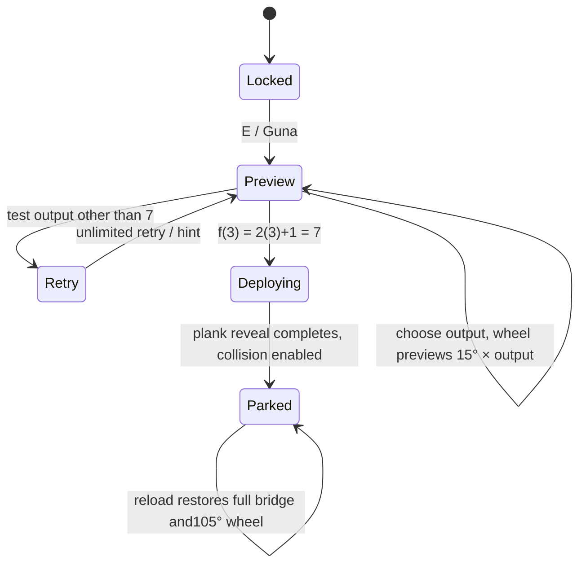

# V10 Batch 0 + Batch 1 — implemented, ready for visual review

**11 November2026. Stop at A/B/C.** Garden, mill, optional café, crate/plate, input/output probe, mapping activity and functional gear bridge are playable. D–G are not implemented or claimed complete.

- Play V10 locally: [v10.html](http://127.0.0.1:8765/app/addmath/rooftop/v10.html).
- Preserved full V9: [index.html](http://127.0.0.1:8765/app/addmath/rooftop/index.html).
- Entry source: `app/addmath/rooftop/v10.html`; isolated engine/data/save files in `app/addmath/rooftop/src/v10/`. Shared original Chill Boy art, audio, stylesheet and Phaser runtime are unchanged.

## Batch completion matrix

| Batch | Status | Evidence / boundary |
|---|---|---|
|0 Integration foundation |Complete |Separate V10 entry/data/save key; reversible snapshot; original movement imported; startup and real movement tested |
|1 A/B/C |Complete for screenshot review |Natural keyboard and touch traversal; crate reward; optional C; gear opens crossing; checkpoints and reload |
|2 D workshop |Not started |Candidate geometry retained as data only |
|3 E waterworks |Not started |No composition mechanism installed |
|4 F/G |Not started |No cave/inverse/final bridge installed |
|5 Final full-world polish |Not started |Current batch has targeted mobile/reduced-motion checks; this is not a full-world release |

World definition is8400×1600. Physics and camera are deliberately capped at **x2916** for this batch, with an explicitly labelled review endpoint at **(2820,972)**. Reaching it records `batch1Completed`, never full V10 completion. No invisible unfinished route is advertised beyond that point.

## Actual screenshots

All images below are local Chromium captures of Phaser, not the illustrated master map. Natural traversal screenshots retain the actual follow camera. Before/after layouts differ in coordinates, so these are corresponding-zone comparisons, not a pixel-aligned camera overlay.

| Area/state | Preserved V9 baseline | Implemented V10 |
|---|---|---|
| A garden |[V9 spawn](before/v9-spawn.png) |[V10 spawn](after/zone-a-spawn.png), [steps](after/zone-a-steps.png) |
| Crate |V9 retained in snapshot |[Plate active](after/crate-plate.png), [optional ledge reached](after/crate-ledge.png) |
| B mill |[V9 B](before/v9-zone-b.png) |[Wrong output](after/gear-wrong.png), [bridge opened](after/gear-open.png) |
| C café |[V9 C](before/v9-zone-c.png) |[Natural arrival](after/zone-c-arrival.png), [mapping](after/cafe-mapping.png) |
| Mobile |V9 regression also passes |[Landscape](after/confirmed-gear-844.png), [portrait](after/confirmed-gear-370.png) |
| Review endpoint |Not comparable to full V9 ending |[B endpoint](after/batch-boundary.png), [batch completion](after/batch-complete.png) |

[Final desktop UI confirmation](after/confirmed-gear-1440.png) and mobile confirmation use valid checkpoint fixtures to inspect framing; they are **not** reachability evidence. Reachability is established separately by [natural traversal](logs/natural-traversal.json), [touch traversal](logs/mobile-save-results.json) and the recorded [browser videos](after/video/).

## Implemented architecture and coordinate changes

The approved structured tables own geometry; the supplied V10.1 image owns architectural intent. [Implemented surface CSV](implemented-surfaces.csv) contains all14 A/B/C surface definitions, including the conditional ledge and gate. The complete future candidate is stored separately in `src/v10/candidate-world.json`; it does not spawn D–G.

| Element | Existing V9 | Implemented V10 |
|---|---|---|
| Spawn |80 / feet1100 |80 / feet1296 |
| First gap |528–648,120px |648–756,108px |
| Crate / plate |220 /400, feet1100 |270 /450, feet1296;48px crate,40px plate radius retained |
| Optional ledge |360–504 / y980 |414–576 / y1176; reward(500,1112) |
| A bank/steps |V9 AB_TERRAIN exported ranges |A0 x0–648y1296; A1 x756–1026y1296; A2 x1026–1134y1242; A3 x1134–1242y1188; A4 x1242–1404y1134 |
| B near bank |crest/recovery terraces and town-walk-2 |B0 x1404–1674y1134; B1 x1674–1782y1080; B2 x1782–2052y1080 |
| First gate |workshop-gate x1300–1600y980 |gear x2052–2376y1080,324px wide |
| B far bank |Previously D approach |B3 x2376–2592y1080; B4 x2592–2700y1026; B5 x2700–2916y972 |
| C surface |650–1030 / y820 |1512–1944 / y810,432px timber deck |
| C ladders |x750 top820/bottom938 |LC-in x1566 top810/bottom1134; LC-out x1836 top810/bottom1080 |
| First machine |p1 (1250,980) |p1 gear control(1960,1080); wheel art centre(2010,978) |
| Input/output / café |Not present |Probe(1480,1134), mapping(1740,810) |
| Checkpoints |Optional café then F/G sequence |cp-a(1080,1242), cp-b(1900,1080), cp-c(1620,810), new cp-b-exit(2790,972), requiring gear |
| Coins |coin-a(432,916), coin-b(1098,900), coin-c(900,760) |Same IDs at(500,1112), (2520,1020), (1880,750) |
| Oyen discovery |(680,820), radius75 |(1900,810), radius48 to separate café interaction |
| Camera |top450, world4300×1300 |top300, playable width2916, bottom1566; existing follow/zoom retained |
| Fall / crate recovery |centre1160 |player centre1510; crate centre1440; gate-relative early reset retained |

Most coordinates exactly match the candidate blueprint. Batch-specific differences are the cp-b-exit/endpoint and restricted playable width; wheel art moved from candidate(2120,990) to(2010,978) so its shaft/frame visibly meets the near bank. Oyen and collectible placements are now explicit. Camera bottom1566 clips the solid fill boundary, avoiding a visible sky strip beneath the land. Collision solids extend to1566; thin timber remains one-way.

## Mechanism state and mathematics

Input is an output dial operated with arrows/A/D, Enter/E, or on-screen buttons. Wrong selections rotate the wheel to a distinct preview angle and show non-punitive feedback; they never create bridge collision. Original p1 hints and equation are reused. A correct response saves the logical solved state, reveals actual timber pieces progressively and enables collision after parking. Reload reconstructs the fully parked crossing, not an intermediate animation.

The probe and café calculate `2x+1` for x∈{0,1,2,3}; the separate codomain is{1,…,8} and range{1,3,5,7}. Café completion records four explored inputs. Both provide visible world readouts; the café activity remains optional. Original p2/p3 question objects are retained by reference for future batches, not installed as fake completed mechanisms.

The crate retains V9's actual contact-push check. No remote input coupling was reintroduced. The plate controls the162px timber ledge,120px above ground and72px above the crate top. Reset preserves collected coins and solved gates. Touch now has an explicit Reset kotak button.

## Asset evidence and visual comparison

[Asset inventory](asset-inventory.json) records the actual atlas hash, native18×18 grid and used frame IDs. Ground uses21/22/23 exposed-edge/interior selection; dirt uses4/5 and appropriate side frames. Wood48/49/50, ladder71, canopy17–19/37–39/57–59, trunk136, vegetation124/125/128, lever64–66, plate107, flags111/112, coin151 and signs84/85 all come from the imported Base pack. No new artwork or fabricated asset filename was added. Original Chill Boy remains the only player.

Compared with the V10.1 image, A now has a wide garden, spaced crate/plate and ascending connected steps; B has a timber mill frame, mounted wheel and an actual locked ravine; C has an awning, posts, table, plants and two return ladders. SampleA/B's connected dirt, thin wood surfaces and irregular tree placement guide the composition. No generated houses, mixed64px terrain or dirt-filled upper café were introduced.

The actual pack lacks a complete gear and a cat sprite. Gear art is assembled from rotated frame68 segments and157 hub; Oyen uses an explicitly named discovery sign rather than invented animal art. These are visual limitations for review. The café is deliberately modular and simpler than the illustrated reference.

## Save isolation and rollback

- Original `lorong-save-v1` and original `src/save.js` remain unchanged.
- V10 uses `lorong-save-v10`, schema3, layoutVersion10 and a distinct level ID.
- Explicit import copies compatible gear/coin/Oyen progress; the complete sanitized legacy record is archived inside the new save so later-batch achievements are not discarded.
- Legacy p1 maps to gear. Late legacy checkpoints safely map back to cp-b in this restricted batch. Original final solution can preserve the independent input latch; composition latch remains false.
- C checkpoint is spatially activated, not the next required array entry. Skipping C does not block cp-b-exit. Checkpoint loading rejects the far bank without a solved gear.
- V10 always keeps full-world `completed=false`. Batch1 completion has a separate flag.

[v9-baseline.zip](v9-baseline.zip) contains the327 original source/asset/runtime/page files and [baseline-hashes.json](baseline-hashes.json) records their hashes. [Integrity verification](logs/integrity.json) confirms all327 still match. Rollback for normal use is simply opening the unchanged V9 entry. The snapshot is a recovery copy; no destructive restore was run. No commits, pushes or deployment.

## Validation results

| Check | Result |
|---|---|
| Original unit suite |12/12 pass; no existing tests weakened |
| V10 unit suite |6/6 pass: geometry, source physics/questions, gate envelope, legacy1/2 import, checkpoint safety, corrupt/version handling |
| V9 full A–G regression |Pass, including main jumps/ladders/puzzles, cave, completion and checkpoint recovery; zero console errors / failed requests |
| V10 natural keyboard |Pass: spawn, contact push, plate, crate mount/ledge/coin, reset, mandatory gap, all terrain rises, probe, wrong/correct gear, failed gate bypass/recovery, far bank, both C ladders, mapping, Oyen, Continue and batch endpoint |
| C skipped |Main route and cp-b-exit reached before any café visit |
| V10 touch-only route |Pass with real CDP multi-touch events: crate/plate/reset, gap/steps, gear retry/hint/preview/solve, far bank and endpoint |
| Save browser tests |Explicit old-save import, original-key byte preservation, collected/secret/mapping retention, solved bridge reload |
| Responsive / reduced motion |1440×1000,844×390 and370×740; final assertions confirm player and gear are not covered by panel |
| Performance spot observation |525 scene objects; brief local confirmation samples57.5–59.75fps. Not a sustained device benchmark or release performance claim |

Commands: `node app/addmath/rooftop/tests/level.test.mjs`, `node app/addmath/rooftop/tests/v10.test.mjs`, and Python scripts `probe.py`, `v10_batch1.py`, `v10_mobile_save.py`, `v10_visual_confirmation.py` under the rooftop tests directory. Browser tests use the local server on8765. Logs are in [logs/](logs/).

Two issues found and resolved: the portrait panel initially covered Chill Boy, fixed by a lower fixed panel and checked geometrically; the first multi-touch test mistakenly released the movement finger, corrected after a pointer-event trace. Neither required changing player physics. The on-screen time is the current session only and resets on reload. Automated runs are not learner-completion-time evidence; full-level timing remains Batch5 work.

## Remaining work / review limits

No known blocker remains in the tested A/B/C routes. Wheel appearance, the sign-only Oyen representation, simple café furniture and overall scene density need user visual review. Some large world labels can clip on portrait; the compact mechanism panel retains the complete equation and feedback. No new artwork is assumed approved.

The V10 engine is an isolated fork of V9's working runtime to guarantee rollback; shared-core consolidation is deferred. D–G, token workshop, composition pipes, inverse cave, final bridge, full coin migration placement and full-world timing are still future batches. Stop here; do not proceed to Batch2 without separate authorization.
