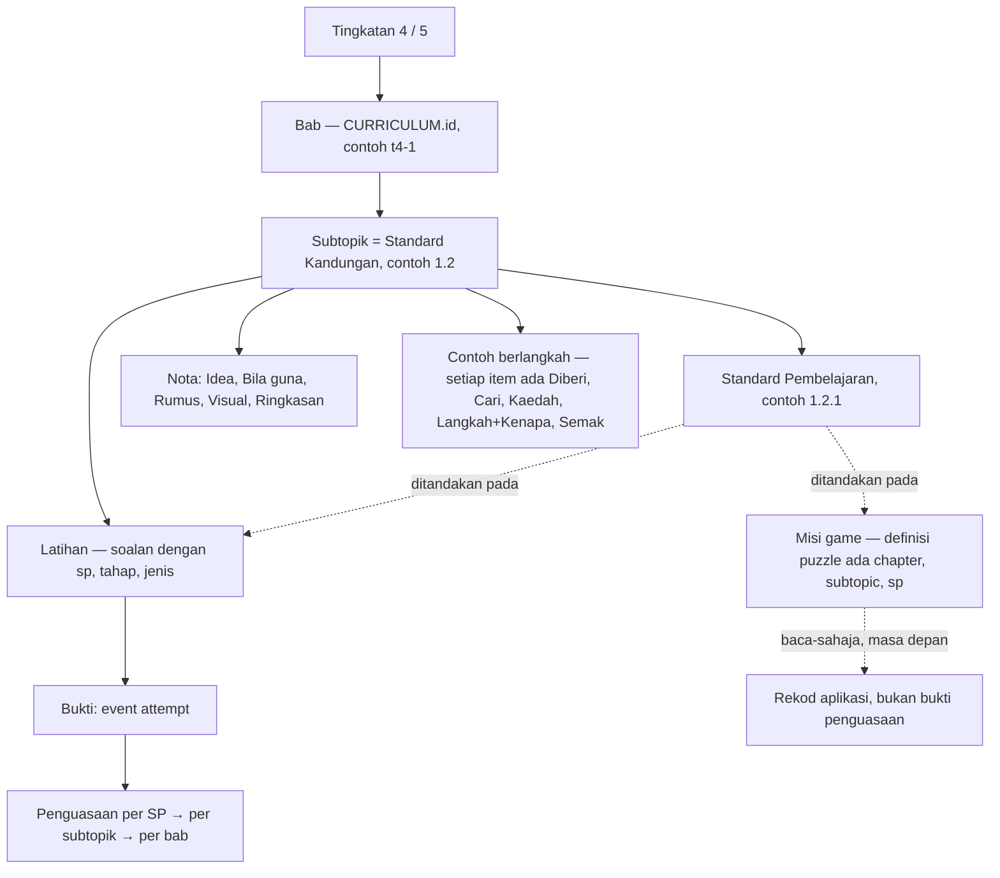
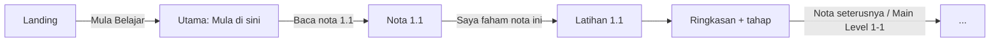
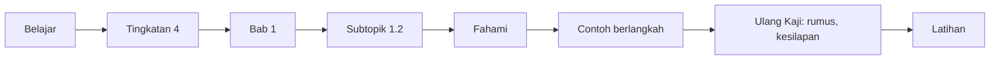
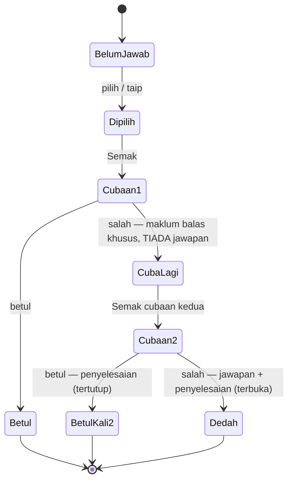
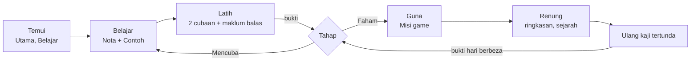
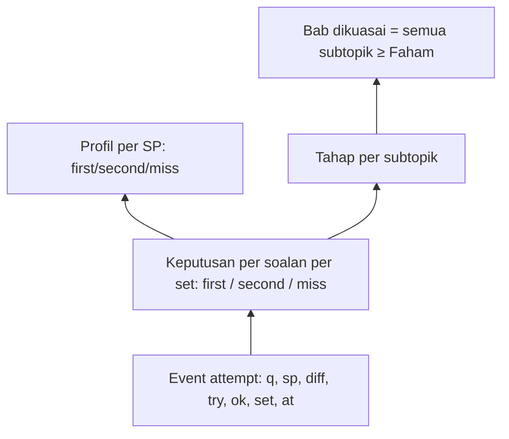

# DENAI Learning Hub — Product Blueprint

> **Jenis dokumen:** perancangan produk dan seni bina pengalaman. **Bukan** spesifikasi pelaksanaan.
> **Status:** draf untuk semakan pemilik. Tiada kod, laluan (route), kandungan atau game diubah untuk menghasilkan dokumen ini.
> **Tarikh:** 2026-11-23. **Kemas kini 2026-11-23:** empat keputusan pemilik baharu (D12–D15) direkod dalam §3 dan diselaraskan ke seluruh dokumen. Perancangan UX seterusnya (IA, navigasi, aliran pengguna) berada dalam `denai/hub/UX-PLANNING.md`.
> **Asas bukti:** repositori pada branch `claude/denai-hub-phase1` (commit `d06921d`) dan `main` (commit `87e1965`), kod sumber, kandungan, ujian dan dokumen audit sedia ada (lihat §4). Penyelidikan luar disenaraikan dalam §27.

**Konvensyen dalam dokumen ini**

| Tanda | Maksud |
|---|---|
| **[KEPUTUSAN D#]** | Keputusan produk yang disahkan oleh pemilik (§3). Bukan cadangan dan bukan hipotesis. Tidak bermaksud sudah dilaksanakan. |
| **[WUJUD]** | Disahkan dalam kod hari ini. Branch dinyatakan jika berbeza. |
| **[CADANGAN]** | Belum dibina. Cadangan produk. |
| **[HIPOTESIS]** | Andaian atau nilai ambang yang perlu diuji dengan pelajar sebenar. |
| **[KAJIAN]** | Dapatan daripada sumber luar, dengan nombor rujukan `[R#]` dalam §27. |
| **[TIDAK DISAHKAN]** | Tuntutan yang tidak dapat disahkan dalam sesi ini. |

Dokumen ini ditulis dalam Bahasa Melayu. Istilah teknikal yang lazim dikekalkan dalam bahasa Inggeris (contohnya *route*, *localStorage*, *mastery*, *empty state*).

---

## 1. Executive Summary (Ringkasan Eksekutif)

**Apa DENAI hari ini.**
DENAI mempunyai tiga aset yang kukuh tetapi masih belum bersambung sepenuhnya:

1. **Bank kandungan Add Math yang telah disahkan.** Untuk Tingkatan 4 Bab 1–10, yang telah diterbitkan:
   - 30 subtopik;
   - 148 contoh berlangkah dengan sebab bagi setiap langkah;
   - 250 soalan dengan penyelesaian penuh;
   - 165 soalan dengan maklum balas khusus bagi jawapan salah.

   Semuanya disemak oleh *validator* automatik.
2. **Game Phaser 3.90 (Dunia 1, tiga level).** Puzzle game ditandakan dengan bab, subtopik dan Standard Pembelajaran (SP).
3. **Learning Hub (`/denai/hub/`)** dengan lapan halaman yang menghubungkan kandungan dan game.

**Penemuan utama.**
Branch `claude/denai-hub-phase1` (belum di-merge) telah menyelesaikan lima daripada sembilan masalah kritikal yang dilaporkan dalam audit lepas:
- kemajuan sebenar;
- cadangan berdasarkan aktiviti;
- set latihan yang berubah;
- cubaan kedua;
- kontras warna.

Tetapi **`main` (versi yang di-deploy) masih menunjukkan semua masalah asal.** Empat masalah masih wujud di kedua-dua branch:
- soalan berstruktur dan penaakulan tidak boleh dicapai;
- tiada medan petunjuk (*hint*);
- dua UI pembelajaran;
- integrasi game sehala.

Lihat §4.3 untuk jadual penuh.

**Hala tuju yang dicadangkan.**
DENAI patut menjadi *platform pembelajaran berpandu*, bukan katalog nota atau aplikasi kuiz. Gelung teras:

**Mula → Fahami → Latih → Guna (game) → Renung → Ulang kaji → Kembali.**

Kemajuan diukur daripada bukti pembelajaran sebenar (jawapan, bukan halaman dibuka), dengan nilai yang terkumpul untuk pelajar sendiri (*Piggy Bank* beretika). Kemajuan ini tidak didorong oleh streak, kerugian atau ganjaran rawak.

**Keputusan pemilik yang telah disahkan (2026-11-23, §3):**
- **D12:** navigasi utama tepat empat destinasi — **Utama · Belajar · Game · Kemajuan**.
- **D13:** penguasaan konservatif berasaskan bukti; label kekal sementara sehingga ujian pelajar.
- **D14:** Game ialah tab utama, bukan tersembunyi dalam halaman bab sahaja.
- **D15:** arah visual hibrid — mod *Play* dan mod *Learning*.

Keputusan ini belum dilaksanakan dalam kod. Navigasi semasa masih lima tab (§10.1).

**Keputusan paling penting yang masih diperlukan daripada pemilik** (senarai penuh dalam §25):
1. Sama ada branch Fasa 1 di-merge sebelum atau selepas ujian pelajar.
2. Polisi petunjuk: guna langkah penyelesaian sedia ada sahaja, atau tulis petunjuk baharu.
3. Jadual semakan kandungan Tingkatan 5.
4. Sama ada hub boleh membaca simpanan game secara baca-sahaja (tidak diputuskan oleh D14).
5. Kelulusan UX-1: `#/hub` sebagai Utama (cadangan pemilik A1, O15), satu CTA "Sambung belajar" (A3) dan learning path (A5) — lihat §3.2.

**Langkah seterusnya yang disyorkan.**
- Jangan bina ciri baharu yang besar sebelum **ujian pelajar pusingan pertama** (§21) dengan 5–8 pelajar.
- Pembaikan P0 (§22) boleh diteruskan kerana ia membetulkan kecacatan, bukan menambah skop.

---

## 2. Product Vision and Positioning (Visi dan Kedudukan Produk)

### 2.1 Visi
Setiap pelajar SPM Matematik Tambahan boleh **memahami** konsep, bukan sekadar menghafal langkah. Mereka juga sentiasa tahu **apa yang mereka sudah kuasai dan apa yang perlu dibuat seterusnya**.

### 2.2 Misi
Menyediakan laluan pembelajaran berpandu yang menghubungkan:
- nota ringkas yang jelas;
- contoh berlangkah;
- latihan dengan maklum balas yang menerangkan kesilapan;
- game yang memberi konteks untuk *menggunakan* konsep.

Kemajuan direkod dengan jujur, berdasarkan bukti pembelajaran.

### 2.3 Kedudukan (*positioning*)
> Platform pembelajaran Matematik Tambahan berpandu yang menghubungkan pembelajaran berstruktur, latihan bermakna dan permainan pendidikan.

### 2.4 Cadangan nilai utama
| Untuk pelajar | Bukti dalam produk |
|---|---|
| "Saya tahu di mana nak mula dan apa seterusnya." | Langkah seterusnya dikira daripada rekod sebenar **[WUJUD, branch Fasa 1]** |
| "Apabila saya salah, saya faham *kenapa*." | 165 soalan ada maklum balas khusus kesilapan **[WUJUD]** |
| "Saya boleh lihat konsep yang sama dalam situasi lain." | Level 1-1, 1-2 dan 1-3 dipetakan ke subtopik 1.1, 1.2 dan 1.3 **[WUJUD]** |
| "Kemajuan saya bermakna." | Tahap penguasaan dikira daripada jawapan, bukan daripada halaman yang dibuka **[WUJUD, branch Fasa 1; ambang ialah HIPOTESIS]** |

### 2.5 Masalah pengguna
- **Masalah utama [HIPOTESIS]:** pelajar Add Math sering boleh mengikut langkah contoh tetapi tidak faham *bila* dan *kenapa* sesuatu kaedah digunakan. Mereka juga tidak tahu topik mana yang lemah.
- **Masalah sekunder [HIPOTESIS]:**
  1. Bahan ulang kaji bertaburan.
  2. Latihan tanpa maklum balas yang menerangkan kesilapan.
  3. Tiada cara mudah untuk kembali ke tempat terakhir.
  4. Motivasi rendah untuk subjek yang dianggap sukar.

Semua masalah ini adalah hipotesis. Ia belum disahkan melalui temu bual pelajar (lihat §21).

### 2.6 Prinsip produk
1. **Faham dahulu, permainan kemudian.** Game melengkapkan latihan akademik. Ia tidak menggantikan latihan itu.
2. **Kemajuan mesti jujur.** Hanya bukti pembelajaran (jawapan) mengubah tahap penguasaan.
3. **Tenang semasa belajar.** Halaman nota dan latihan bebas daripada hiasan game (mod *Learning*, **[KEPUTUSAN D15]**).
4. **Diilhamkan oleh game, bukan game di mana-mana.** Identiti DENAI digunakan pada Utama, Game, navigasi dan penemuan (mod *Play*, **[KEPUTUSAN D15]**).
5. **Guna semula, jangan gandakan.** Kandungan disahkan sekali dan dipaparkan di mana-mana.
6. **Tiada mekanik manipulatif.** Tiada desakan palsu, streak menghukum atau ganjaran rawak.
7. **Pelajar memiliki data mereka.** Data minimum, boleh dipadam, dan setempat secara lalai.
8. **Mudah alih dan desktop sama penting.**

### 2.7 DENAI ialah / bukan
| DENAI **ialah** | DENAI **bukan** |
|---|---|
| Laluan pembelajaran berpandu mengikut DSKP | Bank soalan tanpa struktur |
| Nota ringkas + contoh berlangkah + latihan dengan maklum balas | Katalog PDF atau video |
| Game yang memberi konteks aplikasi konsep | Aplikasi yang memberi XP untuk setiap klik |
| Rekod pembelajaran peribadi pelajar | Platform pengawasan atau papan pendahulu akademik |

### 2.8 Pembeza teras
1. **Penjajaran DSKP yang disahkan.** Kod SK dan SP disemak terhadap DSKP KSSM halaman demi halaman (`app/addmath/PROGRESS.md`).
2. **Maklum balas berasaskan kesilapan lazim** yang ditulis untuk konteks Malaysia, contohnya `\kos`, notasi vektor `\uv{a}`, dan `had`.
3. **Game yang matematiknya disahkan oleh model.** Jawapan puzzle disemak oleh `puzzles/validators`.
4. **Bahasa Melayu sepenuhnya** dengan istilah DSKP.

### 2.9 Matlamat
| Jangka | Matlamat produk |
|---|---|
| Pendek | Pelajar baharu sampai ke aktiviti pembelajaran pertama tanpa bantuan. Pelajar kembali menyambung tanpa mencari semula. Latihan memberi peluang kedua dan maklum balas bermakna. |
| Sederhana | Semua soalan yang diterbitkan boleh dicapai (termasuk berstruktur). Ulang kaji berjarak untuk subtopik lemah. Tingkatan 5 diterbitkan selepas semakan. |
| Panjang | Bukti penguasaan per SP yang boleh dipercayai. Integrasi dua hala dengan game, jika diluluskan. Penyegerakan merentas peranti, hanya selepas akaun dan backend wujud dan kajian privasi dibuat. |

### 2.10 Definisi kejayaan
**Hasil pembelajaran** (matlamat sebenar):

| ID | Hasil | Petunjuk |
|---|---|---|
| S1 | Pelajar boleh mula belajar sendiri | Aktiviti pembelajaran pertama tanpa bantuan dalam ujian kebolehgunaan |
| S2 | Pelajar memahami konsep melalui penerangan berstruktur | Ketepatan cubaan pertama pada soalan Sederhana selepas membaca nota |
| S3 | Pelajar mengenal pasti dan membetulkan miskonsepsi | Betul pada cubaan kedua selepas maklum balas; tag miskonsepsi yang sama tidak berulang kemudian |
| S4 | Pelajar mengingat konsep lama | Ketepatan pada ulang kaji tertunda (≥1 hari) |
| S5 | Pelajar melihat kemajuan yang bermakna | Pelajar boleh menerangkan tahap mereka dalam temu bual |
| S6 | Pelajar mengaplikasi konsep dalam game | Pelajar boleh menyebut konsep yang digunakan dalam misi |
| S7 | Pelajar kembali tanpa mencari semula | "Sambung" digunakan sebagai tindakan pertama selepas kembali |

**Penglibatan** hanya penunjuk sokongan. Lihat §20.

---

## 3. Confirmed Product Decisions (Keputusan Produk yang Disahkan)

Keputusan ini diberikan oleh pemilik dan **tidak dibuka semula** dalam dokumen ini.

| # | Keputusan | Sumber |
|---|---|---|
| D1 | Sasaran: pelajar SPM Tingkatan 4 dan 5, subjek Matematik Tambahan | Arahan blueprint |
| D2 | Desktop dan mudah alih sama penting; reka bentuk responsif yang disengajakan | Arahan blueprint |
| D3 | Keseimbangan antara pembelajaran, latihan dan game; kualiti pembelajaran tidak dikorbankan | Arahan blueprint |
| D4 | Hala tuju: Learn → Understand → Practise → Apply → Reflect → Return | Arahan blueprint |
| D5 | Hub ialah pintu masuk utama pelajar; aplikasi nota ialah rujukan penuh; game ialah pengalaman pembelajaran melalui permainan | Keputusan pemilik (Fasa 1) |
| D6 | Kekalkan route sedia ada; jangan buang atau gandakan kandungan aplikasi nota | Keputusan pemilik (Fasa 1) |
| D7 | Petunjuk berasaskan langkah penyelesaian sedia ada; jangan dedahkan jawapan penuh selepas kesilapan pertama | Keputusan pemilik (Fasa 1) |
| D8 | Tingkatan 5 kekal berstatus `review` sehingga disahkan | Keputusan pemilik (Fasa 1) |
| D9 | Kekalkan taksonomi miskonsepsi sedia ada buat masa ini | Keputusan pemilik (Fasa 1) |
| D10 | Integrasi game baca-sahaja; game, gameplay, aset Kenney dan sistem simpanan tidak diubah | Keputusan pemilik (Fasa 1) |
| D11 | Tiada mekanik retensi manipulatif | Arahan blueprint |
| D12 | **Navigasi utama: tepat empat destinasi — Utama, Belajar, Game, Kemajuan.** Desktop: navigasi atas, keempat-empat destinasi jelas boleh dicapai, dengan satu tindakan utama yang jelas. Mudah alih: navigasi bawah empat item, setiap item ada label yang boleh dibaca dan ikon yang dikenali; kandungan dan fokus papan kekunci tidak dilindungi oleh navigasi tetap. Tiada tab kelima Profil atau Tetapan; tetapan dan kawalan data peribadi diletakkan dalam Kemajuan atau lokasi sekunder. | Keputusan pemilik — 2026-11-23 |
| D13 | **Sistem penguasaan konservatif berasaskan bukti.** Membuka nota atau menanda nota selesai bukan bukti kefahaman. Penyiapan game, syiling, masa, rahsia dan pencapaian bukan bukti penguasaan akademik. Hanya bukti pembelajaran yang sah boleh mengubah penguasaan. Jawapan betul selepas petunjuk dibezakan daripada cubaan pertama tanpa bantuan. Jawapan berulang pada soalan yang sama tidak boleh mencipta penguasaan tiruan. Penguasaan memerlukan bukti merentas soalan berbeza dan hari belajar berbeza. Ulang kaji tertunda menyumbang kepada bukti yang lebih kukuh. Jika bank soalan tidak mencukupi, tunjuk "bukti belum mencukupi" dan bukan tahap yang tidak wajar. Tahap tidak diturunkan semata-mata kerana masa berlalu; penanda "Perlu ulang kaji" boleh digunakan secara berasingan. Label Belum mula, Mencuba, Faham dan Mahir **kekal sementara** sehingga ujian pelajar. **Tiada ambang angka baharu diluluskan** oleh keputusan ini. | Keputusan pemilik — 2026-11-23 |
| D14 | **Game ialah destinasi utama** dalam navigasi empat tab, bukan tersembunyi dalam halaman bab sahaja. Tab Game menunjukkan dunia dan misi yang tersedia, menerangkan hubungan misi dengan topik Add Math, membezakan penyiapan game daripada penguasaan akademik, dan memberi pautan pembelajaran kontekstual tanpa mengubah game. Keputusan ini **tidak** meluluskan bacaan simpanan game atau pautan balik dari dalam game. | Keputusan pemilik — 2026-11-23 |
| D15 | **Arah visual hibrid.** Mod *Play* untuk Utama, Game, navigasi dan elemen penemuan terpilih (identiti DENAI yang ceria, bahasa visual game sedia ada, aset jenama dan palet sedia ada, hierarki jelas, hiasan terkawal). Mod *Learning* untuk Belajar, nota, contoh berlangkah, latihan, maklum balas dan ulang kaji (tenang, bersih, tipografi dan kebolehbacaan matematik yang kukuh, hiasan minimum, tiada tekstur, bingkai atau animasi game yang tidak perlu). Kedua-dua mod mesti terasa seperti satu produk DENAI. Watak dalam game dan aset Kenney tidak direka semula atau diganti. | Keputusan pemilik — 2026-11-23 |

### 3.1 Cara membaca status dalam dokumen ini
| Kategori | Tanda | Contoh | Di mana |
|---|---|---|---|
| Keputusan yang disahkan | **[KEPUTUSAN D#]** | Empat tab utama (D12) | §3 |
| Keupayaan sedia ada yang disahkan | **[WUJUD]** | Rekod `denai-hub-progress-v1` (branch Fasa 1) | §4 |
| Keupayaan yang dicadangkan | **[CADANGAN]** | "Perlu ulang kaji", notis "rekod game bukan penguasaan" dalam tab Game | §9, §12–§16 |
| Hipotesis yang perlu diuji | **[HIPOTESIS]** | Ambang Faham dan Mahir semasa; selang ulang kaji | §14, §21 |
| Keputusan terbuka | O# | Merge branch Fasa 1; bacaan simpanan game | §25 |

### 3.2 Arahan pemilik — pusingan semakan sebelum UX-1 (2026-11-23)
Arahan ini diterapkan pada draf IA dan navigasi dalam `UX-PLANNING.md`. Ia **menjadi muktamad apabila UX-1 diluluskan**. Sebelum itu, ia ialah hala tuju yang diberikan oleh pemilik, bukan keputusan D yang dikunci.

| # | Arahan | Kesan dalam dokumen |
|---|---|---|
| A1 | Cadangkan `#/hub` sebagai Utama (papan pemuka pelajar); kekalkan `#/` jika masih berfungsi sebagai landing. Pemetaan route disahkan semula terhadap kod. | O15: cadangan `#/hub`; `#/` kekal sebagai landing (logo dan pautan dari `/denai/` menuju ke situ, **[WUJUD]**) |
| A2 | Desktop: empat tab mendatar (Utama, Belajar, Game, Kemajuan); tiada tab atau menu utama baharu | §10.2, `UX-PLANNING.md` §4.1 |
| A3 | Tindakan utama di Utama ialah "Sambung belajar"; elak CTA yang bersaing | §12 baris 2; cadangan buang butang "Main DENAI" daripada bar atas |
| A4 | Aliran Belajar: Tingkatan → Bab → Subtopik → Nota/Contoh/Latihan | §10.4, `UX-PLANNING.md` §3 |
| A5 | Learning path sebagai corak navigasi utama bab dan subtopik; visual ringkas diinspirasikan prinsip UX Duolingo, tanpa meniru aset atau jenama | `UX-PLANNING.md` §4.1b, §15 |
| A6 | Kurangkan kad papan pemuka, statistik, trofi, badge dan hiasan yang tidak membantu tindakan pembelajaran | §18.2, `UX-PLANNING.md` §2, §15.1 |
| A7 | Kekalkan pemisahan mod *Play* dan *Learning* | §18.1 (D15) |
| A8 | O16 kekal terbuka; tiada ambang penguasaan atau kecukupan bank soalan baharu | §14.3b, §25 |

**Tafsiran D10 dalam dokumen ini (pemilik boleh membetulkannya):** "integrasi baca-sahaja" bermaksud hub tidak menulis atau mengubah game, gameplay, aset atau simpanan. Ia **tidak** meluluskan hub membaca simpanan game; itu kekal keputusan terbuka O6.

**Penting:** keputusan D12–D15 menetapkan *apa* produk patut jadi. Ia **belum dilaksanakan**. Pelaksanaan hanya bermula selepas fasa UX dalam `UX-PLANNING.md` diluluskan.

---

## 4. Current Product Audit (Audit Produk Semasa)

### 4.1 Status Git semasa inspeksi
| Perkara | Nilai |
|---|---|
| Branch semasa | `claude/denai-hub-phase1` |
| Commit semasa | `d06921d` (Phase 1 — real learning progress) |
| `main` (dikemas kini dari remote) | `87e1965` (Merge PR #18) |
| Beza branch berbanding `main` | 1 commit, 24 fail, semuanya dalam `denai/hub/` |
| Fail diubah (sebelum dokumen ini) | Tiada |
| Fail untracked (sebelum dokumen ini) | Tiada |
| Fail di-ignore | `app/addmath/denai/design/trailer/` (bahan kerja CapCut, `.gitignore`) |
| `denai/hub/PRODUCT-ROADMAP.md` | **Tracked** dalam branch ini (di-commit dalam `d06921d`), bukan untracked seperti yang dinyatakan dalam arahan. SHA-256 direkod sebelum kerja: `53a8a786…ee8f34`. |

### 4.2 Inventori teknikal [WUJUD]
| Bahagian | Lokasi | Fakta |
|---|---|---|
| Hosting | Cloudflare Pages (`_headers`, `_redirects`) | Statik, tiada build step. CSP dan HSTS diset dalam `_headers`. `/denai/*` guna `no-cache`. |
| Learning Hub | `/denai/hub/` | HTML, CSS dan modul ES. Route hash: `#/`, `#/hub`, `#/bab[?t=5]`, `#/bab/<id>`, `#/nota/<id>/`, `#/latihan/<id>/`, `#/main[?bab=<id>]`, `#/kemajuan`. |
| Aplikasi nota | `/app/addmath/` | Route hash: `#/bab/<id>`, `#/nota/<id>/`, `#/ulangkaji/<id>` (dengan carian), `#/latihan/<id>[/]` (tapis tahap dan subtopik). Pratonton pemilik: `?semak=1`. |
| Game | `/app/addmath/denai/main` | Phaser 3.90.0 (di-vendor), modul ES. Dunia 1 ada tiga scene, dibuka secara linear (`levels/registry.js`). |
| Landing game | `/denai/` | Pautan ke hub (PR #18). Membaca simpanan game secara baca-sahaja untuk statistik pemain kembali. |
| Matematik | KaTeX yang di-host sendiri | Output `htmlAndMathml`, jadi pembaca skrin menerima MathML. |
| Ujian | `app/addmath/tests/*`, `denai/hub/tests/*` | Validator kandungan, ujian mutasi dan regresi. Ujian unit hub (16). Smoke Playwright hub (115 check). Smoke nota (410). **Tiada CI.** |

### 4.3 Pengesahan semula dapatan audit lepas
| # | Dapatan audit lepas | `main` (deployed) | Branch `claude/denai-hub-phase1` | Bukti |
|---|---|---|---|---|
| 1 | Kemajuan kebanyakannya data demo | **Masih benar** | **Diselesaikan.** Rekod sebenar dalam `denai-hub-progress-v1`; demo hanya dengan `?demo=1`. | `js/core/store.js`, `js/core/learner.js`; smoke test "Demo actions never write the real record" |
| 2 | Sambung dan cadangan bukan daripada tingkah laku sebenar | Masih benar | **Diselesaikan** (berasaskan peraturan mudah) | `learner.js#nextAction` |
| 3 | Latihan sentiasa 5 soalan pertama | Masih benar | **Diselesaikan.** Pilihan daripada semua soalan auto; set baharu apabila mengulang. | `js/core/practice.js`; 4 ujian unit |
| 4 | 54 soalan berstruktur/penaakulan tidak boleh dicapai | Benar | **Masih benar** | `data.js#questionPool` hanya terima `mcq`, `numeric`, `expression`. Kiraan semula: 22 berstruktur + 32 penaakulan = 54. |
| 5 | Kesilapan pertama mendedahkan jawapan dan penyelesaian | Benar | **Diselesaikan.** Dua cubaan; jawapan hanya selepas betul atau salah kali kedua. | `pages/exercise.js`; smoke test |
| 6 | Tiada medan *hint* dalam kandungan | Benar | **Masih benar** | Carian `hint:` dalam `src/content/notes`: 0. Puzzle **game** pula ada `hints` dan `explanation` (`puzzles/definitions/world1.js`). |
| 7 | Empat masalah kontras | Benar (diukur: 2.75, 3.47–3.84, 3.86, 3.28) | **Diselesaikan.** 5.30, 5.18, 5.41, 4.91 (diukur dalam browser oleh smoke test) | `hub.css` tokens; `tests/hub-smoke.cjs#contrast` |
| 8 | Dua UI pembelajaran | Benar | **Masih benar.** Peranan diputuskan (D5), tetapi belum dizahirkan dalam UX. | Hub memaut ke aplikasi nota untuk "nota penuh" |
| 9 | Integrasi game sehala | Benar | **Masih benar.** Hub tidak membaca simpanan game; game tiada pautan ke hub. | Carian "denai/hub" dalam game: 0 |

**Pembetulan angka inventori:**

| Item | Audit lepas | Kiraan semula | Catatan |
|---|---|---|---|
| Subtopik T4 diterbitkan | 30 | **30** | Sama |
| Contoh berlangkah | 148 | **148** | Sama |
| Soalan diterbitkan | 250 | **250** (52 MCQ, 127 numerik, 17 ungkapan, 22 berstruktur, 32 penaakulan) | Sama |
| Soalan dengan maklum balas jawapan salah | 165 | **165** | Definisi: pilihan salah dengan maklum balas, atau senarai `wrong[]` |
| T5 dalam `review` | 23 subtopik, 172 soalan | **23, 172** | Sama |
| Tag miskonsepsi | "146, ramai sekali guna" | **Diterbitkan: 97 tag unik, 69 digunakan sekali sahaja. Semua status (termasuk T5 review): 149 unik, 112 sekali guna.** | Angka 146 dahulu datang daripada carian teks, bukan kiraan berstruktur. |
| Soalan auto per subtopik | — | **3 hingga 10**. Empat subtopik ada kurang daripada 5: 6.3, 8.3, 9.3 (4 soalan); 9.4 (3 soalan). | Memberi kesan pada set latihan dan ambang penguasaan |
| Tahap kesukaran | — | 55 Asas, 106 Sederhana, 89 Cabaran (diterbitkan) | |
| Puzzle game | — | 6 definisi: 3 × `supply-store` (1.1, SP 1.1.3, mudah); `machine-order` (1.2, SP 1.2.1/1.2.2, sederhana); `valve-meter` (1.3, SP 1.3.1/1.3.2, sederhana); `pressure-plates` (1.3, SP 1.3.1/1.3.2, **"cabaran"**) | Game guna perkataan `cabaran`, nota guna `mencabar`. Ini ketidakselarasan perbendaharaan kata. |

### 4.4 Halaman hub sedia ada (branch Fasa 1)
| Halaman | Route | Fungsi sekarang |
|---|---|---|
| Home | `#/` | Landing: wira, lima langkah, pratonton bab, pratonton game |
| Learning Hub | `#/hub` | Pelajar baharu (mula di sini) atau pelajar kembali (sambung, langkah seterusnya, aktiviti, kemajuan) |
| Pilih Bab | `#/bab`, `#/bab?t=5` | 18 bab DSKP, status tersedia/dalam penyediaan, tahap dikuasai |
| Gambaran Bab | `#/bab/<id>` | Intro, langkah seterusnya, senarai subtopik dengan tahap penguasaan, game berkaitan |
| Nota | `#/nota/<id>/` | Fahami, Contoh, Ulang Kaji, Latihan; butang "Saya faham nota ini" |
| Latihan | `#/latihan/<id>/` | Set 5 soalan, dua cubaan, sambung selepas refresh, ringkasan |
| Game | `#/main` | Pautan ke game sebenar, level ↔ subtopik, tangkapan skrin |
| Kemajuan | `#/kemajuan` | Statistik, bab semasa, penguasaan per bab, sejarah set latihan |

### 4.5 Penyimpanan data [WUJUD]
| Kunci | Pemilik | Kandungan | Hub menulis? |
|---|---|---|---|
| `denai-hub-progress-v1` | Hub (Fasa 1) | Event `note-open`, `note-done`, `attempt`, `set-done`; set aktif | Ya |
| `denai-hub-demo-v1` | Hub | Pilihan persona demo | Ya (mod demo sahaja) |
| `denai-save-v14`, `denai-profile-v1`, `denai-campaign-v1`, `denai-l3-campaign-v1`, `denai-records-v14`, `denai-lb-*` | Game | Larian semasa, siap/masa terbaik, syiling, rahsia, pencapaian, papan pendahulu | **Tidak.** Hub juga tidak membacanya. |
| `addmath-progress-v1`, `addmath-semak` | Aplikasi nota | Lokasi terakhir; mod pratonton pemilik | Tidak (`semak` dibaca untuk pratonton) |

**Bukti pembelajaran dalam simpanan game [WUJUD].** Simpanan game merekod:
- penyiapan, masa terbaik, syiling dan rahsia;
- keadaan puzzle (selesai atau belum);
- pencapaian.

Kiraan cubaan salah/betul hanya wujud untuk misi lama `lift` di Level 1-1 (`save.js`), yang telah diganti. **Tiada rekod jawapan per soalan atau penggunaan petunjuk untuk misi semasa.** Oleh itu, simpanan game **tidak** sesuai dijadikan bukti penguasaan akademik (§16).

### 4.6 Kebolehaksesan yang diperhatikan
| Perkara | Status | Bukti |
|---|---|---|
| Kontras teks (token utama) | Lulus AA di branch Fasa 1; gagal di `main` | §4.3 #7 |
| Saiz sasaran sentuh | Kebanyakan ≥44px; terkecil 32px (`summary` visual, slider); semua ≥24px | `hub.css`. WCAG 2.5.8 (AA) minimum 24×24 **[R4]** |
| Matematik untuk pembaca skrin | KaTeX `htmlAndMathml` | `app/addmath/src/notes/math.js` |
| Visual interaktif | Ada "Penerangan teks bagi visual ini" | `pages/note.js` |
| Fokus selepas navigasi | Fokus dipindah ke `h1` | `js/app.js` |
| *Reduced motion* | Dihormati (8 blok `prefers-reduced-motion`) | `hub.css` |
| **Fokus tersembunyi** | **[TIDAK DISAHKAN — RISIKO].** Bar atas *sticky* (64px) dan tab bar bawah *fixed* (64px) tanpa `scroll-padding`. Elemen yang difokus dengan papan kekunci mungkin terlindung (WCAG 2.4.11 Focus Not Obscured, AA **[R4]**). | Perlu ujian papan kekunci |
| Kawasan `aria-live` | Hanya halaman latihan | `pages/exercise.js` |

---

## 5. UX Research and Benchmark (Penyelidikan UX dan Penanda Aras)

> **Batasan:** penanda aras ini berdasarkan dokumentasi rasmi, blog rasmi dan senarai App Store yang ditemui dalam sesi ini. Ia **bukan** ujian tangan pertama ke atas setiap produk. Pemerhatian yang tidak bersumber ditanda **[TIDAK DISAHKAN]**.

### 5.1 Khan Academy
| Aspek | Apa yang didokumenkan | Sumber |
|---|---|---|
| Penguasaan | Tahap per kemahiran: Not started, Attempted, Familiar, Proficient, Mastered. Naik dan turun bergantung pada prestasi. | [R21] |
| Peraturan naik | Familiar: kira-kira 70–85% dalam latihan. Proficient: semua betul bermula dari Familiar. Mastered: semua betul dalam Unit Test atau Course Challenge bermula dari Proficient. | [R21] |
| Peratus penguasaan | Hanya kemahiran pada Proficient atau Mastered dikira. | [R21b] |
| Mastery Challenge | Soalan bercampur daripada beberapa kemahiran; boleh naik atau turun tahap. | [R21c] |
| Petunjuk | Butang "Skip" memberi panduan berlangkah tetapi menanda soalan sebagai salah. Khan menyatakan pelajar keliru tentang kesan petunjuk pada skor. | [R21d] (posting komuniti rasmi) |

| | Untuk DENAI |
|---|---|
| **Pelajari** | Penguasaan berasaskan bukti yang boleh **turun**. Pengesahan tertunda (unit test) sebelum "Mastered". Peraturan yang dinyatakan dengan jelas kepada pelajar. |
| **Sesuaikan** | DENAI sudah ada empat tahap yang serupa (§14). Tambah pengesahan tertunda melalui ulang kaji, bukan ujian unit yang panjang. Tunjuk peraturan dalam bahasa mudah. |
| **Elakkan** | Mata penguasaan (points) sebagai ganjaran tambahan, kerana ia mengalih perhatian daripada maksud tahap. Peraturan petunjuk yang tidak jelas, yang Khan sendiri akui mengelirukan **[R21d]**. |
| **Kenapa sesuai untuk SPM Add Math** | Topik Add Math bersifat kumulatif. Contohnya, fungsi digunakan dalam pembezaan. Jadi status per kemahiran yang jujur membantu pelajar Tingkatan 5 mengesan jurang. |

### 5.2 Brilliant
| Aspek | Apa yang didokumenkan | Sumber |
|---|---|---|
| Pendekatan | "Learn by doing": tiada video; pelajaran interaktif; masalah dahulu, kemudian kefahaman | [R22] |
| Maklum balas | Respons semasa penaakulan masih segar; peluang untuk menyemak semula, bukan sekadar ditanda salah | [R22] |
| Tutor | Panduan berlangkah tanpa terus memberi jawapan | [R22] |

| | Untuk DENAI |
|---|---|
| **Pelajari** | Satu soalan sebelum penerangan ("Cuba dahulu"). Maklum balas yang memberi peluang membetulkan. |
| **Sesuaikan** | DENAI sudah ada 39 visual interaktif (32 plot, 6 jadual, 1 pemetaan). Gunakannya sebagai titik "cuba" yang dikaitkan dengan soalan, bukan hanya ilustrasi. |
| **Elakkan** | Menjadikan setiap nota interaktif penuh. Ini mahal untuk ditulis, dan *expertise reversal effect* **[R14]** menunjukkan bantuan yang berguna untuk pemula boleh mengganggu pelajar mahir (contohnya pelajar Tingkatan 5 yang mengulang kaji). |
| **Kenapa** | Pelajar SPM perlu kemahiran prosedur yang lancar, bukan hanya intuisi. Jadi interaksi mesti membawa kepada latihan prosedur. |

### 5.3 Duolingo
| Aspek | Apa yang didokumenkan | Sumber |
|---|---|---|
| Streak | Direka sebagai alat tabiat. Duolingo menyatakan ia memanfaatkan *loss aversion* ("averse to losing something") apabila streak panjang. | [R23] |
| Kelonggaran | Streak Freeze. Memisahkan streak daripada matlamat harian (satu pelajaran cukup) meningkatkan retensi hari ke-14 sebanyak 3.3% dalam ujian A/B dalaman mereka. | [R23], [R23b] |

| | Untuk DENAI |
|---|---|
| **Pelajari** | Sesi pendek dengan langkah seterusnya yang jelas; laluan tersusun. |
| **Sesuaikan** | "Laluan bab" (§10) menunjukkan urutan dan kedudukan pelajar tanpa mengunci kandungan. |
| **Elakkan** | Streak yang bergantung pada rasa takut kehilangan. Liga. Permata. Pemberitahuan mendesak. Mekanisme *loss aversion* yang diakui sendiri oleh Duolingo **[R23]** bertentangan dengan prinsip D11 dan Standard 13 ICO tentang teknik *nudge* untuk kanak-kanak **[R25]**. |
| **Kenapa** | Add Math memerlukan sesi berfikir yang lebih panjang dan tidak sesuai dipecah kepada "satu pelajaran sehari" demi streak. Pelajar SPM juga menghadapi tekanan peperiksaan, dan DENAI tidak patut menambah tekanan. |

### 5.4 Finch
| Aspek | Apa yang ditemui | Sumber |
|---|---|---|
| Gelung | Pelajar menetapkan matlamat sendiri; menyiapkannya memberi tenaga kepada burung maya | [R24] (App Store) |
| Kritikan | Internet Matters menyatakan desakan log masuk harian boleh menimbulkan tekanan bagi sesetengah pengguna | [R24b] |
| Hukuman apabila terlepas | **[TIDAK DISAHKAN]** — tiada sumber rasmi ditemui | — |

| | Untuk DENAI |
|---|---|
| **Pelajari** | Pemilikan matlamat oleh pengguna, dan nada yang lembut. |
| **Sesuaikan** | Matlamat **pilihan**, contohnya "3 subtopik minggu ini", yang ditetapkan sendiri oleh pelajar dan tanpa penalti (Could Have). |
| **Elakkan** | Watak yang "menderita" atau sedih apabila pelajar tidak hadir. Ini satu bentuk tekanan emosi **[TIDAK DISAHKAN untuk Finch, tetapi kekal sebagai larangan DENAI]**. |
| **Kenapa** | Watak Chill Boy sudah wujud dalam game. Menggunakannya untuk menekan pelajar akan merosakkan hubungan positif dengan game. |

### 5.5 Heuristik kebolehgunaan Nielsen [R1] → keperluan DENAI
| Heuristik | Keperluan DENAI | Status |
|---|---|---|
| Visibility of system status | Tunjuk "Soalan 2 daripada 5", cubaan 1 atau 2, tahap penguasaan selepas set, dan di mana kemajuan disimpan | Kebanyakan WUJUD (branch Fasa 1) |
| Match between system and real world | Gunakan istilah DSKP dan buku teks (objek, imej, gubahan, songsang); perkataan tahap yang difahami pelajar | WUJUD; label tahap perlu diuji (§14) |
| User control and freedom | Keluar dari latihan tanpa kehilangan kemajuan (sambung); keluar dari mod demo; padam data sendiri | Sambung WUJUD; padam data CADANGAN |
| Consistency and standards | Satu kosa kata kesukaran (Asas, Sederhana, Cabaran) merentas nota, hub dan game | **Tidak konsisten:** game guna `cabaran`, data nota guna `mencabar` (§4.3) |
| Error prevention | Format input dinyatakan (contoh `3/4`); input tidak sah tidak dikira sebagai cubaan | WUJUD |
| Recognition rather than recall | Rumus dan langkah berada dalam satu halaman; carian; laluan bab | Carian CADANGAN |
| Flexibility and efficiency | Pelajar Tingkatan 5 boleh terus ke latihan atau ulang kaji tanpa membaca nota | Separa (pautan Latihan dalam gambaran bab) |
| Aesthetic and minimalist design | Nota dan latihan tanpa hiasan; satu tindakan utama per skrin | WUJUD; dipelihara (§18) |
| Help users recover from errors | Maklum balas khusus, cubaan kedua, penyelesaian penuh | WUJUD (branch Fasa 1) |
| Help and documentation | Penerangan ringkas maksud tahap penguasaan dan di mana data disimpan | Separa |

NN/g juga mengesyorkan *empty state* yang menerangkan status, mengajar fungsi dan memberi laluan terus kepada tindakan **[R2]**. Hub sudah mempunyai *empty state* untuk pelajar baharu. Ia perlu diteruskan untuk ulang kaji dan sejarah.

---

## 6. Learning Science Implications (Implikasi Sains Pembelajaran)

> Setiap baris memisahkan **apa yang disokong oleh kajian** daripada **cadangan DENAI**.

| Konsep | Apa yang disokong oleh bukti [KAJIAN] | Cadangan DENAI | Di mana | Batasan |
|---|---|---|---|---|
| **Latihan mengingat semula (retrieval practice)** | Ujian amalan dinilai "high utility" dalam ulasan 10 teknik **[R6]**. Ujian tanpa maklum balas menghasilkan ingatan lebih baik selepas 2 hari dan 1 minggu berbanding membaca semula, walaupun membaca semula terasa lebih yakin **[R7]**. | Latihan, bukan membaca semula, ialah bukti utama penguasaan. "Saya faham nota ini" tidak mengubah tahap. | Latihan, ulang kaji, "Cuba dahulu" | Kajian [R7] menggunakan petikan prosa; kesan pada penyelesaian masalah matematik berbilang langkah perlu disahkan dalam konteks DENAI |
| **Latihan berjarak (spaced practice)** | Meta-analisis 317 eksperimen: selang belajar optimum bertambah apabila selang pengekalan bertambah **[R8]**. "High utility" **[R6]**. Panduan IES mengesyorkan mengulang bahan selepas tempoh berjarak **[R10]**. | Barisan ulang kaji: subtopik dan soalan yang pernah salah kembali selepas beberapa hari. "Mahir" memerlukan bukti pada hari berbeza. | Ulang kaji (§13.5), penguasaan (§14) | Selang optimum bergantung pada tarikh peperiksaan. Nilai selang DENAI ialah HIPOTESIS. |
| **Interleaving** | Latihan matematik bercampur menghasilkan skor ujian lebih tinggi daripada latihan berblok, terutama pada ujian tertunda **[R9]** (angka kesan dilaporkan dalam pracetak; sahkan pada versi jurnal). "Moderate utility" **[R6]**. | Ulang kaji merentas subtopik, contohnya "5 minit campuran". Set dalam satu subtopik kekal berblok untuk pembelajaran awal. | Ulang kaji, sebelum peperiksaan | Interleaving terlalu awal boleh mengelirukan pemula. Gunakan selepas tahap Faham. |
| **Contoh berlangkah (worked examples)** | Belajar daripada contoh mengurangkan beban kognitif berbanding menyelesaikan masalah secara konvensional untuk pemula **[R13]**. Ulasan prinsip contoh **[R11]**. *Fading*: langkah dikurangkan beransur-ansur sehingga pelajar menyelesaikan sendiri **[R12]**. | Contoh dipaparkan langkah demi langkah dengan "kenapa". *Fading* menggunakan langkah sedia ada (Should Have). | Nota (Contoh) | Kesan *expertise reversal*: pelajar mahir mungkin lebih baik terus ke latihan **[R14]**. Jadi beri pilihan "Langkau ke latihan". |
| **Beban kognitif** | Ingatan kerja terhad; bantuan yang berlebihan untuk pelajar mahir boleh merugikan **[R13]**, **[R14]** | Satu idea per nota; satu tindakan utama per skrin; tiada hiasan game dalam nota dan latihan | Semua halaman pembelajaran | Prinsip umum. Ukuran beban sebenar memerlukan ujian. |
| **Penilaian formatif dan maklum balas** | Kesan maklum balas besar tetapi bergantung pada jenis dan cara ia diberi **[R15]**. Maklum balas formatif patut fokus pada tugasan, bukan pada diri pelajar **[R16]**. | Maklum balas menerangkan *kesilapan* (sudah ada dalam 165 soalan), bukan pujian umum | Latihan | Kualiti maklum balas bergantung pada kandungan. Soalan tanpa maklum balas khusus memaparkan teks generik. |
| **Masa maklum balas** | Meta-analisis persekitaran berkomputer: maklum balas segera kelihatan lebih baik untuk pembelajaran peringkat rendah, dan tertunda untuk peringkat tinggi, tetapi interaksi itu tidak signifikan **[R17]** | Segera untuk cubaan (betul/salah dan petunjuk). Penyelesaian penuh hanya selepas betul atau dua cubaan. Ringkasan di akhir set. | Latihan | Bukti tentang masa tidak muktamad. Jangan buat dakwaan kuat. |
| **Pembelajaran penguasaan (mastery learning)** | Meta-analisis 108 penilaian terkawal: program penguasaan meningkatkan prestasi peperiksaan **[R18]**. Khan Academy membina sistemnya atas prinsip ini **[R21]**. | Tahap penguasaan per subtopik/SP berdasarkan bukti, boleh turun | §14 | Kesan bergantung pada pelaksanaan. Penguasaan berkumpulan mungkin kurang kesan pada ujian standard (kritikan Slavin 1987, seperti dilaporkan dalam carian sekunder **[TIDAK DISAHKAN sepenuhnya]**). |
| **Kefahaman konsep dan prosedur** | Pengetahuan konsep dan prosedur berkembang secara berulang dan saling menyokong **[R19]** | Nota menggabungkan "Idea utama" (konsep) dengan "Cara menyelesaikan" (prosedur). Soalan penaakulan (32) penting untuk konsep dan perlu dicapai. | Nota, latihan berstruktur | Soalan penaakulan disemak secara manual (`type: 'reasoning'`). Penandaan automatik tidak mungkin. |
| **Permainan pendidikan** | Meta-analisis K-16: game meningkatkan pembelajaran berbanding bukan game (kira-kira g = 0.33). Reka bentuk lebih penting daripada medium. Reka bentuk visual yang lebih ringkas sama atau lebih berkesan **[R20]**. | Game menjadi tempat *aplikasi* konsep, dipaut ke nota dan latihan; bukan pengganti latihan | §16 | Hasil purata merentas banyak jenis game. Kesan game DENAI sendiri belum diukur. |

---

## 7. Ethical Engagement Strategy (Strategi Penglibatan Beretika)

> **Batasan sumber:** rangka kerja enam bahagian (Itch, Lazy Thumb, Paved Path, Slot Machine, Bottomless Pit, Piggy Bank) disebut dalam arahan sebagai daripada "video reka bentuk produk yang dibekalkan". **Video tersebut tidak dibekalkan dalam sesi ini, dan carian web tidak menemui sumber yang menggunakan nama-nama ini sebagai satu rangka kerja.** Takrifan di bawah adalah **tafsiran berdasarkan nama** dan arahan pemilik **[TIDAK DISAHKAN]**. Sila sahkan dengan video asal.

| Prinsip | Tafsiran | Versi beretika untuk DENAI | Larangan |
|---|---|---|---|
| **Itch** (keperluan atau rasa ingin tahu yang mencetuskan tindakan) | Sebab sebenar untuk membuka produk | Keperluan pembelajaran sebenar: "Saya ada kerja rumah fungsi gubahan", "SPM dalam 3 bulan". Hub menjawab "apa seterusnya?" dengan segera. | Mencipta rasa cemas atau desakan palsu ("Streak anda akan hilang!") |
| **Lazy Thumb** (tindakan seterusnya tanpa geseran) | Langkah seterusnya boleh dicapai dengan sekali tekan | "Sambung" dan "Langkah seterusnya" sebagai tindakan utama **[WUJUD, branch Fasa 1]**; set latihan disambung selepas refresh | Autoplay atau aktiviti seterusnya yang bermula tanpa pilihan pelajar |
| **Paved Path** (laluan berpandu) | Laluan disyorkan yang jelas | Laluan bab mengikut DSKP; cadangan berdasarkan bukti | Mengunci kandungan di sebalik penguasaan. Nota sentiasa terbuka. |
| **Slot Machine** (ganjaran berubah-ubah) | Ganjaran rawak yang mencipta paksaan | **Ditolak.** Ganjaran DENAI boleh diramal dan bermakna: tahap penguasaan berubah kerana jawapan. | Kotak ganjaran rawak, peti misteri, gacha. Game sudah ada syiling tetap dan rahsia yang direka; itu bukan undian. |
| **Bottomless Pit** (aliran tanpa penghujung) | Kandungan tanpa titik henti | **Ditolak.** Set latihan ada penghujung (5 soalan) dan ringkasan. "Latihan lagi" mesti dipilih sendiri. | Suapan soalan tanpa henti, atau "satu lagi!" automatik |
| **Piggy Bank** (nilai yang terkumpul) | Nilai yang bertambah dengan penggunaan dan rugi jika ditinggalkan | **Versi beretika:** nilai yang terkumpul ialah *rekod pembelajaran yang berguna untuk pelajar sendiri* (§15), dan pelajar boleh mengeksport atau memadamnya. | Menggunakan rasa takut kehilangan data untuk menghalang pelajar pergi; menyandera data |

**Rujukan kawal selia yang relevan:**
- Standard 13 ICO (UK) melarang teknik *nudge* yang mengeksploitasi bias psikologi kanak-kanak untuk melemahkan privasi, dan membenarkan *nudge* pro-kesejahteraan seperti berehat **[R25]**. DENAI bukan perkhidmatan UK, tetapi standard ini ialah rujukan reka bentuk yang baik untuk pengguna bawah umur.
- Dokumen sedia ada `app/addmath/denai/growth/EMAIL-OPTIN-SPEC.md` sudah menggunakan prinsip PDPA 2010 (dipinda 2024) untuk pengguna bawah umur. Blueprint ini kekal konsisten dengannya.

---

## 8. User Personas and Jobs-to-be-Done (Persona dan Tugasan Pengguna)

> **Semua persona adalah HIPOTESIS.** Ia dibina daripada konteks produk (DSKP, SPM, peranti) dan tidak disahkan melalui penyelidikan pengguna. Butiran demografi sengaja diminimumkan.

### 8.1 Persona A — Pelajar Tingkatan 4 yang memerlukan bimbingan
| Dimensi | Penerangan |
|---|---|
| Matlamat | Memahami Bab 1 hingga 3 sebelum ujian sekolah; tidak "tertinggal" |
| Motivasi | Lulus dan faham; mengelak rasa keliru di kelas |
| Kekecewaan | Langkah buku teks melompat; tidak tahu kenapa jawapan salah; asas algebra lemah (contohnya tanda negatif, yang merupakan tag miskonsepsi `tanda` paling kerap dalam data) |
| Tingkah laku | Membaca nota sebelum mencuba; perlukan contoh; berhenti jika keliru |
| Keperluan pembelajaran | Penerangan ringkas, contoh berlangkah dengan sebab, maklum balas pada kesilapan, laluan yang jelas |
| Konteks peranti | **[HIPOTESIS]** telefon pada waktu malam; komputer sekolah atau rumah kadang-kadang |
| Kebolehaksesan | Teks dan matematik boleh dibaca pada skrin kecil; tiada pergantungan pada warna |
| JTBD | "Apabila saya tidak faham topik di kelas, saya mahu penerangan yang lebih perlahan dan contoh, supaya saya boleh buat kerja rumah sendiri." |

### 8.2 Persona B — Pelajar Tingkatan 5 yang bersedia untuk SPM
| Dimensi | Penerangan |
|---|---|
| Matlamat | Mengenal pasti topik lemah merentas T4 dan T5; latihan berfokus; ulang kaji rumus |
| Motivasi | Gred SPM; masa terhad |
| Kekecewaan | Membaca semula nota yang sudah difahami; tidak tahu keutamaan; bahan T5 tidak tersedia (**[WUJUD]** T5 masih `review`) |
| Tingkah laku | Terus ke latihan; mengulang topik lemah; menggunakan senarai rumus |
| Keperluan pembelajaran | Diagnostik ringkas, ulang kaji berjarak, latihan bercampur, helaian rumus, soalan berstruktur ala SPM |
| Konteks peranti | **[HIPOTESIS]** telefon dan desktop; sesi lebih panjang menjelang peperiksaan |
| Kebolehaksesan | Navigasi papan kekunci yang pantas pada desktop |
| JTBD | "Apabila saya ada sejam untuk ulang kaji, saya mahu tahu topik mana paling lemah dan berlatih di situ, supaya masa saya tidak terbuang." |

### 8.3 Persona C — Pelajar interaktif
| Dimensi | Penerangan |
|---|---|
| Matlamat | Belajar melalui cubaan dan cabaran; menikmati game |
| Motivasi | Rasa ingin tahu; cabaran; kemajuan yang kelihatan |
| Kekecewaan | Teks panjang; latihan yang berulang; game yang "tiada kaitan" |
| Tingkah laku | Mencuba visual (slider); bermain game dahulu, kemudian kembali ke nota apabila tersekat |
| Keperluan pembelajaran | "Cuba dahulu"; visual interaktif; misi game yang dihubungkan ke konsep; **tetap memerlukan** maklum balas akademik |
| Konteks peranti | **[HIPOTESIS]** telefon dalam mod landskap untuk game; desktop untuk game dengan papan kekunci |
| Kebolehaksesan | Kawalan game sentuh (sudah wujud dalam game); *reduced motion* |
| JTBD | "Apabila saya tersekat dalam misi game, saya mahu cepat faham konsep di sebaliknya, supaya saya boleh selesaikan misi dan faham matematiknya." |

### 8.4 Matriks keperluan
| Keperluan | A | B | C | Jenis |
|---|---|---|---|---|
| Tahu apa yang perlu dibuat seterusnya | ●●● | ●● | ●● | Sepunya |
| Maklum balas yang menerangkan kesilapan | ●●● | ●●● | ●●● | Sepunya |
| Kemajuan yang jujur dan difahami | ●● | ●●● | ●● | Sepunya |
| Sambung tanpa mencari semula | ●●● | ●●● | ●● | Sepunya |
| Penerangan perlahan dan contoh berlangkah | ●●● | ● | ●● | Berbeza (A) |
| Diagnostik dan topik lemah | ● | ●●● | ● | Berbeza (B) |
| Ulang kaji berjarak dan bercampur | ● | ●●● | ● | Berbeza (B) |
| Helaian rumus dan carian | ●● | ●●● | ● | Berbeza (B) |
| Interaksi "cuba dahulu" | ●● | ● | ●●● | Berbeza (C) |
| Pautan game ↔ konsep | ●● | ● | ●●● | Berbeza (C) |
| Soalan berstruktur ala SPM | ● | ●●● | ● | Berbeza (B) |

---

## 9. Product Requirements and Scope (Keperluan dan Skop Produk)

### 9.1 Ringkasan MoSCoW
| Must Have | Should Have | Could Have | Won't Have Yet |
|---|---|---|---|
| Rekod kemajuan setempat yang jujur; tiada data demo dalam paparan pelajar | Petunjuk berperingkat daripada langkah penyelesaian | Matlamat mingguan pilihan | Akaun pelajar |
| Navigasi empat tab: Utama, Belajar, Game, Kemajuan **[D12]** | Soalan berstruktur dalam latihan hub | Penapis kesukaran manual | Penyegerakan awan |
| Navigasi bab, subtopik dan nota | Penanda "Perlu ulang kaji" (tanpa penurunan berasaskan masa, D13) | | |
| Tab Game dengan hubungan misi ↔ topik **[D14]** | | | |
| Nota dan contoh | Ulang kaji berjarak (barisan) | Visual "cuba dahulu" | Papan pemuka guru |
| Latihan dengan dua cubaan dan maklum balas | Bacaan game baca-sahaja (hanya jika O6 diluluskan) | Pencapaian pembelajaran (tanpa mata) | Papan pemuka ibu bapa |
| Penguasaan konservatif berasaskan bukti **[D13]** | Helaian rumus bab dalam hub | Eksport rekod (JSON) | Ciri AI (tutor, penjanaan soalan) |
| Sambung dan langkah seterusnya | Contoh berlangkah dengan *reveal* | Carian merentas bab | Pemberitahuan tolak (push) |
| Padam data saya | Sejarah pembelajaran | Persekitaran latihan bercampur sebelum SPM | Papan pendahulu akademik |
| Kebolehaksesan WCAG 2.2 AA | Bar alat input matematik di telefon | | Streak |
| Mod visual *Play* dan *Learning* **[D15]** | | | Tab kelima Profil/Tetapan **[D12]** |

### 9.2 Spesifikasi ciri
| Ciri | Masalah pengguna | Nilai | Keutamaan | Kebergantungan | Status semasa | Keadaan masa depan | Kriteria penerimaan | Keluaran awal? |
|---|---|---|---|---|---|---|---|---|
| Akaun pelajar | Kemajuan hilang apabila bertukar peranti | Kesinambungan merentas peranti | Won't yet | Backend, kajian privasi, persetujuan penjaga | Tiada | Selepas pengesahan produk dan PDPA | — | Tidak |
| Onboarding | Pelajar baharu tidak tahu di mana mula | Masa ke aktiviti pertama singkat | Must | — | Paparan "Mula di sini" + cadangan 1.1 **[WUJUD, Fasa 1]** | Pilih tingkatan (T4/T5) sebagai satu soalan pilihan; tiada borang | ≥80% peserta ujian mula aktiviti pertama tanpa bantuan dalam ≤2 minit | Ya |
| Pilihan pelajar | Pelajar T5 mahu terus ke ulang kaji | Kandungan yang relevan | Could | Onboarding | Tiada | Tingkatan, *reduced motion* (ikut sistem) | Pilihan kekal selepas refresh; boleh ditukar | Tidak |
| Papan pemuka (Utama) | "Apa seterusnya?" | Kurang geseran | Must | Rekod kemajuan | **[WUJUD, Fasa 1]** | Tambah "Perlu ulang kaji" | Menjawab 5 soalan pelajar kembali (§15.2) | Ya |
| Penjelajah kurikulum | Mencari bab | Akses pantas | Must | Kurikulum DSKP | **[WUJUD]** | Carian | Bab ditemui dalam ≤3 interaksi | Ya |
| Gambaran bab | Faham struktur bab | Orientasi | Must | — | **[WUJUD, Fasa 1]** | Laluan bab visual | — | Ya |
| Laluan subtopik | Urutan dalam bab | Paved path | Should | Penguasaan | Senarai berurutan | Laluan: nota → latihan → misi | Pelajar boleh menyatakan langkah seterusnya | Tidak |
| Nota | Faham konsep | Pembelajaran | Must | Kandungan | **[WUJUD]** | "Cuba dahulu" pilihan | — | Ya |
| Contoh berlangkah | Ikut penyelesaian | Kurang beban | Must | Kandungan | Paparan penuh | *Reveal* berlangkah, *fading* | ≥70% peserta boleh menerangkan satu langkah "kenapa" | Ya (paparan sedia ada) |
| Visual interaktif | Gambaran konsep | Intuisi | Should | `visuals.js` | 1 visual per nota dalam hub **[WUJUD]** | Dikaitkan dengan soalan | — | Ya (sedia ada) |
| Latihan | Berlatih dan dinilai | Bukti pembelajaran | Must | Bank soalan | **[WUJUD, Fasa 1]** | Pilihan berasaskan ulang kaji | Set berubah apabila diulang; ≤1 soalan bertindih jika bank ≥10 | Ya |
| Soalan berstruktur | 22 soalan tidak dicapai | Persediaan SPM | Should | Pemeriksa bahagian dalam aplikasi nota | Tidak dicapai dalam hub | Disokong per bahagian | Semua 22 boleh dijawab dalam hub | Tidak |
| Soalan penaakulan | 32 soalan tidak dicapai | Kefahaman konsep | Should | Semakan manual (tiada penanda auto) | Tidak dicapai | Penilaian kendiri: pelajar bandingkan dengan model jawapan; **tidak** dikira dalam penguasaan | Semua 32 boleh dibuka | Tidak |
| Maklum balas miskonsepsi | Faham kesilapan | Pembetulan | Must | Kandungan (165) | **[WUJUD]** | Rekod tag dalam event (MCQ sahaja kini) | — | Ya |
| Petunjuk | Tersekat sebelum menjawab | Kurang kecewa | Should | Keputusan D7, langkah `solution` | Tiada | Petunjuk berperingkat (§13.4) | Petunjuk tidak mendedahkan langkah terakhir | Tidak |
| Penjejakan kemajuan | "Di mana saya?" | Orientasi | Must | Event | **[WUJUD, Fasa 1]** | — | Kekal selepas refresh (diuji) | Ya |
| Penguasaan | "Adakah saya faham?" | Fokus | Must | Event, bank soalan | **[WUJUD, Fasa 1; ambang HIPOTESIS]** | Peraturan konservatif **[KEPUTUSAN D13]**: keadaan "bukti belum mencukupi", bukti ulang kaji tertunda, penanda "Perlu ulang kaji" **tanpa** penurunan berasaskan masa | Lihat §14.7 | Ya |
| Penjadualan ulang kaji | Lupa | Retensi | Should | Penguasaan, event | Tiada | Barisan "Perlu ulang kaji" | §13.5 | Tidak |
| Tab Game | Game sukar ditemui; kaitan dengan topik tidak jelas | Penemuan dan aplikasi konsep | Must **[KEPUTUSAN D14]** | D10, D12 | Halaman `#/main` dan tab "Main" **[WUJUD]** | Tab "Game": dunia, misi, hubungan misi ↔ topik, notis "rekod game bukan penguasaan" | §16.0 | Ya |
| Integrasi game (data) | Game terasing | Aplikasi konsep | Should | D10, O6 | Pautan sehala | Bacaan baca-sahaja **hanya jika O6 diluluskan** | §16 | Tidak |
| Pencapaian | Pengiktirafan | Motivasi | Could | Penguasaan | Pencapaian game sahaja (dalam game) | Peristiwa penguasaan sahaja; tiada mata | Tiada pencapaian berasaskan masa skrin | Tidak |
| Sejarah pembelajaran | "Apa saya buat?" | Refleksi | Should | Event | Jadual set latihan **[WUJUD, Fasa 1]** | Halaman sejarah dengan penapis | — | Separa |
| Cadangan peribadi | Keutamaan | Kecekapan | Must (asas) | Event | Peraturan `nextAction` **[WUJUD, Fasa 1]** | Termasuk ulang kaji | Cadangan sentiasa boleh diterangkan ("kerana…") | Ya |
| Penyegerakan awan | Bertukar peranti | Kesinambungan | Won't yet | Akaun | Tiada | — | — | Tidak |
| Papan pemuka guru | Guru mahu pantau | Kelas | Won't yet | Akaun, persetujuan | Tiada (halaman perintis guru wujud dalam `growth/`) | — | — | Tidak |
| Papan pemuka ibu bapa | — | — | Won't yet | Akaun | Tiada | — | — | Tidak |
| Ciri AI | — | — | Won't yet | Kajian ketepatan matematik dan privasi | Tiada | Dinilai hanya selepas kandungan teras stabil | — | Tidak |

---

## 10. Information Architecture (Seni Bina Maklumat)

### 10.1 Struktur semasa [WUJUD, branch Fasa 1]
Navigasi utama (top nav ≥960px, tab bar bawah <960px): **Utama (`#/`) · Hub (`#/hub`) · Bab (`#/bab`) · Main (`#/main`) · Kemajuan (`#/kemajuan`)**.

**Masalah yang diperhatikan:**
1. "Utama" ialah landing pemasaran, manakala "Hub" ialah papan pemuka. Pelajar kembali yang menekan "Utama" sampai ke landing, bukan ke kerja mereka.
2. "Hub" bukan perkataan yang bermakna untuk pelajar **[HIPOTESIS, perlu diuji]**.
3. Tiada tempat untuk tetapan dan data (padam, eksport).

### 10.2 Navigasi utama sasaran [KEPUTUSAN D12]
Navigasi utama mengandungi **tepat empat destinasi: Utama · Belajar · Game · Kemajuan.** Tiada tab kelima.

| Tab | Peranan | Route sedia ada yang boleh diguna semula | Status |
|---|---|---|---|
| Utama | Papan pemuka pelajar dengan **satu** tindakan utama "Sambung belajar" (A3) dan baris "Perlu ulang kaji" | `#/hub` | Tab diputuskan (D12). **Route: cadangan pemilik `#/hub` (A1); O15 menunggu kelulusan UX-1.** `#/` kekal sebagai landing kerana logo hub dan pautan dari `/denai/` menuju ke situ **[WUJUD]**. |
| Belajar | Tingkatan → Bab → Subtopik → Nota / Contoh / Latihan (A4), dengan **learning path** untuk bab dan subtopik (A5) | `#/bab`, `#/bab?t=5`, `#/bab/<id>`, `#/nota/<id>/`, `#/latihan/<id>/` | Tab diputuskan; route wujud; paparan *path* **[CADANGAN]** |
| Game | Dunia, misi, hubungan misi ↔ topik (D14) | `#/main`, `#/main?bab=<id>` | Tab diputuskan; route wujud |
| Kemajuan | Penguasaan, sejarah, cadangan ulang kaji, data dan tetapan | `#/kemajuan` | Tab diputuskan; route wujud |
| ~~Profil & Tetapan~~ | **Bukan tab utama (D12).** "Data & tetapan" ialah bahagian dalam Kemajuan atau lokasi sekunder. | — | — |

**Desktop:** empat tab mendatar sentiasa kelihatan (A2) dan satu tindakan utama yang jelas. Cadangan pusingan semakan 1: tindakan utama berada dalam kandungan halaman, dan butang "Main DENAI" yang kini ada dalam bar atas **[WUJUD]** dibuang supaya tidak bersaing dengan "Sambung belajar" (menunggu kelulusan UX-1). **Mudah alih:** navigasi bawah empat item dengan label yang boleh dibaca dan ikon yang dikenali; kandungan dan fokus papan kekunci tidak boleh dilindungi oleh bar tetap (WCAG 2.4.11).

Perubahan ini melibatkan **label dan kumpulan destinasi**; route sedia ada kekal (D6). **Belum dilaksanakan:** kod semasa masih lima tab (§10.1). Ujian (§21, tugasan 1, 7 dan 8) mengesahkan pelaksanaan, bukan bilangan tab.

### 10.3 Hierarki kandungan (mengikut DSKP)

**Fakta [WUJUD]:**
- Subtopik dalam nota menggunakan kod SK DSKP (`s.id === s.sk`).
- Soalan membawa `sp` (94 kod SP diliputi soalan yang diterbitkan).
- Puzzle game membawa `chapter`, `subtopic` dan `sp`.

### 10.4 Navigasi sekunder dan breadcrumb
| Konteks | Navigasi sekunder | Breadcrumb |
|---|---|---|
| Belajar | Tab Tingkatan 4 dan 5 | Belajar / Tingkatan 4 |
| Gambaran bab | Senarai subtopik; game berkaitan | Belajar / Tingkatan 4 / Bab 1 |
| Nota | Lompat bahagian (Fahami, Contoh, Ulang Kaji, Latihan); sebelum/seterusnya | Belajar / … / Bab 1 / 1.2 Fungsi Gubahan |
| Latihan | Kedudukan soalan; keluar ke nota | Belajar / … / 1.2 / Latihan |
| Game | Dunia → misi ↔ subtopik | Game (tahap pertama; tiada breadcrumb) |
| Kemajuan | Ringkasan, Mengikut bab, Sejarah, Data & tetapan | Kemajuan (tahap pertama; tiada breadcrumb) |

**Prinsip:**
- Breadcrumb bermula dengan nama tab yang memiliki halaman itu (D12), dan dipaparkan pada semua halaman di bawah tahap pertama.
- Butang "kembali" mengikut hierarki, bukan sejarah pelayar sahaja.
- Tab aktif mengikut pemilik halaman. Contohnya nota dan latihan sentiasa menyerlahkan "Belajar", walaupun dibuka dari Utama atau Game. **[CADANGAN]**

### 10.5 Hub dan aplikasi nota (D5, D6)
| Perkara | `/denai/hub/` (utama pelajar) | `/app/addmath/` (rujukan penuh) |
|---|---|---|
| Peranan | Laluan berpandu, kemajuan, latihan berasaskan bukti, game | Semua bahagian nota (pilihan, contoh tambahan, visual lain), Ulang Kaji dengan carian, bank latihan bertapis, pratonton pemilik |
| Kandungan | Dibaca melalui `core/content.js` (satu adapter) | Sumber kebenaran |
| Kemajuan | Merekod event | Tidak merekod ke hub |
| Hubungan | Memaut ke "nota penuh" pada subtopik yang sama | **[CADANGAN]** pautan "Kembali ke DENAI Learning Hub" dalam aplikasi nota memerlukan perubahan pada aplikasi nota, jadi ia perlu kelulusan |

**Masalah UX:** latihan dalam aplikasi nota tidak dikira dalam kemajuan hub. Pelajar mungkin keliru.
**Cadangan:** dalam hub, labelkan pautan keluar sebagai "Nota penuh (rujukan)", dengan nota ringkas bahawa kemajuan hanya direkod dalam hub. Kaedah pengesahan: tugasan 7 dalam §21.

### 10.6 Semasa vs cadangan
| Elemen | Semasa [WUJUD] | Sasaran |
|---|---|---|
| Tab utama | Utama (landing), Hub, Bab, Main, Kemajuan (5) | **Utama, Belajar, Game, Kemajuan (4) [KEPUTUSAN D12]** |
| Landing | Tab "Utama" (`#/`) | Kekal di `#/` sebagai halaman pelawat; dicapai dari logo dan `/denai/`; bukan destinasi tab **[CADANGAN A1; O15]** |
| Utama | Dua butang primer ("Sambung" dan kad "Langkah seterusnya") serta kad aktiviti, kemajuan dan pintasan | Satu butang "Sambung belajar"; kad lain dipindah ke Kemajuan atau dibuang **[CADANGAN A3, A6]** |
| Navigasi bab/subtopik | Grid kad bab; senarai subtopik | Learning path untuk bab dan subtopik **[CADANGAN A5]** |
| Tetapan | Tiada | "Data & tetapan" dalam Kemajuan **[D12 menetapkan lokasi sekunder; kandungan CADANGAN]** |
| Game | Tab "Main" → `#/main` | Tab "Game" → `#/main` **[KEPUTUSAN D14]** |
| Ulang kaji | Dalam aplikasi nota sahaja | "Perlu ulang kaji" pada Utama; helaian rumus bab dalam hub |
| Sejarah | Jadual set dalam Kemajuan | Bahagian Sejarah dalam Kemajuan |

---

## 11. Complete User Journeys (Perjalanan Pengguna Lengkap)

Event yang dirujuk: `note-open`, `note-done`, `attempt`, `set-done` **[WUJUD]**. Event `hint-used`, `solution-viewed` dan `review-done` adalah **[CADANGAN]** (§15.3).

### Journey A — Pelajar baharu
- **Matlamat:** aktiviti pembelajaran bermakna pertama.
- **Titik masuk:** `/denai/` atau `/denai/hub/`.

| Langkah | Tindakan pelajar | Respons sistem | Keadaan UI | Event |
|---|---|---|---|---|
| 1 | Buka landing | Tunjuk nilai DENAI dan dua CTA | — | — |
| 2 | Tekan "Mula Belajar" | Papan pemuka *empty state* dengan tiga langkah dan satu cadangan | Kosong (tiada rekod) | — |
| 3 | Tekan "Baca nota" | Nota 1.1 | Membaca | `note-open` |
| 4 | Tekan "Saya faham nota ini" | Tanda selesai | Nota selesai | `note-done` |
| 5 | Latihan, 5 soalan | Dua cubaan per soalan | Cubaan 1 dan 2, diselesaikan | `attempt` × n |
| 6 | Tamat | Skor, tahap penguasaan, langkah seterusnya | Selesai | `set-done` |

- **Geseran:**
  - Papan pemuka sebelum belajar (dua klik).
  - Pelajar Tingkatan 5 mungkin tidak mahu bermula di 1.1. Pilihan Tingkatan menyelesaikannya (§9.2, Onboarding).
- **Ralat:** storan disekat → banner "Kemajuan tidak dapat disimpan" **[WUJUD]**.
- **Kejayaan:** satu set latihan selesai dalam sesi pertama.

### Journey B — Pelajar kembali
- **Matlamat:** menyambung tanpa mencari semula.
- **Titik masuk:** `/denai/hub/` (Utama).

| Langkah | Sistem | Event |
|---|---|---|
| 1 | Utama: "Selamat kembali", bab semasa, terakhir dibuka (masa relatif) | — |
| 2 | "Langkah seterusnya": set yang belum habis → "Sambung latihan"; atau nota belum selesai; atau latihan untuk subtopik di bawah Faham | — |
| 3 | Pelajar tekan → kembali ke soalan yang sama, termasuk cubaan 2 jika sedang di situ **[WUJUD, Fasa 1]** | `attempt` |

- **Geseran:** data hilang jika pelayar dibersihkan atau pelajar bertukar peranti. Nyatakan ini dengan jujur **[WUJUD, nota storan]**.
- **Kejayaan:** tindakan pertama ialah "Sambung" atau "Langkah seterusnya".

### Journey C — Mempelajari konsep baharu

- **Keadaan penting:**
  - lompatan bahagian (*sticky*);
  - visual dengan penerangan teks;
  - contoh dengan "kenapa".
- **Geseran:** contoh panjang di telefon. Cadangan: *reveal* berlangkah (§13.3).
- **Kejayaan:** cubaan pertama betul pada ≥1 soalan Sederhana selepas nota.

### Journey D — Menjawab salah

| Keadaan | Kandungan | Status |
|---|---|---|
| Input tidak sah | Mesej format; **tidak dikira sebagai cubaan** | [WUJUD] |
| Cuba lagi | Maklum balas pilihan atau `wrong[]`, atau teks generik; "Jawapan penuh ditunjuk selepas cubaan kedua" | [WUJUD, Fasa 1] |
| Petunjuk (sebelum cubaan 2) | Langkah 1 penyelesaian | [CADANGAN] §13.4 |
| Pemulihan | Ringkasan set menunjukkan soalan yang salah, "Latihan lagi" (set baharu) | [WUJUD, Fasa 1] |

**Kejayaan:** betul pada cubaan kedua, atau soalan serupa betul dalam ulang kaji kemudian.

### Journey E — Memerlukan ulang kaji
| Langkah | Sistem | Status |
|---|---|---|
| 1 | Utama: "Perlu ulang kaji (3)", iaitu subtopik pada Mencuba dan subtopik Faham/Mahir yang lama tidak disentuh | [CADANGAN] |
| 2 | Kemajuan: penguasaan mengikut bab, dengan subtopik lemah diserlahkan | Separa [WUJUD] |
| 3 | Sesi ulang kaji: soalan yang pernah salah + soalan baharu daripada subtopik yang sama, campuran merentas subtopik selepas tahap Faham | [CADANGAN] |
| 4 | Ringkasan: perubahan tahap dan cadangan seterusnya | [CADANGAN] |

- **Event:** `review-done` [CADANGAN].
- **Kejayaan:** ketepatan ulang kaji tertunda meningkat.

### Journey F — Masuk ke game
| Langkah | Sistem | Status |
|---|---|---|
| 1a | Pelajar membuka tab **Game** terus dari navigasi utama | Tab diputuskan **[KEPUTUSAN D14]**; kini tab "Main" **[WUJUD]** |
| 1b | Atau menemui misi dari gambaran bab, nota (notis Level) atau ringkasan latihan | [WUJUD] |
| 2 | Halaman Game: dunia, level ↔ subtopik, kawalan, "Main DENAI", notis bahawa rekod game bukan penguasaan | Level ↔ subtopik [WUJUD]; notis [CADANGAN, D14] |
| 3 | Game dibuka (halaman penuh; landskap di telefon) | [WUJUD, game] |
| 4 | Kembali ke hub: melalui butang Back pelayar, atau pautan dari landing `/denai/` | **Jurang:** game tiada pautan ke hub |
| 5 | Hub menunjukkan status misi (baca-sahaja) | [CADANGAN] §16 — **hanya jika O6 diluluskan** |

- **Geseran:** jalan pulang tidak jelas.
- **Kejayaan:** pelajar boleh menyebut konsep yang digunakan oleh misi tersebut.

### Journey G — Mencapai pencapaian pembelajaran
| Langkah | Sistem |
|---|---|
| 1 | Tamat set → tahap naik (contohnya Mencuba → Faham) **[WUJUD, tag tahap dalam ringkasan]** |
| 2 | **[CADANGAN]** Mesej perubahan yang menerangkan bukti, contohnya "1.2 kini Faham: 3 soalan berbeza betul pada cubaan pertama, termasuk Sederhana." Angka dalam contoh ini mengikut ambang semasa yang masih **[HIPOTESIS]** (§14.2). Penjelasan *kenapa*, bukan konfeti. |
| 3 | Gambaran bab: tanda ✓ pada subtopik; bab "Dikuasai" apabila semua subtopik Faham atau lebih **[WUJUD]** |

**Kejayaan:** pelajar boleh menerangkan maksud tahap mereka (temu bual §21).

### Journey H — Tiada kemajuan (rekod kosong)
| Halaman | *Empty state* | Tindakan |
|---|---|---|
| Utama | "Selamat datang ke DENAI", 3 langkah | "Baca nota 1.1" **[WUJUD]** |
| Kemajuan | "Kemajuan anda akan muncul di sini" + statistik 0 | "Mula Bab 1: Fungsi" **[WUJUD]** |
| Gambaran bab | Semua "Belum mula" + kunci tahap | "Mula belajar" **[WUJUD]** |
| Ulang kaji | "Belum ada apa-apa untuk diulang kaji. Ulang kaji muncul selepas anda berlatih." | Ke latihan [CADANGAN] |

**Kejayaan:** event pertama direkod dalam ≤2 minit.

---

## 12. Page-by-Page UX Specification (Spesifikasi UX Mengikut Halaman)

> Keadaan *loading* bagi semua halaman yang memuatkan kandungan: penunjuk "Memuatkan…" **[WUJUD]**. Ralat am: halaman "Halaman tidak dapat dibuka" dengan pautan ke Utama **[WUJUD]**. Baris di bawah hanya menyenaraikan perkara khusus untuk setiap halaman.
>
> **Pemilik tab (D12) dan mod visual (D15):** halaman 1–2 → Utama (*Play*); 3–10 → Belajar (*Learning*); 11–12 → Game (*Play*); 13–15 → Kemajuan (*Learning* untuk data dan jadual; elemen penemuan boleh guna *Play* secara terkawal). Inventori halaman yang lebih terperinci berada dalam `UX-PLANNING.md` §6.

| # | Halaman | Tujuan / soalan utama | Kandungan utama (paling atas) | Tindakan utama | Sekunder | *Empty state* | Keadaan selesai | Desktop | Mudah alih | Kebolehaksesan | Data |
|---|---|---|---|---|---|---|---|---|---|---|---|
| 1 | Home (landing) | "Apa DENAI dan kenapa saya patut guna?" | Tajuk, satu ayat nilai, tangkapan skrin game sebenar | Mula Belajar | Teroka Game | — | — | Dua lajur (teks + pentas) | Satu lajur; CTA dalam paparan pertama | Tiada teks dalam imej sahaja | Kurikulum (bilangan bab tersedia) |
| 2 | Utama (papan pemuka, `#/hub` — A1) | "Apa saya buat seterusnya?" | Destinasi dan sebab tindakan seterusnya; kedudukan dalam laluan bab | **Sambung belajar** (satu sahaja, A3) | Baris "Perlu ulang kaji"; pautan teks "Lihat laluan bab". Aktiviti terkini dan statistik dipindah ke Kemajuan (A6) | Satu ayat alu-aluan + satu tindakan (label O17) | — | Satu lajur, lebar bacaan | Satu lajur; butang dalam paparan pertama | Satu `h1`; `aria-live` untuk perubahan tidak perlu | Event, `nextAction` |
| 3 | Pilih Tingkatan | "T4 atau T5?" | Dua tab dengan bilangan tersedia | Pilih tab | — | T5: "Sedang disemak" + ke T4 **[WUJUD]** | — | Tab di atas grid | Tab penuh lebar | Tab ialah pautan dengan `aria-current` | Kurikulum, status |
| 4 | Penjelajah bab (laluan bab, A5) | "Bab mana?" | Laluan bab menegak: nombor, tajuk, status (Tersedia / Sedang belajar / Dikuasai / Dalam penyediaan) | Nod bab semasa | Nod bab lain; penapis Elektif [CADANGAN] | — | Bab "Dikuasai" | Laluan di tengah, lebar terhad | Laluan satu lajur | Senarai tersusun; status dalam teks | Kurikulum, ringkasan bab |
| 5 | Gambaran bab (laluan subtopik, A5) | "Apa ada dalam bab ini dan di mana saya?" | Tajuk; laluan subtopik dengan tahap; nod semasa dengan tindakan disyorkan | Tindakan pada nod semasa | Nota / Contoh / Latihan per nod; misi game (O18) | Semua Belum mula | "Bab ini dikuasai" | Laluan + panel nod | Panel di bawah nod | Kunci tahap dalam teks, bukan warna sahaja **[WUJUD]**; nod dalam `ol` | Nota bab, penguasaan |
| 6 | Gambaran subtopik **[CADANGAN]** | "Apa yang saya perlu faham dalam 1.2?" | SP (kod + tajuk DSKP), tahap, anggaran minit | Baca nota / Latihan | Nota penuh (rujukan), misi | Belum mula | Mahir + tarikh | Mungkin digabung dengan nota (bahagian atas). **Keputusan terbuka.** | — | — | Kurikulum, penguasaan per SP |
| 7 | Nota | "Apa idea ini?" | Idea utama, Bila guna | Teruskan membaca → Latihan | Saya faham nota ini; nota penuh | — | "Nota selesai" | Lajur bacaan ≤720px | Lompat bahagian boleh skrol mendatar | Struktur `h2` per bahagian; visual + teks alternatif | Kandungan V3 |
| 8 | Contoh berlangkah | "Bagaimana menyelesaikannya?" | Soalan, Diberi/Cari/Kaedah | Tunjuk langkah seterusnya [CADANGAN] | Tunjuk semua | — | Jawapan + semak | Semua langkah boleh dibuka | Satu langkah pada satu masa | Langkah ialah senarai bernombor | `examples[].steps` |
| 9 | Latihan | "Boleh saya buat?" | Soalan + input | Semak jawapan | Petunjuk [CADANGAN]; keluar | Tiada soalan → kembali ke nota **[WUJUD]** | Ringkasan set | Kad 720px | Butang Semak sentiasa kelihatan di atas papan kekunci | Radio dengan anak panah **[WUJUD]**; `aria-live` | Soalan, set aktif |
| 10 | Maklum balas jawapan | "Kenapa salah? Apa sekarang?" | Status (Betul / Cuba lagi / Belum tepat) + sebab | Cuba lagi / Seterusnya | Penyelesaian penuh | — | — | Dalam kad | Dalam kad, di atas butang | Status dalam teks dan ikon, bukan warna sahaja | `feedback`, `wrong[]`, `solution` |
| 11 | Game (tab utama, **[KEPUTUSAN D14]**) | "Misi apa yang ada dan apa kaitannya dengan Add Math?" | Dunia yang tersedia, misi ↔ subtopik/SP, notis "rekod game bukan penguasaan akademik" | Main DENAI | Nota/Latihan per misi; dunia yang sedang dibina (jujur) | Bab tanpa game: notis jujur **[WUJUD]** | Status misi [CADANGAN, hanya jika O6 diluluskan] | Wira 2 lajur | Butang Main di atas | Kawalan papan kekunci disenaraikan | `GAME`, puzzle definitions |
| 12 | Maklumat misi [CADANGAN] | "Apa yang saya akan buat?" | Objektif pembelajaran (daripada `learningObjective`), konsep, SP | Main | Baca nota dahulu | — | "Misi selesai (rekod game)" — hanya jika O6 diluluskan | — | — | — | Puzzle definitions (baca-sahaja) |
| 13 | Kemajuan | "Apa saya kuasai, apa lemah?" | Penguasaan mengikut bab | Latih yang lemah | Sejarah, Data & tetapan | Statistik 0 + mula **[WUJUD]** | — | Jadual | Jadual menjadi kad **[WUJUD]** | Label pada bar kemajuan (`role=progressbar`) **[WUJUD]** | Event |
| 14 | Sejarah [CADANGAN] | "Apa saya buat minggu lepas?" | Senarai kronologi (nota selesai, set, ulang kaji) | Buka item | Penapis bab | "Belum ada sejarah" | — | Jadual | Senarai | Tarikh dalam teks | Event |
| 15 | Data & tetapan [CADANGAN; bahagian dalam Kemajuan, bukan tab — D12] | "Data saya di mana? Boleh padam?" | Penerangan storan setempat | Padam kemajuan saya (dengan pengesahan) | Eksport JSON [Could]; mod demo untuk guru | — | "Kemajuan dipadam" | — | — | Dialog pengesahan boleh diakses | Kunci hub sahaja (`core/keys.js`) |

---

## 13. Learning Experience Design (Reka Bentuk Pengalaman Pembelajaran)

### 13.1 Penilaian model gelung
Model cadangan: **Discover → Learn → Understand → Practise → Apply → Reflect → Review.**

- **Penilaian:** model ini kukuh, tetapi "Understand" bukan langkah yang boleh dilakukan secara berasingan. Ia ialah *hasil* daripada Learn + Practise dengan maklum balas **[R15]**, **[R19]**.
- **Cadangan:** gelung operasi DENAI:

"Reflect" dizahirkan melalui ringkasan set dan sejarah yang menerangkan perubahan. Ia bukan jurnal bertulis, kerana itu menambah beban **[HIPOTESIS]**.

### 13.2 Nota
| Elemen | Sumber [WUJUD] | Cadangan |
|---|---|---|
| Penerangan ringkas | V3 `idea`, `when` (T4 Bab 1–10) | Kekalkan satu idea per nota |
| Rumus | `formula[].tex` + syarat | Kekalkan; tambah helaian rumus bab (Should) |
| Visual | 39 visual | Visual utama dipaut ke soalan "cuba dahulu" (Could) |
| Pautan DSKP | `sp` pada subtopik | Tunjuk kod SP dan tajuk SK dalam gambaran subtopik. **Jangan** salin teks rasmi DSKP (nota `curriculum.js`: "official wording … not reproduced") |

### 13.3 Contoh berlangkah
- **[WUJUD]:** setiap contoh ada Diberi, Cari, Kaedah, langkah (`do` + `why`), Semak dan Jawapan.
- **[CADANGAN]:**
  1. *Reveal* langkah demi langkah di telefon. Desktop menunjukkan semua langkah secara lalai, dengan pilihan "langkah demi langkah".
  2. "Apa langkah seterusnya?" sebagai soalan pilihan sebelum *reveal*. Ini menggunakan semula teks `do`; tiada kandungan baharu diperlukan.
  3. *Fading* **[R12]** hanya selepas ujian, kerana ia memerlukan soalan susulan yang sepadan.
- **Pengesahan:** tugasan 3 (§21) — pelajar menerangkan satu "kenapa".

### 13.4 Petunjuk (keputusan D7)
| Pilihan | Kebaikan | Risiko | Penilaian |
|---|---|---|---|
| **A. Guna semula langkah `solution` sebagai petunjuk berperingkat** | Tiada kandungan baharu; disahkan | Langkah ditulis sebagai penyelesaian, bukan petunjuk. Langkah 1 mungkin terlalu mendedahkan atau terlalu remeh. Bilangan langkah berbeza-beza. | **Disyorkan untuk mula**, dengan peraturan di bawah |
| B. Tulis petunjuk baharu | Kualiti pedagogi terbaik | Kos penulisan untuk 196+ soalan; perlu disahkan | Later; mungkin untuk soalan Cabaran sahaja |
| C. Petunjuk generik ("Semak tanda") | Murah | Kurang membantu | Sebagai sandaran sahaja |

**Peraturan yang dicadangkan [HIPOTESIS]:**
1. Petunjuk hanya tersedia **selepas cubaan pertama salah** (selaras dengan D7, dan mengurangkan penyalahgunaan; Khan Academy juga mengehadkan petunjuk dalam kuiz **[R21d]**).
2. Tunjuk langkah `solution[0]` sahaja. **Jangan pernah** tunjuk langkah terakhir sebagai petunjuk.
3. Soalan dengan ≤2 langkah penyelesaian tidak ditawarkan petunjuk berasaskan langkah. Gunakan maklum balas kesilapan sahaja.
4. Rekod `hint-used`. Jawapan betul selepas petunjuk **tidak** dikira sebagai "betul cubaan pertama" untuk penguasaan (§14).
5. **Prasyarat:** semakan sampel langkah pertama oleh pemilik atau guru (contohnya 20 soalan) untuk memastikan ia sesuai dijadikan petunjuk.

### 13.5 Ulang kaji
| Komponen | Cadangan [CADANGAN] | Asas |
|---|---|---|
| Soalan yang pernah salah | Kembali dalam sesi ulang kaji selepas ≥1 hari | Spacing **[R8]**, retrieval **[R7]** |
| Subtopik lemah | Tahap Mencuba diutamakan | Penguasaan **[R18]** |
| Pengesahan tertunda | Subtopik Faham disemak semula selepas ≥3–7 hari [HIPOTESIS] | Spacing **[R8]**, **[R10]** |
| Campuran | Merentas subtopik dalam bab selepas Faham | Interleaving **[R9]** |
| Mengelak ramalan | Pilih soalan berbeza dalam subtopik yang sama, bukan hanya soalan yang sama berulang | Mengelak hafalan jawapan |
| Had | Sesi ulang kaji ada penghujung (contohnya 5 soalan) | Larangan Bottomless Pit (§7) |

### 13.6 Latihan
| Aspek | Semasa [WUJUD, Fasa 1] | Seterusnya |
|---|---|---|
| Pemilihan | 2 Asas + 2 Sederhana + 1 Cabaran; utamakan belum dicuba atau salah; elakkan set sebelumnya | Tambah soalan ulang kaji |
| Jenis | MCQ, numerik, ungkapan | Berstruktur (per bahagian), penaakulan (penilaian kendiri, tidak dikira) |
| Variasi | Bank 3–10 soalan per subtopik | Empat subtopik dengan <5 soalan akan cepat berulang. Ini kebergantungan kandungan (§24). |
| Input matematik | Teks dengan contoh format | Bar alat simbol + pratonton (Should) |

---

## 14. Mastery and Progress Framework (Rangka Penguasaan dan Kemajuan)

### 14.0 Prinsip penguasaan konservatif [KEPUTUSAN D13]
Prinsip ini disahkan. **Peraturan pengiraan dan ambang angka yang melaksanakannya belum disahkan** (§14.2–§14.3).

| # | Prinsip | Implikasi |
|---|---|---|
| P1 | Membuka nota bukan bukti kefahaman | `note-open` tidak mengubah tahap |
| P2 | Menanda nota selesai bukan bukti kefahaman | `note-done` tidak mengubah tahap |
| P3 | Penyiapan game, syiling, masa, rahsia dan pencapaian bukan bukti akademik | Rekod game tidak pernah mengubah tahap (§16.3) |
| P4 | Hanya bukti pembelajaran yang sah mengubah penguasaan | Kini: event `attempt` sahaja |
| P5 | Betul selepas petunjuk ≠ betul cubaan pertama tanpa bantuan | Perlu event `hint-used` sebelum petunjuk dilancarkan |
| P6 | Jawapan berulang pada soalan yang sama tidak mencipta penguasaan tiruan | Bukti dikira per soalan *berbeza* |
| P7 | Penguasaan memerlukan bukti merentas soalan berbeza **dan** hari belajar berbeza | — |
| P8 | Ulang kaji tertunda menyumbang kepada bukti yang lebih kukuh | Perlu event `review-done` atau penanda tertunda |
| P9 | Bank soalan tidak mencukupi → "bukti belum mencukupi", bukan tahap yang tidak wajar | Keadaan baharu dalam UI (§14.3b) |
| P10 | Tiada penurunan tahap semata-mata kerana masa | "Perlu ulang kaji" ialah penanda berasingan |
| P11 | Label kekal sementara | Belum mula, Mencuba, Faham, Mahir diuji dengan pelajar (§21) |

### 14.1 Penilaian label (sementara, D13)
| Label | Kekuatan | Risiko | Cadangan |
|---|---|---|---|
| Belum mula | Jelas | — | Kekal sementara |
| Mencuba | Jujur, tidak menghukum | Boleh kekal lama, jadi pelajar mungkin rasa tidak maju | Kekal sementara; tunjuk bukti yang masih diperlukan |
| Faham | Mudah difahami | **Terlebih dakwa:** beberapa jawapan betul bukan bukti *kefahaman* konsep | **Ujian label diperlukan.** Alternatif: "Boleh buat" **[HIPOTESIS]** |
| Mahir | Bermotivasi | Hilang makna jika tidak boleh diperbetulkan oleh bukti baharu | Kekal sementara; diperbetulkan oleh bukti (bukan oleh masa) |

**Keputusan terbuka O3:** kekalkan "Faham" atau tukar label. Uji dalam §21 (soalan temu bual 4).

### 14.2 Peraturan semasa [WUJUD, branch Fasa 1, `js/core/mastery.js`] — semuanya HIPOTESIS
Ambang di bawah ialah **nilai permulaan pelaksanaan Fasa 1**. Ia **tidak** diluluskan oleh D13 dan perlu disahkan dengan data rintis dan ujian pelajar.

| Tahap | Bukti diperlukan (kod semasa) |
|---|---|
| Belum mula | Tiada cubaan |
| Mencuba | ≥1 cubaan |
| Faham | ≥3 soalan **berbeza** betul pada cubaan pertama (ambang dikecilkan kepada saiz bank jika bank <3), termasuk ≥1 Sederhana atau Cabaran jika bank mempunyainya |
| Mahir | Faham + ≥1 Cabaran betul cubaan pertama (jika bank mempunyainya) + keputusan terakhir dalam tetingkap min(5, saiz bank) semuanya betul cubaan pertama + kejayaan cubaan pertama pada **≥2 hari berbeza** |

**Butiran pelaksanaan yang relevan kepada D13 [WUJUD, dibaca daripada kod]:**
- Satu "keputusan" = satu soalan dalam satu set latihan (`outcomes()`). Soalan yang sama dalam set lain menjadi keputusan baharu.
- Syarat Faham mengira soalan **berbeza** (selaras dengan P6).
- Tetingkap "5 terakhir" dan kiraan hari **tidak** mengasingkan soalan berulang. Jadi soalan yang sama yang dijawab semula pada hari lain boleh menyumbang kepada Mahir (bercanggah dengan P6 dan P7).
- Kod sengaja mengecilkan ambang untuk bank kecil "supaya setiap tahap kekal boleh dicapai" (komen dalam `mastery.js`). Ini **bercanggah dengan P9**: D13 meminta "bukti belum mencukupi", bukan ambang yang lebih rendah.
- Tiada petunjuk dan tiada ulang kaji tertunda dalam kod, jadi P5 dan P8 belum boleh dilaksanakan.
- Tiada penurunan berasaskan masa (selaras dengan P10). Penurunan Mahir → Faham berlaku hanya apabila keputusan terkini tidak lagi bersih.

### 14.3 Jurang berbanding D13
Angka dalam lajur cadangan ialah **contoh sedia ada daripada draf blueprint ini dan kekal [HIPOTESIS]**. Ia bukan ambang yang diluluskan.

| Jurang | Kesan | Cadangan [CADANGAN] |
|---|---|---|
| Tiada penanda ulang kaji | "Mahir" kekal walaupun berbulan-bulan tidak disentuh, tanpa isyarat | Tunjuk "Perlu ulang kaji" selepas satu tempoh (contoh draf: 21 hari **[HIPOTESIS]**) **tanpa** menurunkan tahap (P10) |
| Soalan berulang dalam tetingkap Mahir dan kiraan hari | Hafalan jawapan boleh memberi Mahir | Hanya soalan berbeza, atau soalan yang sama selepas jarak masa yang mencukupi, dikira untuk Mahir (contoh draf: jawapan pada soalan yang sama dalam ≤24 jam tidak dikira **[HIPOTESIS]**) |
| Petunjuk dan penyelesaian | Belum wujud | Jawapan selepas petunjuk tidak dikira sebagai "cubaan pertama" (P5). Soalan yang penyelesaiannya sudah didedahkan tidak dikira untuk satu tempoh (contoh draf: 7 hari **[HIPOTESIS]**) |
| Ulang kaji tertunda | Tiada | Kejayaan dalam ulang kaji tertunda menjadi bukti yang lebih kukuh (P8). Selang ulang kaji ialah **[HIPOTESIS]** (§13.5) |
| Pembetulan apabila bukti bercanggah | Hanya melalui tetingkap "5 terakhir" | Lihat §14.3c |
| Soalan penaakulan | Tidak dicapai | Penilaian kendiri **tidak** mengubah tahap (tiada penanda boleh dipercayai); keputusan terbuka O5 |
| Pencapaian game | Tiada kaitan | **Tidak** mengubah tahap (P3, §16) |
| Bank kecil | Ambang dikecilkan, jadi Mahir boleh dicapai dengan menghafal | Lihat §14.3b |

### 14.3b Bank soalan kecil: 6.3, 8.3, 9.3 dan 9.4
Kiraan soalan auto (MCQ, numerik, ungkapan; diterbitkan) dibuat semula dalam sesi ini daripada fail kandungan:

| Subtopik | Soalan auto | Asas | Sederhana | Cabaran | Kesan peraturan semasa |
|---|---|---|---|---|---|
| 6.3 | 4 | 1 | 1 | 2 | Faham = 3 daripada 4 soalan. Tetingkap Mahir = 4 keputusan terakhir. Satu set latihan sudah meliputi hampir seluruh bank. |
| 8.3 | 4 | 1 | 1 | 2 | Sama seperti 6.3 |
| 9.3 | 4 | 1 | 2 | 1 | Sama seperti 6.3 |
| 9.4 | 3 | 1 | 2 | 0 | Faham = **semua** 3 soalan. Tiada Cabaran, jadi syarat Cabaran untuk Mahir tidak terpakai. Mahir boleh dicapai dengan mengulang 3 soalan yang sama pada hari kedua. |

**Apa yang berlaku apabila bank terlalu kecil [CADANGAN, selaras dengan P9]:**
1. Tahap yang memerlukan bukti lebih daripada yang bank boleh berikan **tidak** diberikan. UI menunjukkan "Bukti belum mencukupi" dengan penerangan jujur, contohnya "Subtopik ini belum ada cukup soalan untuk mengesahkan tahap Mahir."
2. Ambang tidak dikecilkan secara senyap.
3. Subtopik bank kecil disenaraikan untuk kerja kandungan (tambah soalan). Ini kebergantungan kandungan, bukan kod (§24).
4. **Berapa saiz bank yang "mencukupi" untuk setiap tahap belum diputuskan** (keputusan terbuka O16). Dokumen ini tidak mencadangkan angka baharu.

### 14.3c Bukti yang mencukupi bagi setiap tahap [CADANGAN — prinsip, bukan ambang]
| Tahap | Jenis bukti yang mencukupi (kualitatif) | Tidak dikira |
|---|---|---|
| Belum mula | Tiada cubaan yang sah | Nota dibuka atau ditanda selesai; aktiviti game |
| Mencuba | Sekurang-kurangnya satu cubaan yang sah | — |
| Faham | Beberapa soalan **berbeza** betul pada cubaan pertama tanpa bantuan, termasuk soalan melebihi tahap Asas jika bank mempunyainya | Jawapan selepas petunjuk; soalan berulang; jawapan selepas penyelesaian didedahkan |
| Mahir | Bukti Faham, ditambah kejayaan pada soalan lebih sukar (jika ada), prestasi terkini yang konsisten, bukti pada **hari berbeza**, dan bukti **ulang kaji tertunda** apabila ulang kaji wujud | Mengulang soalan yang sama dalam tempoh singkat; rekod game |
| Bukti belum mencukupi | Bank soalan tidak dapat memberikan bukti yang diperlukan untuk tahap seterusnya | — |
| Perlu ulang kaji (penanda, bukan tahap) | Tiada bukti baharu untuk satu tempoh; tahap kekal | — |

**Bagaimana soalan berulang dikendalikan:** bukti dikira per soalan berbeza. Jawapan betul berulang pada soalan yang sama boleh menunjukkan ingatan, tetapi tidak menambah keluasan bukti. Ia hanya dikira sebagai bukti tertunda selepas jarak masa yang ditetapkan kemudian (**[HIPOTESIS]**).

**Bagaimana petunjuk mempengaruhi bukti:** jawapan betul selepas petunjuk direkod sebagai "betul dengan bantuan". Ia menunjukkan kemajuan, tetapi tidak dikira sebagai cubaan pertama tanpa bantuan untuk Faham atau Mahir. Butiran polisi petunjuk kekal terbuka (O4).

**Bagaimana ulang kaji tertunda mempengaruhi bukti:** jawapan betul pada ulang kaji selepas satu tempoh menguatkan bukti dan diperlukan untuk Mahir apabila ulang kaji wujud. Jawapan salah dalam ulang kaji tertunda ialah bukti bercanggah (di bawah).

**Bagaimana penguasaan diperbetulkan apabila bukti kemudian bercanggah:**
- Tahap boleh turun **hanya kerana bukti baharu**, contohnya jawapan salah pada soalan berbeza atau dalam ulang kaji tertunda, bukan kerana masa berlalu (P10).
- Penurunan disertai penerangan, contohnya "Mahir → Faham kerana 2 soalan dalam ulang kaji terakhir belum tepat", dan langkah seterusnya yang jelas.
- Bilangan jawapan salah yang mencetuskan penurunan ialah **[HIPOTESIS]** yang belum diputuskan.
- Rekod event asal tidak dipadam oleh pembetulan (had sedia ada 5000 event masih membuang event tertua, §15.5); tahap sentiasa dikira semula daripada event, jadi pembetulan boleh diaudit.

### 14.4 Hubungan hierarki

- **[WUJUD]:** tahap dikira per subtopik. Profil per SP (`bySp`) disimpan untuk laporan masa depan.
- **[CADANGAN]:** tahap per SP dipaparkan hanya apabila setiap SP mempunyai ≥3 soalan. Ini perlu disemak, kerana sesetengah SP mungkin ada 1–2 soalan sahaja **[TIDAK DISAHKAN, perlu kiraan]**.

### 14.5 Senario contoh
Baris tanpa tanda mengikut kod Fasa 1 dan ambang **[HIPOTESIS]**. Baris bertanda *(cadangan)* mengikut prinsip D13 yang belum dilaksanakan.

| Senario | Event | Tahap | Sebab |
|---|---|---|---|
| *(cadangan)* Betul selepas petunjuk | `attempt` + `hint-used` | Tidak dikira sebagai cubaan pertama | P5 |
| *(cadangan)* Subtopik 9.4: semua 3 soalan betul pada dua hari | `attempt` | Faham + "Bukti belum mencukupi untuk Mahir" (jika O16 menetapkan 3 soalan tidak mencukupi) | P6, P9 |
| *(cadangan)* Mahir, kemudian 30 hari tanpa aktiviti | — | Kekal Mahir + penanda "Perlu ulang kaji" | P10 |
| Buka nota 1.1, tekan "Saya faham" | `note-open`, `note-done` | Belum mula | Membaca bukan bukti |
| Set pertama: 1 betul daripada 5 | 5 `attempt` | Mencuba | — |
| 3 Asas betul cubaan pertama | — | Mencuba | Tiada Sederhana |
| 2 Asas + 1 Sederhana betul cubaan pertama | — | Faham | Memenuhi syarat |
| Semua betul dalam satu hari, termasuk Cabaran | — | Faham | Perlu ≥2 hari |
| Hari kedua, 5 betul cubaan pertama | — | Mahir | Memenuhi syarat |
| Kemudian salah satu soalan | — | Faham | "5 terakhir" tidak bersih |
| Siap Level 1-2 dalam game | (rekod game) | **Tidak berubah** | Game ≠ bukti akademik |

### 14.6 Komunikasi kepada pelajar
- Tunjuk **peraturan** dalam bahasa mudah di sebelah tahap. Contoh (ambang semasa, **[HIPOTESIS]**): "Faham = 3 soalan berbeza betul pada cubaan pertama, termasuk satu Sederhana."
- Tunjuk **jarak ke tahap seterusnya**. Contoh: "1 lagi soalan Sederhana."
- Bezakan dengan jelas: nota selesai, latihan dicuba, betul cubaan pertama, betul selepas petunjuk, bukti ulang kaji tertunda, dan misi game selesai. Hanya tiga yang di tengah ialah bukti latihan; misi game sentiasa dilabel "rekod game" (D13, D14). Butiran paparan dalam `UX-PLANNING.md` §8.
- Tunjuk "Bukti belum mencukupi" dan "Perlu ulang kaji" sebagai keadaan berasingan daripada empat label tahap.
- Gunakan bentuk dan teks, bukan warna sahaja. **[WUJUD]**: kunci tahap dengan teks dan ikon.

### 14.7 Kriteria penerimaan penguasaan
1. Tiada laluan kepada Faham atau Mahir tanpa event `attempt` (ujian unit).
2. Membaca nota sahaja → kekal Belum mula (ujian unit dan smoke).
3. Dalam ujian pelajar, ≥4 daripada 5–8 peserta boleh menerangkan maksud tahap mereka dengan betul.
4. Ambang dikaji semula selepas data rintis (§20); perubahan direkod.
5. Rekod game tidak pernah mengubah tahap (D13 P3).
6. Tiada tahap diturunkan tanpa event bukti baharu (D13 P10).
7. Subtopik yang banknya tidak mencukupi menunjukkan "Bukti belum mencukupi" dan bukan tahap yang dikecilkan ambangnya (D13 P9; bergantung pada O16).

---

## 15. Piggy Bank and Personalisation (Nilai Pembelajaran Peribadi)

### 15.1 Data yang bernilai untuk pelajar
| Data | Nilai untuk pelajar | Status | Simpan? |
|---|---|---|---|
| Aktiviti terakhir | Sambung serta-merta | [WUJUD] | Ya |
| Nota selesai | Tahu apa sudah dibaca | [WUJUD] | Ya |
| Cubaan latihan (soalan, betul/salah, cubaan 1/2) | Penguasaan, ulang kaji | [WUJUD] | Ya |
| Corak jawapan salah (tag miskonsepsi) | "Saya selalu salah tanda" | Separa: MCQ sahaja [WUJUD] | Ya (setempat) |
| Penguasaan | Fokus | Dikira, tidak disimpan | Kira semula |
| Rekod misi game | Kaitan aplikasi | Dalam simpanan game | Baca sahaja, jangan salin |
| Sejarah ulang kaji | Bukti tertunda | [CADANGAN] | Ya |
| Keutamaan (tingkatan) | Relevan | [CADANGAN] | Ya |

### 15.2 Pengalaman pelajar kembali
| Soalan pelajar | Jawapan dalam produk | Status |
|---|---|---|
| Apa saya belajar kali terakhir? | Kad "Bab semasa · Terakhir: 2.2 · Semalam" | [WUJUD, Fasa 1] |
| Apa saya faham? | Tahap per subtopik; bab dikuasai | [WUJUD, Fasa 1] |
| Apa yang saya bergelut? | Subtopik Mencuba dengan skor set; "salah 3× pada tanda negatif" | Separa; tag [CADANGAN] |
| Apa perlu diulang kaji? | "Perlu ulang kaji" | [CADANGAN] |
| Apa boleh saya pelajari seterusnya? | Langkah seterusnya | [WUJUD, Fasa 1] |

### 15.3 Event pembelajaran
| Event | Medan | Status | Kenapa perlu |
|---|---|---|---|
| `note-open` | ch, sub, at | [WUJUD] | Lokasi terakhir (deduplikasi 30 minit) |
| `note-done` | ch, sub, at | [WUJUD] | Nota selesai (tidak mengubah tahap) |
| `attempt` | ch, sub, q, set, try, ok, sp, diff, type, misc?, at | [WUJUD] | Bukti penguasaan |
| `set-done` | ch, sub, set, total, first, right, at | [WUJUD] | Sejarah |
| `hint-used` | ch, sub, q, set, step, at | [CADANGAN] | Penguasaan jujur |
| `solution-viewed` | ch, sub, q, set, at | [CADANGAN] | Penguasaan jujur |
| `review-done` | ch, sub, set, total, first, at | [CADANGAN] | Pengesahan tertunda |

### 15.4 Penjejakan yang dielakkan
- Masa di halaman.
- Kedudukan skrol.
- Rakaman ketikan.
- Teks bebas.
- Nama dan e-mel.
- Lokasi.
- Cap jari peranti.
- ID pengiklanan.
- Teks jawapan yang salah (hanya nilai betul/salah dan tag miskonsepsi disimpan).

**[WUJUD]:** sanitiser event membuang medan yang tidak dikenali; ujian unit mengesahkan `name` dan `email` dibuang.

### 15.5 Privasi, persetujuan dan pengekalan
| Perkara | Cadangan |
|---|---|
| Lokasi data | Setempat (`localStorage`) secara lalai. Tiada penghantaran. **[WUJUD]** |
| Minimum data | Hanya event §15.3 |
| Pengekalan | Had 5000 event (yang tertua dibuang) **[WUJUD]**. Pertimbangkan pemadatan event lama kepada ringkasan [CADANGAN]. |
| Padam | "Padam kemajuan saya" dengan pengesahan (Must) [CADANGAN] |
| Eksport | Fail JSON (Could), membolehkan pelajar memindahkan data sebelum akaun wujud |
| Awan | Hanya selepas: akaun, notis privasi, persetujuan penjaga bagi bawah 18 tahun, dan kajian terhadap PDPA 2010 (dipinda 2024) **[R26]**. Selaras dengan `growth/EMAIL-OPTIN-SPEC.md`. |
| Kanak-kanak | Rujuk Standard ICO 13 sebagai amalan baik: tiada *nudge* untuk mengurangkan privasi **[R25]** |
| Game | Data game kekal dalam kunci game. Hub tidak menyalin ke rekodnya sendiri. |

---

## 16. Game Integration Strategy (Strategi Integrasi Game)

### 16.0 Tab Game [KEPUTUSAN D14]
Game ialah destinasi utama dalam navigasi empat tab (D12). Ia tidak tersembunyi dalam halaman bab sahaja; pautan kontekstual dari bab, nota dan latihan kekal sebagai titik masuk kedua.

| Keperluan (D14) | Sumber data tanpa mengubah game | Status |
|---|---|---|
| Tunjuk dunia dan misi yang tersedia | `data.js#GAME` (Dunia 1, Level 1-1 hingga 1-3) **[WUJUD]**; dunia lain dalam `menu/progress.js` game (Dunia 2 *Lembah Batu Kapur*, Fungsi Kuadratik, berstatus `development`) | Dunia 1 dipaparkan **[WUJUD]**. Dunia yang sedang dibina belum dipaparkan dalam hub **[CADANGAN]**. |
| Terangkan hubungan misi ↔ topik | Level ↔ subtopik dalam `data.js`; `chapter`, `subtopic`, `sp`, `learningObjective` dalam `puzzles/definitions/world1.js` | Level ↔ subtopik **[WUJUD]**; SP dan objektif **[CADANGAN]** |
| Jelaskan misi yang tersedia | Status statik daripada data hub (tersedia / sedang dibina) | **[CADANGAN]**. Status *per pemain* (selesai/belum) memerlukan O6. |
| Bezakan penyiapan game daripada penguasaan | Teks dan label UI | **[CADANGAN]**: notis tetap "Rekod game bukan bukti penguasaan akademik" |
| Pautan pembelajaran kontekstual | Route hub sedia ada `#/nota/<id>/`, `#/latihan/<id>/` | Pautan Nota/Latihan per level **[WUJUD]** |

**Perlu disahkan sebelum UX-3 (wireframe) [TIDAK DISAHKAN sebagai pilihan nama]:** hub memaparkan Dunia 1 sebagai "Jejak Taman Fungsi" (`data.js#GAME.name`). Dalam game, "Jejak Taman Fungsi" ialah nama **Level 1-1** (`levels/registry.js`), manakala Dunia 1 bernama **"Hutan & Sungai"** (`menu/progress.js`, `puzzles/definitions/world1.js`). Penamaan dalam tab Game perlu diselaraskan dengan game.

**Kekal berasingan dan tidak diputuskan oleh D14:**
- Bacaan simpanan game secara baca-sahaja → **O6** (terbuka).
- Pautan balik dari dalam game ke hub → **O7** (terbuka; memerlukan perubahan game, D10).
- Event game yang dipiawaikan → kerja masa depan (§16.5).

### 16.1 Hubungan semasa
| Arah | Semasa |
|---|---|
| Hub → game | Pautan "Main DENAI" ke `/app/addmath/denai/main`; level ↔ subtopik dalam `data.js#GAME` (teks ditulis tangan berdasarkan salinan landing) |
| Game → hub | **Tiada** |
| Data | Hub tidak membaca simpanan game (Fasa 1) |
| Landing `/denai/` | Membaca `denai-save-v14` dan `denai-profile-v1` secara baca-sahaja untuk statistik pemain kembali (preseden) |
| Menu game | `menu/progress.js` menyediakan paparan status baca-sahaja (COMPLETED, IN_PROGRESS, AVAILABLE, LOCKED) untuk tiga level |

### 16.2 Pemetaan misi ↔ kurikulum [WUJUD]
| Level | Mekanik | Subtopik | SP | Tahap (game) |
|---|---|---|---|---|
| 1-1 Jejak Taman Fungsi | `supply-store` (kos linear C(x) = px + d) | 1.1 | 1.1.3 | mudah |
| 1-2 Jambatan Berkembar | `machine-order` (gubahan) | 1.2 | 1.2.1, 1.2.2 | sederhana |
| 1-3 Gerbang Songsang | `valve-meter` (songsang) | 1.3 | 1.3.1, 1.3.2 | sederhana |
| 1-3 (gua, pilihan) | `pressure-plates` | 1.3 | 1.3.1, 1.3.2 | cabaran |

### 16.3 Adakah penyiapan game bukti pembelajaran?
- **Tidak sebagai penguasaan.**
- **Sebab:**
  1. Simpanan game tidak merekod jawapan per cubaan untuk misi semasa (§4.5).
  2. Puzzle mempunyai petunjuk dalam game, dan penggunaannya tidak direkod.
  3. Penyelesaian boleh dicapai melalui cubaan berulang.
  4. Meta-analisis menunjukkan kesan game bergantung pada reka bentuk **[R20]**.
- **Cadangan:** tunjuk sebagai **"Aplikasi"**, satu rekod berasingan: "Misi 1-2 diselesaikan (rekod game)". Ia diletakkan di sebelah tahap penguasaan, tetapi tidak mengubahnya.

### 16.4 Strategi baca-sahaja (Fasa 1 integrasi) — hanya jika O6 diluluskan
| Langkah | Cadangan | Risiko | Mitigasi |
|---|---|---|---|
| 1 | Baca status level melalui kunci yang sama seperti `/denai/denai.js`, atau import `menu/progress.js#worldOneLevels` | Import modul game memuatkan kod game ke hub | Lebih baik baca kunci secara langsung dengan sanitiser sendiri (tiada import) |
| 2 | Paparan: "Selesai / Sedang dimainkan / Belum" per level pada halaman Game dan gambaran bab | Skema simpanan game berubah | Sanitiser yang toleran; jika tidak dikenali, sembunyikan (jangan teka) |
| 3 | Pemetaan level ↔ SP daripada `puzzles/definitions` (bukan teks tangan) | Laluan import | Melalui `core/content.js` atau adapter game baharu |
| 4 | **Jangan menulis** kunci game | — | Diuji oleh smoke test sedia ada (`storageKeys`) |

### 16.5 Kerja masa depan yang memerlukan perubahan game (perlu kelulusan berasingan, D10)
- Butang "Ulang kaji konsep ini" pada skrin kemenangan atau jeda, menuju ke `/denai/hub/#/nota/t4-1/`.
- Event game yang dipiawaikan (cubaan, petunjuk) untuk hub. Memerlukan reka bentuk bersama dan kelulusan.
- Menyelaraskan kosa kata tahap `cabaran` ↔ `mencabar`.

### 16.6 Yang kekal berasingan
- Simpanan.
- Unlock level.
- Leaderboard dan PlayFab.
- Pencapaian game.
- Syiling dan rahsia.
- Watak dan aset Kenney.

---

## 17. Responsive UX Strategy (Strategi UX Responsif)

Titik putus [WUJUD]: **600px** (tablet) dan **960px** (desktop).

| Elemen | Desktop (≥960px) | Mudah alih (<600px) | Kenapa |
|---|---|---|---|
| Navigasi | Navigasi atas dengan **empat** destinasi berlabel (Utama, Belajar, Game, Kemajuan) dan satu tindakan utama yang jelas **[KEPUTUSAN D12]** | Navigasi bawah **empat item**, setiap satu ikon + label yang boleh dibaca **[KEPUTUSAN D12]**; ketinggian semasa 64px **[WUJUD]**; kandungan dan fokus tidak dilindungi | Ibu jari mencapai bahagian bawah dengan lebih mudah **[HIPOTESIS umum]** |
| Utama | Dua lajur (sambung + langkah seterusnya; aktiviti + kemajuan) | Satu lajur, urutan: Sambung → Langkah seterusnya → Perlu ulang kaji → Aktiviti | Tindakan pertama dalam paparan pertama |
| Penjelajah bab | Grid 3 lajur | 1 lajur; kad ringkas (nombor, tajuk, status) | Imbasan menegak |
| Nota | Lajur bacaan ≤720px; lompat bahagian *sticky* | Lompat bahagian boleh skrol mendatar; visual penuh lebar | Panjang baris yang mudah dibaca |
| Rumus | Paparan blok | Skrol mendatar di dalam kotak rumus, **bukan** halaman **[WUJUD]**. Tiada saiz fon dikecilkan secara automatik. | Mengelak *reflow* yang rosak (WCAG 1.4.10 **[R3]**) |
| Contoh | Semua langkah | Satu langkah pada satu masa [CADANGAN] | Panjang skrol |
| Latihan | Kad 720px | Input dengan `inputmode` yang betul **[WUJUD]**; butang Semak tidak tertutup oleh papan kekunci [CADANGAN, uji] | Papan kekunci maya |
| Maklum balas | Dalam kad | Dalam kad, skrol ke maklum balas | Konteks |
| Carta kemajuan | Bar dan jadual | Jadual → kad **[WUJUD]** | Tiada skrol mendatar |
| Pelancaran game | Butang Main + kawalan papan kekunci | Nota landskap; game sendiri mengurus orientasi | Game ialah landskap |

**Keperluan khusus:**
- Sasaran sentuh: ≥44px untuk tindakan utama; minimum 24px (WCAG 2.5.8 **[R4]**).
- Tiada skrol mendatar halaman pada 320–1280px (diuji 390/820/1280 **[WUJUD]**; tambah 320 [CADANGAN]).
- Fokus papan kekunci kelihatan dan **tidak dilindungi** oleh bar *sticky* atau *fixed*. Perlu `scroll-padding` [CADANGAN, §4.6].
- Landskap telefon untuk nota: tab bar mengambil ketinggian terhad. Uji pada 844×390.

---

## 18. Visual Design Principles (Prinsip Reka Bentuk Visual)

Berdasarkan sistem sedia ada (`denai/hub/hub.css`, `denai/denai.css`).

### 18.1 Arah visual hibrid [KEPUTUSAN D15]
| | Mod *Play* | Mod *Learning* |
|---|---|---|
| Digunakan untuk | Utama, Game, navigasi, elemen penemuan terpilih | Belajar, nota, contoh berlangkah, latihan, maklum balas, ulang kaji |
| Watak | Identiti DENAI yang ceria; bahasa visual game sedia ada | Tenang, bersih, bebas gangguan |
| Visual | Aset jenama dan palet sedia ada (langit, rumput, emas, kayu); hierarki jelas; hiasan terkawal | Tipografi kukuh; kebolehbacaan matematik; hiasan minimum; tiada tekstur, bingkai atau animasi game yang tidak perlu |
| Tipografi | Lilita One untuk tajuk paparan; Nunito untuk badan | Nunito; tajuk Nunito tebal; KaTeX untuk matematik |
| Asas dalam kod | Permukaan `play` dalam `hub.css` **[WUJUD]** | Permukaan `read` dalam `hub.css` **[WUJUD]** |

**Kesepaduan:** kedua-dua mod berkongsi token warna, skala ruang 4-pt, komponen butang dan tag, ikon, dan navigasi yang sama, supaya terasa sebagai satu produk DENAI.

**Kekangan:** watak dalam game (Chill Boy) dan aset Kenney tidak direka semula atau diganti. Hub hanya menggunakan semula aset dan tangkapan skrin sebenar.

**Belum diputuskan:** mod untuk Kemajuan. Cadangan: *Learning* untuk jadual dan data penguasaan, dengan elemen penemuan *Play* yang terkawal (perlu disahkan dalam UX-4).

### 18.2 Prinsip terperinci
| Aspek | Prinsip |
|---|---|
| Jenama | Logo DENAI (Lilita One, emas dengan garis merah) dan palet game (langit, rumput, emas, kayu) **untuk penemuan dan navigasi sahaja** |
| Tipografi | Paparan: Lilita One untuk tajuk pada permukaan *play* sahaja. Badan: Nunito. Nota dan latihan menggunakan Nunito tebal untuk tajuk. **[WUJUD]** |
| Matematik | KaTeX (fon KaTeX); saiz 1.08em; paparan blok boleh skrol **[WUJUD]**; makro Malaysia (`\kos`, `\uv`) |
| Peranan warna | Utama (emas): tindakan utama. Hijau: betul/penguasaan. Merah: salah. Langit: maklumat/pautan. Ungu: elektif. **Warna tidak pernah satu-satunya isyarat.** |
| Kontras | Teks ≥4.5:1; teks besar dan komponen bukan teks ≥3:1 **[R3]**. Nilai semasa diukur dalam smoke test. |
| Dua mod | *Play* (Utama, Game): langit, bingkai kayu. *Learning* (Nota, Latihan; dalam kod dinamakan permukaan `read`): kertas, tenang, tanpa tekstur game. Permukaan wujud **[WUJUD]**; arah dan peruntukan halaman disahkan **[KEPUTUSAN D15]** |
| Komponen | Satu set butang (primary, secondary, quiet, ok); tag status; label tahap dengan ikon. Jangan tambah variasi baharu tanpa keperluan. |
| Ruang | Skala 4-pt. Lajur bacaan ≤720px. |
| Ilustrasi | Hanya aset game sebenar (Chill Boy, tangkapan skrin sebenar). Tiada ilustrasi stok atau janaan. |
| Gerakan | Pudar halaman 0.28s, bar kemajuan dan maklum balas. **Semua dimatikan dengan `prefers-reduced-motion`.** **[WUJUD]** |
| *Empty states* | Ikon ringkas + satu ayat + satu tindakan **[R2]** |
| Elemen yang mesti berfungsi (A6) | Kad, statistik, trofi, badge dan hiasan dikekalkan hanya jika ia membantu tindakan pembelajaran. Pautan yang menduplikasi navigasi utama dibuang. Tahap penguasaan kekal kerana ia memandu pilihan. |
| Learning path (A5) | Laluan menegak ringkas dengan nod bernombor; prinsip UX diinspirasikan Duolingo (satu laluan, kedudukan semasa jelas, langkah kecil). **Tiada** aset, maskot, warna jenama atau ikon Duolingo; tiada nod berkunci, streak, permata atau XP. Dalam mod *Learning*. |
| Larangan | Kecerunan atau bayang berlebihan pada halaman pembelajaran; kad berhias tanpa fungsi; estetika papan pemuka "generik AI"; konfeti untuk aktiviti remeh |

---

## 19. Accessibility Requirements (Keperluan Kebolehaksesan)

**Sasaran:** WCAG 2.2 AA **[R3]**, **[R4]**.

### 19.1 Status semasa vs keperluan
| Keperluan | Kriteria WCAG | Status semasa | Tindakan |
|---|---|---|---|
| Kontras teks | 1.4.3 | **Lulus** pada branch Fasa 1 (4.91–5.41 untuk empat pasangan yang dahulu gagal). **Gagal** pada `main`. | Merge pembetulan (keputusan §25) |
| Kontras bukan teks | 1.4.11 | **[TIDAK DISAHKAN]**: sempadan input, cincin fokus dan titik kemajuan belum diukur | Ukur |
| Papan kekunci | 2.1.1 | Navigasi, pilihan jawapan (anak panah) dan butang boleh dicapai **[WUJUD]** | Uji visual interaktif (slider) |
| Fokus kelihatan | 2.4.7 | Garis 3px **[WUJUD]** | — |
| Fokus tidak dilindungi | 2.4.11 | **Risiko** (§4.6) | `scroll-padding-top/bottom` + ujian |
| Sasaran | 2.5.8 | Semua ≥24px **[WUJUD]** | Kekalkan ≥44px untuk tindakan utama |
| Struktur semantik | 1.3.1 | `h1` per halaman; `nav` dengan label; jadual dengan `th` | Semak hierarki `h2`/`h3` |
| Label | 3.3.2 | Input jawapan berlabel **[WUJUD]** | — |
| Mesej ralat | 3.3.1, 3.3.3 | Input tidak sah diterangkan **[WUJUD]** | — |
| Bebas warna | 1.4.1 | Ikon dan teks untuk betul/salah/tahap **[WUJUD]** | — |
| Matematik | — | KaTeX MathML **[WUJUD]**. Teks alternatif visual **[WUJUD]**. W3C MathML sedang distandardkan untuk kebolehaksesan **[R5]**. | Uji dengan NVDA atau VoiceOver |
| Gerakan | 2.3.3 (AAA), amalan baik | `prefers-reduced-motion` **[WUJUD]** | — |
| Status | 4.1.3 | `aria-live` dalam latihan **[WUJUD]**; tiada dalam bahagian lain | Tambah untuk "Nota selesai" |
| Bahasa | 3.1.1 | `lang="ms"` **[WUJUD]** | — |

### 19.2 Senarai semak penerimaan
- [ ] Tiada teks <4.5:1; komponen UI <3:1 (alat automatik + pengukuran smoke test).
- [ ] Semua tugasan §21 boleh disiapkan dengan papan kekunci sahaja.
- [ ] Elemen yang difokus tidak pernah terlindung sepenuhnya oleh bar *sticky* atau *fixed*.
- [ ] Rumus boleh dibaca dengan pembaca skrin (NVDA + Firefox/Chrome, VoiceOver + Safari).
- [ ] Zoom 200% dan lebar 320px tanpa kehilangan kandungan.
- [ ] Mod *reduced motion* menghentikan semua animasi bukan penting.
- [ ] Setiap perubahan status (betul/salah, nota selesai) diumumkan.

---

## 20. Product Metrics (Metrik Produk)

> **Tiada analitik dilaksanakan.** Data hub setempat sahaja. Modul analitik game dimatikan secara lalai (`analytics.enabled: false`). Semua metrik di bawah memerlukan **rintis berasaskan persetujuan** atau ujian kebolehgunaan.

| Kategori | Metrik | Apa yang diukur | Kenapa penting | Cara ukur | Batasan | Privasi |
|---|---|---|---|---|---|---|
| Pembelajaran | Kadar penyiapan pembelajaran | Set latihan selesai per subtopik dimulakan | Penglibatan bermakna | Event `set-done`/mula (rintis) | Tidak mengukur kefahaman | Agregat tanpa nama |
| Pembelajaran | Ketepatan cubaan pertama | Kefahaman semasa | Teras | `attempt.try=1` | Bank kecil boleh dihafal | Agregat |
| Pembelajaran | Ingatan tertunda | Ketepatan ulang kaji ≥1 hari | Retensi **[R7]** | `review-done` [CADANGAN] | Memerlukan ulang kaji | Agregat |
| Pembelajaran | Kemajuan penguasaan | Peralihan tahap | Laluan | Pengiraan tahap | Ambang ialah hipotesis | Agregat |
| Pembelajaran | Pembetulan miskonsepsi | Tag yang sama tidak berulang | Nilai maklum balas | `misc` | MCQ sahaja; tag tidak dipiawaikan (D9) | Agregat |
| Pembelajaran | Prestasi topik berulang | Ketepatan pada set kedua dan seterusnya | Pembelajaran | `set-done` | Soalan berbeza | Agregat |
| Kebolehgunaan | Kadar kejayaan tugasan | §21 tugasan 1–8 | Kebolehgunaan | Pemerhatian | Sampel kecil | Persetujuan |
| Kebolehgunaan | Masa ke tindakan pembelajaran pertama | Onboarding | S1 | Pemerhatian / event pertama | — | — |
| Kebolehgunaan | Ralat navigasi | Klik salah, patah balik | IA | Pemerhatian | — | — |
| Kebolehgunaan | Tugasan tanpa bantuan | Kebebasan | S1 | Pemerhatian | — | — |
| Kebolehgunaan | Isu mudah alih | Masalah spesifik telefon | D2 | Pemerhatian | — | — |
| Penglibatan | Kembali belajar | Sesi dengan aktiviti pada hari berbeza | Kesinambungan | Rintis | **Bukan kejayaan sendiri** | Agregat |
| Penglibatan | Sambungan aktiviti | "Sambung" sebagai tindakan pertama | S7 | Rintis | — | — |
| Penglibatan | Penyiapan ulang kaji | — | Retensi | `review-done` | — | — |
| Penglibatan | Sambungan game ↔ pembelajaran | Pergi ke nota atau latihan selepas halaman game | Integrasi | Rintis | Sehala tanpa perubahan game | — |

**Larangan:**
- Kiraan log masuk atau masa skrin **tidak** digunakan sebagai definisi kejayaan.
- Tiada metrik individu dilaporkan kepada pihak ketiga.

---

## 21. Student Testing Plan (Pelan Ujian Pelajar)

> **Belum dijalankan.** Ini cadangan. Produk tidak dianggap disahkan sehingga ujian ini dibuat.

| Perkara | Pelan |
|---|---|
| Objektif | (1) Adakah pelajar boleh mula dan menyambung tanpa bantuan? (2) Adakah maklum balas dan cubaan kedua membantu pemulihan? (3) Adakah label tahap difahami? (4) Adakah pelajar menghubungkan misi game dengan konsep? |
| Sampel | **5–8 pelajar** (contohnya 3–4 Tingkatan 4 dan 2–4 Tingkatan 5), campuran tahap keyakinan Add Math |
| Persetujuan | Persetujuan ibu bapa atau penjaga dan persetujuan pelajar; tiada rakaman wajah; data tanpa nama (selaras dengan `growth/` dan PDPA **[R26]**) |
| Peranti | Separuh telefon (milik sendiri jika boleh), separuh desktop atau laptop |
| Format | 30–40 minit; *think-aloud*; pemerhati + pencatat |
| Persediaan | Rekod kosong untuk tugasan 1–5; rekod demo "Pelajar Kembali" (`?demo=1`) untuk tugasan 6–7 |

**Tugasan:**
| # | Tugasan | Kejayaan | Pemerhatian |
|---|---|---|---|
| 1 | Cari Bab 6 Hukum Linear | ≤3 interaksi, tanpa bantuan | Label navigasi |
| 2 | Cari subtopik 7.2 | Ditemui | Breadcrumb dan senarai |
| 3 | Baca satu contoh dan terangkan *kenapa* satu langkah | Penerangan munasabah | Panjang dan kejelasan contoh di telefon |
| 4 | Jawab satu soalan latihan | Diserahkan | Input matematik |
| 5 | Selepas jawapan salah, pulih | Cuba semula dengan bermakna | Adakah maklum balas dibaca? |
| 6 | Cari topik paling lemah | Subtopik Mencuba ditemui | Kemajuan, label |
| 7 | Sambung pembelajaran terdahulu | "Sambung" digunakan | Utama |
| 8 | Cari misi game berkaitan 1.3 | Halaman game, Level 1-3 | Pautan |

**Soalan temu bual:**
1. Apa yang anda jangka berlaku selepas menekan "Saya faham nota ini"?
2. Bila anda salah, apa yang membantu atau tidak membantu?
3. Adakah anda mahu petunjuk sebelum mencuba? Kenapa?
4. Apa maksud "Faham" dan "Mahir" bagi anda?
5. Adakah game membantu anda faham fungsi? Bagaimana?
6. Di mana anda fikir kemajuan anda disimpan?

**Tahap keterukan isu:**
| Tahap | Definisi |
|---|---|
| 4 — Kritikal | Pelajar tidak dapat menyiapkan tugasan |
| 3 — Tinggi | Siap dengan bantuan atau selepas kekeliruan yang ketara |
| 2 — Sederhana | Siap dengan geseran |
| 1 — Kosmetik | Komen sahaja |

**Bagaimana dapatan digunakan:**
- Isu tahap 4 dan 3 menjadi P0 sebelum pelaksanaan seterusnya.
- Keputusan label tahap (§14.1, O3) dibuat berdasarkan tugasan 6 dan soalan 4.
- Bilangan tab sudah diputuskan (D12). Tugasan 1, 7 dan 8 menguji **pelaksanaan** navigasi empat tab (label, ikon, kebolehcarian Game), bukan membuka semula keputusan itu.

---

## 22. Product Roadmap (Peta Jalan Produk)

### 22.1 Penilaian fasa yang dicadangkan
**Pemerhatian:** pelaksanaan teknikal "Phase 1 — Real Learning Progress" sudah dibuat pada branch sebelum fasa UX (wireframe, prototaip, ujian). Fasa di bawah menyusun semula supaya kerja seterusnya disahkan dahulu. Pembaikan P0 yang membetulkan kecacatan boleh diteruskan tanpa menunggu.

| Fasa | Objektif | Hasil | Kebergantungan | Risiko | Kriteria keluar | Kelulusan diperlukan |
|---|---|---|---|---|---|---|
| 0 — Penemuan | Fahami produk dan pengguna | `PRODUCT-ROADMAP.md` (ada), blueprint ini | — | Andaian tidak diuji | Pemilik meluluskan blueprint | Blueprint + keputusan §25 |
| 1 — Seni bina pengalaman | IA, perjalanan, keperluan | §10–§15 dimuktamadkan | Fasa 0 | Skop berkembang | Senarai MoSCoW diluluskan | IA, label, petunjuk |
| 2 — Wireframe | Aliran desktop dan mudah alih kesetiaan rendah | Wireframe untuk Utama, Belajar, Nota, Latihan, Kemajuan, Ulang kaji | Fasa 1 | Reka bentuk terlalu awal | Semakan pemilik | Wireframe |
| 3 — Sistem visual | Komponen dan token | Kemas kini `hub.css` sebagai spesifikasi | Fasa 2 | Menyimpang daripada identiti game | Kontras dan komponen disahkan | Arah visual |
| 4 — Prototaip dan ujian | Sahkan perjalanan | Prototaip boleh klik **atau** branch pratonton; laporan ujian §21 | Fasa 2–3 | Sampel kecil | Tiada isu tahap 4; tahap 3 ada pelan | Laporan ujian |
| 5 — Pelaksanaan | Bina yang diluluskan | Kod, ujian | Fasa 4 | Regresi game | Semua ujian lulus; tiada kunci game ditulis | Semakan PR |
| 6 — Pengesahan | Kebolehaksesan, prestasi, maklum balas | Audit, ujian pusingan 2 | Fasa 5 | — | Senarai semak §19.2 dan §26 | Pelepasan |

> **Kemas kini 2026-11-23:** Fasa 1–4 di atas diperincikan sebagai fasa UX-1 hingga UX-7 dalam `UX-PLANNING.md` §12 (IA → aliran pengguna → wireframe → sistem visual → prototaip → ujian → serahan). Keputusan D12–D15 menjadi input tetap kepada fasa tersebut.
>
> **Catatan:** arahan meminta prototaip dalam Fasa 4. Arahan terdahulu juga melarang "prototaip lain". **Keputusan terbuka:** guna branch pratonton (contohnya Fasa 1) dengan `?demo=1` sebagai bahan ujian, bukannya prototaip berasingan.

### 22.2 Matriks keutamaan ciri
| P0 — Penting | P1 — Tinggi | P2 — Kemudian | Belum lagi |
|---|---|---|---|
| Merge atau tolak branch Fasa 1 (rekod sebenar, dua cubaan, kontras) | Petunjuk berperingkat (selepas semakan sampel) | Matlamat mingguan pilihan | Akaun |
| "Padam kemajuan saya" | Ulang kaji berjarak + "Perlu ulang kaji" | Eksport JSON | Penyegerakan awan |
| `scroll-padding` untuk fokus | Status misi game baca-sahaja (jika O6 diluluskan) | Carian merentas bab | Papan pemuka guru dan ibu bapa |
| Navigasi empat tab (D12) — selepas IA diluluskan (UX-1) | Soalan berstruktur dalam hub | Visual "cuba dahulu" | Ciri AI |
| Ujian pelajar pusingan 1 | Contoh berlangkah dengan *reveal* | Pembetulan tahap berdasarkan bukti ulang kaji tertunda (bukan masa, D13) | Streak, liga, mata |
| CI untuk validator + smoke | Helaian rumus bab | Penilaian kendiri soalan penaakulan | Pemberitahuan tolak |
| | Bar alat input matematik | Pemetaan level daripada definisi puzzle | Perubahan game (tanpa kelulusan) |

Tiada garis masa ditetapkan, kerana sumber dan ketersediaan tidak diketahui.

---

## 23. Technical Constraints (Kekangan Teknikal)

### 23.1 Seni bina semasa [WUJUD]
| Lapisan | Teknologi |
|---|---|
| Hosting | Cloudflare Pages, statik, tiada build. CSP dalam `_headers` dan meta. |
| Front-end | HTML + CSS + modul ES; tiada framework; tiada `package.json` |
| Routing | Hash router per aplikasi (hub, aplikasi nota). Game ialah halaman berasingan. |
| Matematik | KaTeX (di-vendor) |
| Game | Phaser 3.90.0 (di-vendor); PlayFab untuk leaderboard (dihidupkan dalam konfigurasi); analitik dimatikan |
| Kandungan | Modul JS (`src/content/notes/<id>.js`, `v3/<id>.js`), `curriculum.js` (DSKP), status `published`/`review`/`draft` |
| Storan | `localStorage` per aplikasi (§4.5) |
| Ujian | Validator Node, smoke Playwright (dijalankan secara manual); tiada CI |

### 23.2 Sistem yang dicadangkan
| Sistem | Tujuan | Input | Output | Kebergantungan | Risiko | Bila |
|---|---|---|---|---|---|---|
| Progress store | Rekod setempat | Event | Keadaan | — | Kehilangan data pelayar | **WUJUD (Fasa 1 branch)** |
| Learning events | Bukti | Tindakan pelajar | Event yang disanitasi | Store | Skema berubah → perlu versi | WUJUD; tambah 3 event (Should) |
| Mastery calculation | Tahap | Event + bank soalan | Tahap per subtopik/SP | Content adapter | Ambang yang salah | WUJUD; diperhalusi selepas ujian |
| Content adapter | Satu pintu ke aplikasi nota | Modul nota | API kandungan | Aplikasi nota | Perubahan laluan | WUJUD |
| Review scheduler | Ulang kaji berjarak | Event, tahap | Barisan ulang kaji | Mastery | Beban berlebihan | P1 |
| Read-only game bridge | Status misi | Kunci game | Status per level | Skema game | Salah tafsir | P1, perlu kelulusan (§25) |
| Sync adapter | Awan | Event | — | Backend, akaun, PDPA | Privasi | Belum lagi |

**Pemisahan:**
- `denai-hub-*` dimiliki hub.
- Kunci game dimiliki game; hub baca sahaja.
- Backend masa depan menerima **event yang sama**, tanpa menyalin data game.

**Tiada janji penyegerakan merentas peranti** sehingga akaun dan backend wujud.

---

## 24. Risk Register (Daftar Risiko)

| Risiko | Keterukan | Kebarangkalian | Kesan | Mitigasi | Pemilik / keputusan |
|---|---|---|---|---|---|
| Ketepatan kandungan | Tinggi | Rendah (validator wujud) | Pelajar belajar salah | Validator, semakan pemilik, `review` untuk T5 | Pemilik kandungan |
| Pemetaan DSKP | Sederhana | Rendah–sederhana (Bab 3 disahkan dari teks sahaja) | Label SP salah | Semakan visual Bab 3 | Pemilik |
| Data kemajuan tidak konsisten (hub vs aplikasi nota) | Sederhana | Tinggi | Kekeliruan | Label "rujukan; tidak direkod" (§10.5) | Keputusan IA |
| Penguasaan terlebih dakwa | Tinggi | Sederhana | Keyakinan palsu sebelum SPM | Ambang konservatif, ulang kaji tertunda, ujian label | Pemilik + ujian |
| Kemajuan game dianggap pencapaian akademik | Sederhana | Sederhana | Salah faham | Rekod "Aplikasi" berasingan (§16.3) | — |
| Kebolehbacaan rumus di telefon | Sederhana | Sederhana | Salah baca | Skrol dalam kotak; ujian peranti | — |
| Dua antara muka bercanggah | Sederhana | Tinggi | Kekeliruan | D5 + label + pautan | Pemilik |
| Kandungan T5 tidak lengkap | Tinggi untuk persona B | Pasti (status semasa) | Pelajar SPM tidak dilayan | Jadual semakan; mesej jujur | **Pemilik** |
| Bank soalan kecil (3–4 per subtopik) | Sederhana | Pasti untuk 4 subtopik | Pengulangan, hafalan | Tambah soalan; peraturan ≥2 hari | Pemilik kandungan |
| Kebolehaksesan pada `main` | Tinggi | Pasti (sehingga merge) | Gagal AA | Merge pembetulan | **Pemilik** (merge) |
| Fokus dilindungi | Sederhana | **Tidak disahkan** | Gagal 2.4.11 | `scroll-padding` + ujian | — |
| Privasi (bawah umur) | Tinggi | Rendah (setempat) → tinggi jika awan | Undang-undang dan kepercayaan | Setempat, minimum, padam; kajian PDPA sebelum awan | Pemilik |
| Navigasi terlalu rumit | Sederhana | Sederhana | Pelajar sesat | 4 tab; ujian tugasan 1/7 | — |
| *Scope creep* | Tinggi | Tinggi | Kelewatan, kualiti | MoSCoW, P0 dahulu | Pemilik |
| Gamifikasi berlebihan | Sederhana | Sederhana | Motivasi luaran, tekanan | §7, §18 larangan | Pemilik |
| Kehilangan data `localStorage` | Sederhana | Tinggi (pelayar sekolah dikongsi) | Kemajuan hilang | Mesej jujur; eksport (Could) | — |
| Tiada CI | Sederhana | Tinggi | Regresi tidak dikesan | CI dengan validator + smoke | Pemilik (persekitaran) |

---

## 25. Open Decisions (Keputusan Terbuka)

Disemak semula pada 2026-11-23 terhadap D12–D15. Hanya keputusan yang benar-benar diselesaikan oleh D12–D15 ditanda **Disahkan**. Lajur "Disyorkan" ialah cadangan, **bukan** keputusan.

| # | Keputusan | Pilihan | Disyorkan (bukan diputuskan) | Status |
|---|---|---|---|---|
| O1 | Branch `claude/denai-hub-phase1`: sama ada dan bila di-merge | Merge sekarang / selepas ujian / tolak | Merge pembetulan kontras dan rekod sebenar lebih awal kerana ia membetulkan kecacatan; atau uji dahulu dengan `?demo=1` | **Terbuka** |
| O2 | Struktur tab utama | Kekal / 4 tab (Utama, Belajar, Game, Kemajuan) / 5 tab | — | **Disahkan oleh D12** (4 tab). Route bagi tab Utama dipisahkan ke O15. |
| O3 | Label tahap tepat ("Faham" dan lain-lain) | Kekal / "Boleh buat" / lain | Uji dahulu | **Terbuka.** D13 mengekalkan label secara sementara sahaja. |
| O4 | Butiran polisi petunjuk | Langkah penyelesaian sahaja / petunjuk baharu untuk Cabaran | Langkah penyelesaian + semakan sampel | **Terbuka.** D7 dan D13 menetapkan prinsip (tiada jawapan penuh selepas kesilapan pertama; betul selepas petunjuk dibezakan), bukan butiran. |
| O5 | Pengendalian soalan berstruktur dan penaakulan | Berstruktur per bahagian; penaakulan penilaian kendiri tidak dikira / tidak dipapar | Penilaian kendiri | **Terbuka** |
| O6 | Integrasi simpanan game baca-sahaja | Ya / tidak | Ya, dengan sanitiser (preseden `/denai/`) | **Terbuka.** D14 secara jelas tidak meluluskannya. |
| O7 | Pautan balik dari game ke hub (perubahan game) | Luluskan sebagai projek berasingan / tidak | Pemilik | **Terbuka.** D14 secara jelas tidak meluluskannya. |
| O8 | Jadual semakan Tingkatan 5 | — | Pemilik | **Terbuka** |
| O9 | Gambaran subtopik sebagai halaman berasingan atau sebahagian nota | — | Sebahagian nota (kurang klik) — uji | **Terbuka** |
| O10 | Prototaip untuk Fasa 4 (UX-5) | Branch pratonton / prototaip berasingan | Branch pratonton | **Terbuka** |
| O11 | CI | GitHub Actions / tiada | Ya, jika dibenarkan | **Terbuka** |
| O12 | Eksport data | Ya (JSON) / tidak | Could | **Terbuka** |
| O13 | Penurunan tahap berasaskan masa | Ya / tidak (hanya "Perlu ulang kaji") | — | **Disahkan oleh D13:** tiada penurunan semata-mata kerana masa; "Perlu ulang kaji" sebagai penanda berasingan. Tempoh penanda kekal [HIPOTESIS]. |
| O14 | Pengesahan sumber rangka kerja penglibatan enam bahagian | Sediakan video atau sumber | — | **Terbuka** |
| O15 | *(baharu, daripada D12)* Route yang dituju oleh tab Utama | `#/hub` (papan pemuka) dengan landing `#/` melalui logo / `#/` dengan papan pemuka di dalamnya / lain | **Cadangan pemilik (A1): `#/hub`**; `#/` kekal sebagai landing | **Terbuka — menunggu kelulusan UX-1** |
| O17 | *(baharu, daripada A3)* Label tindakan utama bagi pelajar tanpa rekod | "Sambung belajar" (seragam) / "Mula belajar" pada slot yang sama | — | **Terbuka** |
| O18 | *(baharu, daripada A5)* Penanda misi game dalam learning path subtopik | Ya (penanda kecil yang memaut ke tab Game, bukan langkah wajib) / tidak | — | **Terbuka** |
| O16 | *(baharu, daripada D13)* Saiz bank dan jenis bukti yang "mencukupi" bagi setiap tahap, termasuk subtopik 6.3, 8.3, 9.3, 9.4 | Ditetapkan oleh pemilik selepas data rintis / kekal ambang semasa sebagai hipotesis | Tiada angka dicadangkan dalam dokumen ini | **Terbuka** |

---

## 26. Acceptance Criteria (Kriteria Penerimaan)

### 26.1 Untuk blueprint ini
- [x] Berdasarkan kod sebenar (§4); dapatan audit disahkan semula (§4.3).
- [x] Andaian ditanda; persona ialah hipotesis.
- [x] Sumber penyelidikan boleh dijejak (§27); tuntutan yang tidak disahkan ditanda.
- [x] Keupayaan semasa (`[WUJUD]`) dipisahkan daripada cadangan.
- [x] Desktop dan mudah alih (§17); game dilindungi (§16); kandungan diguna semula (§10.5).
- [x] Keputusan D12–D15 direkod (§3) dan diselaraskan dalam IA (§10), perjalanan (§11), halaman (§12), penguasaan (§14), game (§16), responsif (§17), visual (§18), peta jalan (§22) dan keputusan terbuka (§25).
- [ ] **Diluluskan oleh pemilik.**

### 26.2 Untuk produk (boleh diukur)
| # | Kriteria | Kaedah |
|---|---|---|
| A1 | ≥80% peserta (§21) memulakan aktiviti pembelajaran pertama tanpa bantuan | Ujian |
| A2 | ≥80% pelajar kembali menggunakan "Sambung" atau "Langkah seterusnya" sebagai tindakan pertama | Ujian (rekod demo) |
| A3 | Tiada perubahan tahap tanpa event `attempt` | Ujian unit |
| A4 | Kesilapan pertama tidak pernah mendedahkan jawapan atau penyelesaian | Smoke test (wujud) |
| A5 | Semua teks ≥4.5:1; UI ≥3:1 | Smoke + alat |
| A6 | Tiada kunci game ditulis oleh hub | Smoke test (wujud) |
| A7 | Kemajuan kekal selepas refresh | Smoke test (wujud) |
| A8 | Mod demo tidak menulis rekod sebenar dan sentiasa berbanner | Smoke test (wujud) |
| A9 | Semua soalan yang diterbitkan boleh dicapai dalam hub (selepas berstruktur/penaakulan) | Kiraan |
| A10 | ≥4/5 peserta menerangkan maksud tahap dengan betul | Temu bual |
| A11 | Tiada isu kebolehgunaan tahap 4; isu tahap 3 ada pelan | Laporan ujian |
| A12 | Semua tugasan §21 boleh disiapkan dengan papan kekunci sahaja | Ujian |
| A13 | Navigasi utama mempunyai tepat empat destinasi berlabel (Utama, Belajar, Game, Kemajuan) pada desktop dan mudah alih; tiada tab Profil/Tetapan (D12) | Smoke test (selepas pelaksanaan) |
| A14 | Elemen yang difokus tidak dilindungi oleh navigasi atas atau bawah (D12, WCAG 2.4.11) | Ujian papan kekunci |
| A15 | Tab Game boleh dicapai dalam satu interaksi dari mana-mana halaman, dan menunjukkan hubungan misi ↔ topik (D14) | Ujian + smoke test |
| A16 | Rekod game tidak mengubah tahap penguasaan; tahap tidak turun tanpa bukti baharu (D13) | Ujian unit |
| A17 | Halaman mod *Learning* tidak mengandungi tekstur, bingkai atau animasi game (D15) | Semakan reka bentuk |
| A18 | Utama mempunyai tepat satu butang primer, "Sambung belajar" (A3), jika UX-1 diluluskan | Semakan reka bentuk + smoke test |
| A19 | Semua nod learning path yang diterbitkan boleh dibuka tanpa kunci, dan keadaan setiap nod dinyatakan dalam teks (A5) | Ujian papan kekunci + pembaca skrin |

---

## 27. Research References (Rujukan Penyelidikan)

> Setiap sumber ditemui dan diperiksa melalui carian web dalam sesi ini (2026-11-23). "Menyokong" menerangkan apa yang **sumber itu sendiri** nyatakan. Penggunaannya dalam DENAI ialah **cadangan kami**, bukan dapatan sumber tersebut.
>
> **Batasan semakan pautan:** polisi rangkaian persekitaran kerja menyekat akses terus ke semua hos rujukan (proxy CONNECT 403; DNS tidak diselesaikan untuk pengambil web). Oleh itu pautan **tidak dapat dibuka secara langsung**.
> - Kebanyakan URL diambil terus daripada hasil carian web.
> - URL `doi.org` dibina daripada DOI yang dilaporkan oleh hasil carian.
> - URL bahasa Inggeris R21 dibina daripada ID artikel yang sama yang ditemui dalam versi bahasa lain.
>
> Sila klik setiap pautan sekali sebelum dokumen ini diterbitkan atau dipetik.

| # | Sumber | Pengarang / organisasi | Tarikh | URL | Apa yang disokong |
|---|---|---|---|---|---|
| R1 | 10 Usability Heuristics for User Interface Design | Jakob Nielsen, Nielsen Norman Group | 1994 (dikemas kini) | https://www.nngroup.com/articles/ten-usability-heuristics/ | Sepuluh heuristik kebolehgunaan |
| R2 | Designing Empty States in Complex Applications: 3 Guidelines | Nielsen Norman Group | Sep 2021 | https://www.nngroup.com/articles/empty-state-interface-design/ | *Empty state* menerangkan status, mengajar, dan memberi laluan terus kepada tindakan |
| R3 | Web Content Accessibility Guidelines (WCAG) 2.2 | W3C | 5 Okt 2023 | https://www.w3.org/TR/WCAG22/ | Kriteria AA (kontras, *reflow*, fokus dan lain-lain) |
| R4 | What's New in WCAG 2.2 | W3C WAI | 2023 | https://www.w3.org/WAI/standards-guidelines/wcag/new-in-22/ | 2.4.11 Focus Not Obscured (AA); 2.5.8 Target Size Minimum (AA, 24×24 CSS px) |
| R5 | Mathematical Markup Language (MathML) Version 4.0; W3C invites implementations of MathML Core | W3C Math WG | 2025 (CR) | https://www.w3.org/TR/mathml4/ ; https://www.w3.org/news/2025/w3c-invites-implementations-of-mathml-core/ | MathML untuk matematik yang boleh diakses. Status MathML Core: Candidate Recommendation, bukan Recommendation penuh. |
| R6 | Improving Students' Learning With Effective Learning Techniques | Dunlosky, Rawson, Marsh, Nathan, Willingham; *Psychological Science in the Public Interest* 14(1) | Jan 2013 | https://doi.org/10.1177/1529100612453266 | Ujian amalan dan latihan berjarak berutiliti tinggi; interleaving sederhana; membaca semula dan menyerlah berutiliti rendah |
| R7 | Test-Enhanced Learning: Taking Memory Tests Improves Long-Term Retention | Roediger & Karpicke; *Psychological Science* 17(3) | Mac 2006 | https://pubmed.ncbi.nlm.nih.gov/16507066/ | Ujian menghasilkan ingatan tertunda yang lebih baik berbanding belajar semula (petikan prosa) |
| R8 | Distributed Practice in Verbal Recall Tasks: A Review and Quantitative Synthesis | Cepeda, Pashler, Vul, Wixted, Rohrer; *Psychological Bulletin* 132(3) | 2006 | https://pubmed.ncbi.nlm.nih.gov/16719566/ | Selang optimum bertambah dengan selang pengekalan (317 eksperimen) |
| R9 | Interleaved Practice Improves Mathematics Learning | Rohrer, Dedrick, Stershic; *Journal of Educational Psychology* 107, 900–908 | 2015 | https://ies.ed.gov/use-work/awards/interleaved-mathematics-practice | Latihan matematik bercampur > berblok, terutama tertunda. **DOI jurnal tidak disahkan dalam sesi ini.** Angka kesan daripada pracetak. |
| R10 | Organizing Instruction and Study to Improve Student Learning (NCER 2007-2004) | Pashler et al., IES | Sep 2007 | https://ies.ed.gov/ncee/WWC/Docs/PracticeGuide/20072004.pdf | Cadangan praktikal termasuk penjarakan dan kuiz |
| R11 | Learning from Examples: Instructional Principles from the Worked Examples Research | Atkinson, Derry, Renkl, Wortham; *Review of Educational Research* 70(2), 181–214 | 2000 | https://assess.ucr.edu/media/741/download | Ulasan prinsip contoh berlangkah (salinan PDF; teks penuh tidak dibaca sepenuhnya) |
| R12 | Structuring the transition from example study to problem solving in cognitive skills acquisition | Renkl & Atkinson | 2003 | https://asu.elsevierpure.com/en/publications/structuring-the-transition-from-example-study-to-problem-solving--2 | Prosedur *fading*. **Venue bercanggah antara sumber** (Educational Psychologist 38 vs bab buku). |
| R13 | Cognitive Load During Problem Solving: Effects on Learning | Sweller; *Cognitive Science* 12(2), 257–285 | 1988 | https://doi.org/10.1207/s15516709cog1202_4 | Penyelesaian masalah konvensional membebankan pemula; asas kesan contoh berlangkah. **DOI alternatif dilaporkan oleh sesetengah indeks.** |
| R14 | The Expertise Reversal Effect | Kalyuga, Ayres, Chandler, Sweller; *Educational Psychologist* 38(1), 23–31 | 2003 | https://doi.org/10.1207/S15326985EP3801_4 | Teknik untuk pemula boleh merugikan pelajar berpengalaman |
| R15 | The Power of Feedback | Hattie & Timperley; *Review of Educational Research* 77(1), 81–112 | 2007 | https://doi.org/10.3102/003465430298487 | Maklum balas berpengaruh, tetapi kesannya bergantung pada jenis dan cara |
| R16 | Focus on Formative Feedback | Shute; *Review of Educational Research* 78(1), 153–189 | Mac 2008 | https://doi.org/10.3102/0034654307313795 | Garis panduan maklum balas formatif (fokus pada tugasan) |
| R17 | Effects of Feedback in a Computer-Based Learning Environment on Students' Learning Outcomes: A Meta-Analysis | Van der Kleij, Feskens, Eggen; *Review of Educational Research* 85(4), 475–511 | 2015 | https://doi.org/10.3102/0034654314564881 | Masa maklum balas: kecenderungan, tetapi interaksi tidak signifikan |
| R18 | Effectiveness of Mastery Learning Programs: A Meta-Analysis | Kulik, Kulik, Bangert-Drowns; *Review of Educational Research* 60(2), 265–299 | 1990 | https://doi.org/10.3102/00346543060002265 | Program penguasaan meningkatkan prestasi peperiksaan (108 penilaian). Kritikan Slavin (1987) disebut dalam carian sekunder sahaja **[TIDAK DISAHKAN]**. |
| R19 | Developing conceptual understanding and procedural skill in mathematics: An iterative process | Rittle-Johnson, Siegler, Alibali; *Journal of Educational Psychology* | 2001 | https://kilthub.cmu.edu/articles/journal_contribution/Developing_conceptual_understanding_and_procedural_skill_in_mathematics_An_iterative_process/6614285 | Pengetahuan konsep dan prosedur berkembang secara berulang |
| R20 | Digital Games, Design, and Learning: A Systematic Review and Meta-Analysis | Clark, Tanner-Smith, Killingsworth; *Review of Educational Research* 86(1), 79–122 | 2016 | https://doi.org/10.3102/0034654315582065 | Game > bukan game (kira-kira 0.33); reka bentuk lebih penting daripada medium; visual ringkas sama atau lebih berkesan |
| R21 | How do Khan Academy's Mastery levels work? | Khan Academy Help Center | — | https://support.khanacademy.org/hc/en-us/articles/5548760867853 | Tahap Attempted, Familiar, Proficient, Mastered; naik dan turun |
| R21b | How is my mastery percentage calculated? | Khan Academy Help Center | — | https://support.khanacademy.org/hc/en-us/articles/48411237993357-How-is-my-mastery-percentage-calculated | Hanya Proficient dan Mastered dikira |
| R21c | What are Mastery Challenges? | Khan Academy Help Center | — | https://support.khanacademy.org/hc/en-us/articles/360037494231-What-are-Mastery-Challenges | Cabaran bercampur yang menaikkan atau menurunkan tahap |
| R21d | Navigate Questions at Your Own Pace with "Skip" Button | Khan Academy (posting komuniti rasmi) | — | https://support.khanacademy.org/hc/en-us/community/posts/26244866687757--Navigate-Questions-at-Your-Own-Pace-with-Skip-Button | Skip memberi panduan dan menanda salah; kekeliruan pelajar tentang kesan petunjuk |
| R22 | How Brilliant teaches math; Our Mission | Brilliant | — | https://brilliant.org/resources/choosing-brilliant/how-brilliant-teaches-math/ ; https://brilliant.org/about/ | Masalah dahulu, interaktif, maklum balas yang membolehkan pembetulan (penerangan kendiri syarikat) |
| R23 | The Duolingo Streak Uses Habit Research to Keep You Motivated | Duolingo Blog | — | https://blog.duolingo.com/how-duolingo-streak-builds-habit/ | Streak sebagai alat tabiat; mengakui penggunaan *loss aversion* |
| R23b | Improving the streak: Forming habits one lesson at a time | Duolingo Blog | 2020 | https://blog.duolingo.com/improving-the-streak/ | Memisahkan streak daripada matlamat: +3.3% retensi hari ke-14 (ujian dalaman, dilaporkan sendiri) |
| R24 | Finch: Self-Care Pet (App Store) | Finch | — | https://apps.apple.com/app/1528595748 | Gelung matlamat sendiri → tenaga untuk haiwan maya |
| R24b | Finch — app guide | Internet Matters | — | https://www.internetmatters.org/advice/apps-and-platforms/wellbeing/finch/ | Risiko tekanan daripada desakan harian bagi sesetengah pengguna |
| R25 | Age appropriate design code — Standard 13: Nudge techniques | Information Commissioner's Office (UK) | — | https://ico.org.uk/for-organisations/uk-gdpr-guidance-and-resources/childrens-information/childrens-code-guidance-and-resources/age-appropriate-design-a-code-of-practice-for-online-services/13-nudge-techniques/ | Larangan *nudge* yang mengeksploitasi bias kanak-kanak; *nudge* pro-privasi dan kesejahteraan dibenarkan |
| R26 | Malaysia: Personal Data Protection (Amendment) Act 2024 to come into force | Baker McKenzie (sekunder) | 2024 | https://insightplus.bakermckenzie.com/bm/data-technology/malaysia-personal-data-protection-amendment-act-2024-to-come-into-force | Pindaan PDPA berkuat kuasa berperingkat pada 2025. **Bukan nasihat undang-undang; sumber rasmi Jabatan PDP tidak disemak.** |
| — | "Video reka bentuk produk" (Itch, Lazy Thumb, Paved Path, Slot Machine, Bottomless Pit, Piggy Bank) | Tidak diketahui | — | **Tidak dibekalkan** | **[TIDAK DISAHKAN]** — lihat §7 |

**Sumber dalaman (repositori):**
- `denai/hub/PLAN.md`
- `denai/hub/PRODUCT-ROADMAP.md`
- `app/addmath/PROGRESS.md`
- `app/addmath/src/content/curriculum.js`
- `app/addmath/denai/audits/day-06/DENAI_WORLD_DESIGN_MASTERPLAN.md`
- `app/addmath/denai/growth/EMAIL-OPTIN-SPEC.md`
- `app/addmath/denai/src/v14/puzzles/definitions/world1.js`
- `app/addmath/denai/src/v14/save.js`, `progress.js`, `menu/progress.js`
