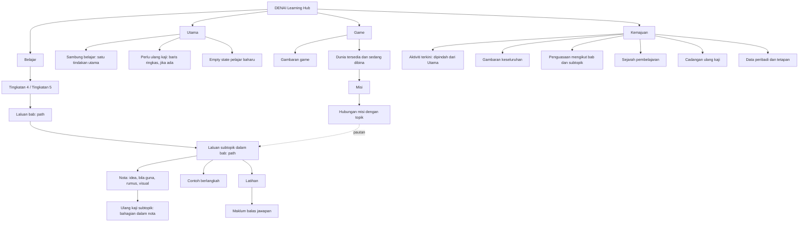
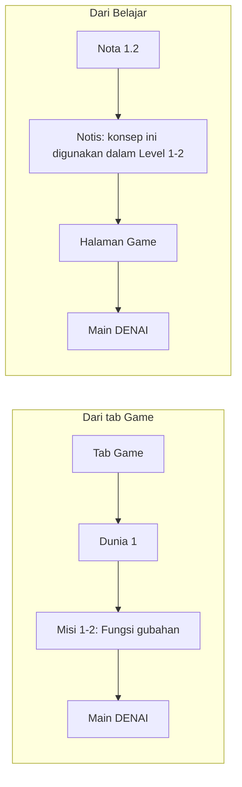
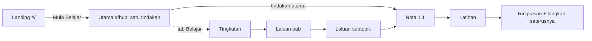
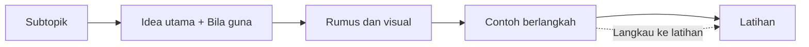
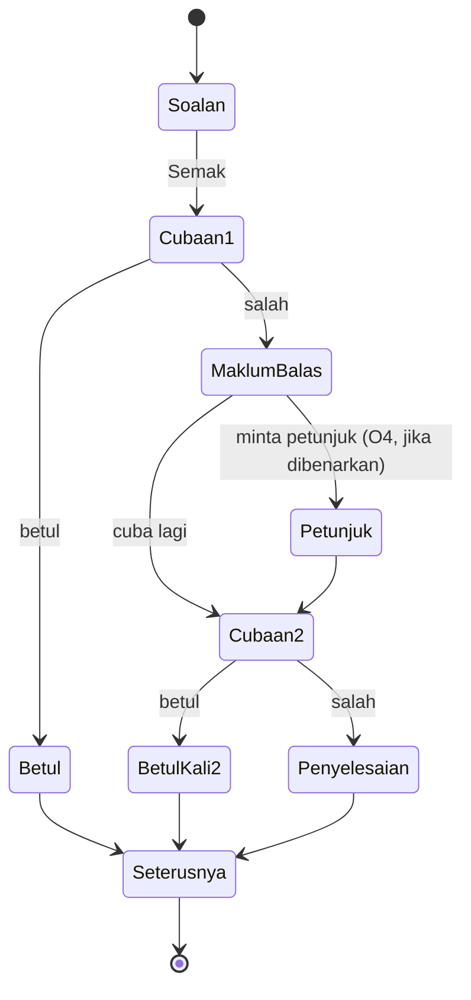

# DENAI Learning Hub — UX Planning

> **Jenis dokumen:** artifak perancangan reka bentuk produk (IA, navigasi, aliran pengguna). **Bukan** spesifikasi pelaksanaan, **bukan** wireframe dan **bukan** prototaip.
> **Status:** draf untuk semakan pemilik. Tiada kod, route, kandungan, ujian atau game diubah untuk menghasilkan dokumen ini.
> **Tarikh:** 2026-11-23.
> **Asas:** `denai/hub/PRODUCT-BLUEPRINT.md` (termasuk keputusan D1–D15), `PRODUCT-ROADMAP.md`, `PLAN.md`, dan kod hub pada branch `claude/denai-hub-phase1` (commit `d06921d`).
> **Pusingan semakan 1 (2026-11-23):** arahan pemilik A1–A8 (blueprint §3.2) diterapkan pada §3, §4, §5, §6, §13 dan §14. Wireframe konseptual Utama, Belajar dan learning path ditambah dalam §15. Ini **bukan** UX-2 dan **bukan** fasa wireframe penuh (UX-3).

**Konvensyen** (sama seperti blueprint)

| Tanda | Maksud |
|---|---|
| **[KEPUTUSAN D#]** | Keputusan pemilik yang disahkan (blueprint §3). Belum tentu dilaksanakan. |
| **[WUJUD]** | Disahkan dalam kod hari ini (branch Fasa 1 jika dinyatakan). |
| **[CADANGAN]** | Struktur atau tingkah laku yang dicadangkan. Belum dibina. |
| **[HIPOTESIS]** | Perlu diuji dengan pelajar. |
| **[PERLU DISAHKAN]** | Fakta teknikal atau reka bentuk yang belum dapat disahkan. |
| **O#** | Keputusan terbuka dalam blueprint §25. |

---

## Kandungan
1. [Tujuan dan skop](#1-tujuan-dan-skop)
2. [Prinsip pengalaman produk](#2-prinsip-pengalaman-produk)
3. [Sitemap dan seni bina maklumat](#3-sitemap-dan-seni-bina-maklumat)
4. [Model navigasi](#4-model-navigasi)
5. [Perjalanan pengguna teras](#5-perjalanan-pengguna-teras)
6. [Inventori halaman dan keperluan UX](#6-inventori-halaman-dan-keperluan-ux)
7. [Peraturan pengalaman pembelajaran](#7-peraturan-pengalaman-pembelajaran)
8. [Pengalaman penguasaan](#8-pengalaman-penguasaan)
9. [Tingkah laku responsif](#9-tingkah-laku-responsif)
10. [Keperluan kebolehaksesan](#10-keperluan-kebolehaksesan)
11. [Pelan ujian UX](#11-pelan-ujian-ux)
12. [Hasil fasa reka bentuk](#12-hasil-fasa-reka-bentuk)
13. [Soalan terbuka dan kebergantungan](#13-soalan-terbuka-dan-kebergantungan)
14. [Cadangan akhir](#14-cadangan-akhir)
15. [Wireframe konseptual dan tindakan seterusnya (pusingan semakan 1)](#15-wireframe-konseptual-dan-tindakan-seterusnya-pusingan-semakan-1)

---

## 1. Tujuan dan skop

### 1.1 Objektif
Menyediakan asas UX yang dipersetujui sebelum wireframe dibuat:
- seni bina maklumat (IA) untuk empat destinasi utama;
- model navigasi desktop dan mudah alih;
- aliran pengguna teras dengan keadaan kejayaan, kekeliruan dan pemulihan;
- keperluan UX per halaman.

### 1.2 Pengguna sasaran
Pelajar SPM Matematik Tambahan, Tingkatan 4 dan 5 (D1). Persona A (T4 perlukan bimbingan), B (T5 bersedia SPM) dan C (pelajar interaktif) dalam blueprint §8 ialah **[HIPOTESIS]**.

### 1.3 Input tetap (keputusan yang disahkan)
| Keputusan | Kesan pada perancangan ini |
|---|---|
| D2 | Desktop dan mudah alih sama penting; setiap aliran dirancang untuk kedua-duanya |
| D5, D6 | Hub ialah pintu masuk utama; aplikasi nota ialah rujukan penuh; route sedia ada kekal |
| D7 | Tiada jawapan penuh selepas kesilapan pertama |
| D10 | Game, gameplay, aset Kenney dan simpanan tidak diubah |
| D11 | Tiada mekanik retensi manipulatif |
| **D12** | Tepat empat destinasi: **Utama · Belajar · Game · Kemajuan** |
| **D13** | Penguasaan konservatif berasaskan bukti; label sementara |
| **D14** | Game ialah tab utama |
| **D15** | Mod visual *Play* (Utama, Game, navigasi, penemuan) dan *Learning* (Belajar, nota, contoh, latihan, maklum balas, ulang kaji) |
| **A1–A8** (arahan semakan pemilik) | `#/hub` dicadangkan sebagai Utama; empat tab mendatar di desktop; satu CTA "Sambung belajar"; aliran Belajar ringkas; learning path sebagai navigasi bab dan subtopik; kurangkan kad dan hiasan; kekalkan dua mod; O16 kekal terbuka. Muktamad apabila UX-1 diluluskan. |

### 1.4 Dalam skop / di luar skop
| Dalam skop fasa ini | Di luar skop fasa ini |
|---|---|
| IA, sitemap, navigasi, aliran pengguna, inventori halaman, peraturan UX, pelan ujian, urutan fasa UX | Wireframe, mockup, prototaip, token visual baharu |
| Mengenal pasti route sedia ada yang boleh diguna semula | Mencipta route baharu atau mengubah route |
| Menyenaraikan keputusan terbuka yang menyekat reka bentuk | Membuat keputusan bagi pihak pemilik |
| — | Kod aplikasi, CSS, ujian, kandungan, game |
| — | Akaun, backend, penyegerakan, analitik |

---

## 2. Prinsip pengalaman produk

| Prinsip | Peraturan UX praktikal | Cara semak |
|---|---|---|
| **Tindakan seterusnya yang jelas** | Setiap skrin ada **satu** tindakan utama yang kelihatan dalam paparan pertama. Utama sentiasa menjawab "apa saya buat sekarang?". | Semakan wireframe: kira butang primer per skrin (sasaran: 1) |
| **Beban kognitif rendah** | Satu idea per nota; satu soalan pada satu masa; maklumat sekunder dalam bahagian yang boleh dibuka. Tiada hiasan dalam mod *Learning* (D15). | Semakan reka bentuk; ujian think-aloud |
| **Kemajuan yang jujur** | Hanya bukti latihan mengubah tahap (D13). Nota selesai, rekod game dan masa tidak dipaparkan sebagai penguasaan. Data demo hanya dengan banner "Mod demo" **[WUJUD]**. | Ujian unit + soalan temu bual |
| **Tiada penglibatan manipulatif** | Tiada streak, kiraan detik, liga, ganjaran rawak, suapan tanpa penghujung atau mesej rasa bersalah (D11, blueprint §7). Set ada penghujung. | Senarai semak larangan dalam semakan wireframe |
| **Matematik yang boleh diakses** | KaTeX dengan MathML **[WUJUD]**; rumus panjang skrol dalam kotaknya sendiri; tiada matematik dalam imej sahaja; visual ada penerangan teks **[WUJUD]**. | Ujian pembaca skrin (perlu dijalankan) |
| **Responsif sejak awal** | Setiap aliran dilukis untuk telefon dan desktop dalam fasa yang sama. Tiada skrol mendatar halaman. | Semakan wireframe pada dua saiz |
| **Bahasa yang konsisten** | Satu istilah bagi satu konsep: tab D12; tahap Belum mula/Mencuba/Faham/Mahir; kesukaran Asas/Sederhana/Cabaran (kini tidak konsisten: data nota `mencabar`, game `cabaran` — **[PERLU DISAHKAN]** istilah paparan); istilah DSKP untuk matematik. | Glosari UI (hasil UX-2) |
| **Pelihara game sedia ada** | Hub memaut ke game; tidak mengubah game. Tiada pautan balik dari dalam game (O7). | Semakan skop |
| **Setiap elemen mesti membantu tindakan pembelajaran** (A6) | Kad, statistik, trofi, badge dan hiasan hanya dikekalkan jika ia membantu pelajar memilih atau melakukan aktiviti pembelajaran seterusnya. Pautan yang menduplikasi navigasi utama dibuang. Tahap penguasaan kekal kerana ia memandu pilihan. | Untuk setiap elemen dalam wireframe: "tindakan apa yang ia bantu?" Jika tiada, buang. |

---

## 3. Sitemap dan seni bina maklumat

### 3.1 Sitemap hierarki [CADANGAN — struktur maklumat, bukan senarai route baharu]


### 3.2 Destinasi dan route yang boleh diguna semula
**Pemetaan route disahkan semula terhadap kod (2026-11-23):**
- `#/` dirender oleh `pages/home.js`: landing dengan CTA "Mula Belajar" (→ `#/hub`), "Teroka Game" (→ `#/main`), "Main DENAI" dan "Masuk Learning Hub". Logo hub memaut ke `#/` (`js/app.js`). Kedua-dua pautan dari `/denai/` menuju ke `/denai/hub/`, iaitu `#/`. **Jadi `#/` masih mempunyai fungsi landing.**
- `#/hub` dirender oleh `pages/hub.js`: papan pemuka pelajar baharu dan pelajar kembali. Halaman 404 memaut ke `#/hub` sebagai tindakan utama.
- Tab navigasi semasa: Utama → `#/`, Hub → `#/hub`, Bab → `#/bab`, Main → `#/main`, Kemajuan → `#/kemajuan` (`NAV` dalam `js/app.js`).

| Nod | Route sedia ada [WUJUD] | Status struktur |
|---|---|---|
| Landing (pelawat) | `#/` | Wujud dan dikekalkan sebagai landing. **Bukan** destinasi tab (cadangan A1). |
| Utama (papan pemuka) | `#/hub` | Wujud. **Dicadangkan sebagai destinasi tab Utama (A1, O15).** Menunggu kelulusan UX-1. |
| Belajar → Tingkatan + laluan bab | `#/bab`, `#/bab?t=5` | Wujud (kini grid kad); paparan *path* **[CADANGAN, A5]** |
| Laluan subtopik dalam bab | `#/bab/<id>` | Wujud (kini senarai subtopik); paparan *path* **[CADANGAN, A5]** |
| Subtopik | Tiada halaman sendiri; bahagian atas nota dan senarai dalam gambaran bab | Halaman berasingan ialah **O9** |
| Nota, Contoh, Ulang kaji (subtopik) | `#/nota/<id>/<sub>` (bahagian Fahami, Contoh, Ulang Kaji, Latihan) | Wujud |
| Latihan + maklum balas | `#/latihan/<id>/<sub>` | Wujud |
| Ulang kaji merentas subtopik (barisan) | Tiada | **[CADANGAN]**; route belum ditetapkan |
| Ulang kaji bab penuh (rujukan) | Aplikasi nota `/app/addmath/#/ulangkaji/<id>` | Wujud di luar hub (D5) |
| Game | `#/main`, `#/main?bab=<id>` | Wujud |
| Misi (maklumat) | Bahagian dalam `#/main` | Halaman berasingan **[CADANGAN]**; route belum ditetapkan |
| Game sebenar | `/app/addmath/denai/main` | Wujud; tidak diubah |
| Kemajuan | `#/kemajuan` | Wujud |
| Sejarah, Cadangan ulang kaji, Data & tetapan | Bahagian dalam `#/kemajuan` (jadual set **[WUJUD]**) | Bahagian tambahan **[CADANGAN]**; sama ada bahagian atau sub-route belum ditetapkan |

### 3.3 Spesifikasi destinasi

#### Utama — mod *Play*
| Perkara | Penerangan |
|---|---|
| Route | `#/hub` (cadangan A1, O15) |
| Niat pengguna | "Apa saya buat sekarang?" |
| Tindakan utama | **"Sambung belajar"** — satu butang sahaja (A3). Destinasinya dikira oleh peraturan `nextAction` sedia ada **[WUJUD]**: set latihan yang belum habis → nota yang belum selesai → latihan sehingga Faham → subtopik seterusnya → bab seterusnya. Label bagi pelajar tanpa rekod ialah keputusan terbuka **O17**. |
| Tindakan sekunder | Satu baris "Perlu ulang kaji" jika ada **[CADANGAN]**; pautan teks kecil "Lihat laluan bab" ke laluan bab semasa. **Tiada** butang primer kedua. |
| Maklumat | Apa yang akan berlaku apabila butang ditekan (subtopik, jenis aktiviti, sebab dalam satu ayat); bab semasa dan kedudukan dalam laluan (contoh "Subtopik 2 daripada 3"); nota storan setempat **[WUJUD]** dalam teks kecil |
| Dibuang atau dipindah (A6) | Kad "Langkah seterusnya" berasingan (digabung ke dalam CTA); kad "Aktiviti terkini" (→ Kemajuan); kad "Kemajuan pembelajaran" dengan statistik (→ Kemajuan); kad pintasan "Pergi ke" Semua bab / Game / Kemajuan (menduplikasi navigasi utama) |
| Titik masuk | Tab Utama; "Mula Belajar" pada landing `#/` |
| Laluan keluar | Ke aktiviti seterusnya (Belajar); tab lain melalui navigasi |

#### Belajar — mod *Learning*
| Perkara | Penerangan |
|---|---|
| Niat pengguna | "Saya mahu belajar atau berlatih topik tertentu." |
| Aliran (A4) | **Tingkatan → Bab → Subtopik → Nota / Contoh / Latihan.** Empat langkah, tiada skrin perantaraan tambahan. |
| Corak navigasi (A5) | **Learning path** pada dua tahap: laluan bab dalam satu Tingkatan, dan laluan subtopik dalam satu bab. Nod semasa ditanda dan membawa tindakan "Sambung belajar" untuk bab itu. |
| Tindakan utama | Tekan nod semasa (atau mana-mana nod) → pilih Nota, Contoh atau Latihan; satu daripadanya ditanda sebagai disyorkan |
| Tindakan sekunder | Tukar Tingkatan; nota penuh (rujukan, aplikasi nota); misi berkaitan |
| Maklumat | Pada setiap nod: nombor, tajuk, tahap penguasaan (teks + ikon) **[WUJUD, Fasa 1]**, status tersedia/dalam penyediaan **[WUJUD]** |
| Tidak dikunci | Semua nod yang diterbitkan boleh dibuka bila-bila masa (blueprint §7, "Paved Path"). Path hanya menunjukkan urutan yang disyorkan. |
| Titik masuk | Tab Belajar; Sambung/Langkah seterusnya dari Utama; pautan dari Game dan Kemajuan |
| Laluan keluar | Breadcrumb ke tahap atas; ringkasan latihan → langkah seterusnya; misi berkaitan → Game |

#### Game — mod *Play* (D14)
| Perkara | Penerangan |
|---|---|
| Niat pengguna | "Saya mahu bermain dan melihat matematik digunakan." |
| Tindakan utama | **Main DENAI** (membuka game sebenar) |
| Tindakan sekunder | Nota/Latihan untuk subtopik misi; lihat dunia yang sedang dibina |
| Maklumat | Dunia 1 dan misinya **[WUJUD]**; subtopik setiap misi **[WUJUD]**; SP dan objektif pembelajaran daripada definisi puzzle **[CADANGAN]**; notis "rekod game bukan bukti penguasaan" **[CADANGAN]**; dunia yang sedang dibina **[CADANGAN]**; kawalan **[WUJUD]** |
| Titik masuk | Tab Game; notis Level dalam nota dan ringkasan latihan **[WUJUD]**; gambaran bab **[WUJUD]** |
| Laluan keluar | Ke game (halaman berasingan); ke nota/latihan berkaitan; pulang secara manual (O7) |
| Tidak termasuk | Status misi per pemain (memerlukan O6) |

#### Kemajuan — mod *Learning* untuk data (D15; mod tepat belum diputuskan, lihat §13.2)
| Perkara | Penerangan |
|---|---|
| Niat pengguna | "Apa yang saya sudah kuasai dan apa yang lemah?" |
| Tindakan utama | **Latih subtopik paling lemah** |
| Tindakan sekunder | Sejarah; cadangan ulang kaji; data & tetapan |
| Maklumat | Gambaran keseluruhan **[WUJUD]**; penguasaan per bab dan subtopik **[WUJUD, Fasa 1]**; jadual set latihan **[WUJUD]**; "Bukti belum mencukupi" dan "Perlu ulang kaji" **[CADANGAN, D13]**; penerangan storan setempat **[WUJUD]**; padam data **[CADANGAN]** |
| Titik masuk | Tab Kemajuan; pautan dari Utama dan ringkasan latihan |
| Laluan keluar | Ke latihan atau nota subtopik; ke Game (rekod game ditunjuk berasingan, hanya jika O6) |

---

## 4. Model navigasi

### 4.1 Navigasi utama [KEPUTUSAN D12]
| | Desktop (≥960px, titik putus sedia ada) | Mudah alih (<960px) |
|---|---|---|
| Bentuk | Navigasi atas: logo, empat destinasi berlabel, satu tindakan utama | Navigasi bawah tetap, empat item |
| Label | Utama · Belajar · Game · Kemajuan | Sama; label sentiasa kelihatan (bukan ikon sahaja) |
| Ikon | Pilihan pada desktop | Wajib; mesti mudah dikenali **[HIPOTESIS: pilihan ikon diuji dalam UX-6]** |
| Bentuk tab (A2) | **Empat tab mendatar**: Utama, Belajar, Game, Kemajuan. Tiada tab, menu lungsur atau menu utama tambahan. | Empat item bar bawah |
| Tindakan utama | **Kini:** bar atas desktop memaparkan butang primer "Main DENAI" ke game pada setiap halaman **[WUJUD, `js/app.js`]**. Butang ini bersaing dengan "Sambung belajar" di Utama. **Cadangan:** tiada CTA dalam bar atas; akses ke game melalui tab Game. Tindakan utama berada dalam kandungan halaman, contohnya "Sambung belajar" di Utama, supaya tiada CTA yang bersaing dengannya (A3). Logo memaut ke landing `#/`. | Tiada CTA dalam bar; tindakan utama di dalam kandungan |
| Fokus | Fokus tidak dilindungi oleh bar atas *sticky* | Fokus dan kandungan terakhir tidak dilindungi oleh bar bawah |

Tablet (600–959px) mengikut corak mudah alih kerana titik putus semasa ialah 960px **[WUJUD]**; sama ada tablet landskap patut menggunakan navigasi atas ialah soalan UX-3.

D12 meminta "satu tindakan utama yang jelas" di desktop. Cadangan ini memenuhinya melalui tindakan utama dalam kandungan setiap halaman, bukan butang tetap dalam bar. **Perlu kelulusan pemilik (UX-1).**

### 4.1b Learning path sebagai corak navigasi Belajar [CADANGAN, A5]
| Prinsip UX (diinspirasikan Duolingo, tidak ditiru) | Penterjemahan DENAI |
|---|---|
| Satu laluan berurutan yang jelas | Bab dalam urutan DSKP; subtopik dalam urutan kod SK (1.1, 1.2, 1.3) |
| Kedudukan semasa sentiasa kelihatan | Nod semasa ditanda dengan bingkai dan label "Anda di sini" |
| Langkah kecil dengan tindakan seterusnya yang jelas | Nod semasa membawa satu tindakan; nod lain hanya membuka pilihan Nota / Contoh / Latihan |
| Kemajuan dilihat pada laluan itu sendiri | Tahap penguasaan pada setiap nod (teks + ikon), bukan bar statistik berasingan |

| **Tidak** diambil daripada Duolingo | Sebab |
|---|---|
| Aset, maskot, warna jenama, bentuk ikon atau gaya ilustrasi Duolingo | Identiti DENAI sendiri (D15); larangan meniru jenama |
| Nod berkunci | Nota sentiasa terbuka (blueprint §7) |
| Streak, permata, nyawa, liga, XP | D11, blueprint §7 |
| Laluan zig-zag yang hanya hiasan | Mod *Learning* (D15): senarai menegak ringkas yang mudah dibaca dan diakses |

**Visual:** laluan menegak dengan nod bulat bernombor yang disambung oleh satu garis. Dalam mod *Learning*: warna token sedia ada, tiada tekstur atau bingkai kayu game. Nod ialah pautan biasa dalam senarai tersusun (`ol`), supaya ia boleh dibaca oleh pembaca skrin dan dinavigasi dengan papan kekunci.

**Misi game dalam laluan:** sama ada misi game dipaparkan sebagai penanda kecil di sebelah subtopik berkaitan (contohnya "Level 1-2" di sebelah 1.2) ialah keputusan terbuka **O18**. Jika diluluskan, penanda itu hanya memaut ke tab Game dan tidak menjadi langkah wajib dalam laluan.

### 4.2 Keadaan aktif
- Tab aktif mengikut **pemilik** halaman, bukan dari mana pelajar datang. Contohnya nota dibuka dari Utama tetap menyerlahkan Belajar **[CADANGAN]**.
- Keadaan aktif ditunjuk dengan bentuk/garis dan teks (`aria-current="page"`), bukan warna sahaja **[WUJUD untuk corak semasa — PERLU DISAHKAN pada empat tab]**.

### 4.3 Breadcrumb, kembali dan tajuk halaman
| Elemen | Peraturan |
|---|---|
| Breadcrumb | Bermula dengan nama tab pemilik (contoh "Belajar / Tingkatan 4 / Bab 1 / 1.2"). Tiada breadcrumb di halaman tahap pertama tab. |
| Kembali | Mengikut hierarki (latihan → nota → bab), bukan sejarah pelayar sahaja |
| Tajuk halaman | Satu `h1` per halaman **[WUJUD]**; `document.title` = halaman + "DENAI" **[PERLU DISAHKAN format]** |
| Fokus selepas navigasi | Dipindah ke `h1` **[WUJUD]** |

### 4.4 Pautan kontekstual
| Dari | Ke | Status |
|---|---|---|
| Nota subtopik yang mempunyai misi | Game (misi berkaitan) | **[WUJUD]** notis Level |
| Ringkasan latihan | Langkah seterusnya; misi berkaitan | **[WUJUD]** |
| Gambaran bab | Game, atau notis jujur jika tiada misi | **[WUJUD]** |
| Game (setiap misi) | Nota dan latihan subtopik | **[WUJUD]** |
| Kemajuan (subtopik lemah) | Latihan subtopik | **[WUJUD]** pautan "Latihan lagi" |
| Nota hub | Nota penuh dalam aplikasi nota, dilabel "rujukan; kemajuan tidak direkod di sana" | Pautan **[WUJUD]**; label **[CADANGAN]** |

### 4.5 Sampai ke misi game

- Kedua-dua laluan menuju **halaman yang sama** (Game). Tiada halaman misi kedua dalam Belajar, untuk mengelakkan corak navigasi berganda.
- Jika halaman maklumat misi berasingan diluluskan kemudian, kedua-dua laluan menuju halaman itu.

### 4.6 *Empty states* dan pelajar kembali
| Destinasi | Rekod kosong | Pelajar kembali |
|---|---|---|
| Utama | Satu ayat alu-aluan + satu tindakan (label O17) ke nota 1.1 **[cadangan berdasarkan `nextAction` WUJUD]** | Satu butang "Sambung belajar" dengan sebab dalam satu ayat **[CADANGAN, A3]**; kini ada dua butang primer ("Sambung" dan kad "Langkah seterusnya") **[WUJUD]** |
| Belajar | Laluan dengan semua nod "Belum mula"; nod pertama ditanda sebagai titik mula | Laluan dengan tahap per nod; nod semasa ditanda "Anda di sini" |
| Game | Dunia dan misi (tiada keadaan kosong) | Sama; status per pemain hanya jika O6 |
| Kemajuan | "Kemajuan anda akan muncul di sini" **[WUJUD]** | Penguasaan, sejarah, cadangan ulang kaji |
| Ulang kaji | "Ulang kaji muncul selepas anda berlatih" **[CADANGAN]** | Senarai subtopik yang perlu diulang kaji |

**Mengelakkan pendua:** satu jalan utama bagi setiap tugasan; pautan kontekstual hanya memintas, tidak mencipta versi kedua halaman yang sama.

---

## 5. Perjalanan pengguna teras

Event yang dirujuk: `note-open`, `note-done`, `attempt`, `set-done` **[WUJUD, Fasa 1]**; `hint-used`, `solution-viewed`, `review-done` **[CADANGAN]**.

### A. Pelajar kali pertama
**Landing → pilih Tingkatan → pilih bab → pilih subtopik → belajar → berlatih**



| Perkara | Penerangan |
|---|---|
| Titik mula | Landing `#/` atau `/denai/` |
| Niat | Mula belajar tanpa bantuan |
| Tindakan | Mula Belajar → Utama → tindakan utama ke nota 1.1; **atau** tab Belajar → Tingkatan → laluan bab → laluan subtopik → Nota / Contoh / Latihan (A4) |
| Respons sistem | Utama menunjukkan satu ayat alu-aluan dan satu tindakan (kini 1.1) **[WUJUD sebagai cadangan `nextAction`]**; pilihan Tingkatan pada skrin Belajar **[WUJUD, tab T4/T5]**; T5 menunjukkan "sedang disemak" **[WUJUD]** |
| Kejayaan | Satu set latihan selesai dalam sesi pertama; event pertama ≤2 minit **[HIPOTESIS sasaran]** |
| Kekeliruan | Pelajar T5 mendapati bab T5 belum diterbitkan; terlalu banyak pilihan sebelum belajar |
| Pemulihan | Mesej jujur T5 + cadangan T4 yang relevan; cadangan pantas "Baca nota 1.1" kekal sebagai jalan pintas |

### B. Pelajar kembali
**Utama → Sambung belajar → aktiviti pembelajaran bermakna terakhir**

| Perkara | Penerangan |
|---|---|
| Titik mula | Utama (`#/hub`, cadangan A1) |
| Niat | Sambung tanpa mencari semula |
| Tindakan | Tekan "Sambung belajar" (satu-satunya butang primer, A3) |
| Respons sistem | Kembali ke set latihan yang belum habis (soalan yang sama, termasuk cubaan 2) **[WUJUD, Fasa 1]**; jika tiada set, ke nota belum selesai atau subtopik di bawah Faham **[WUJUD, peraturan `nextAction`]** |
| "Bermakna" | Latihan yang belum habis diutamakan berbanding nota yang hanya dibuka. **Disahkan dalam kod:** `nextAction` sudah meletakkan set aktif yang belum habis di tempat pertama **[WUJUD]**. Butang "Sambung" semasa pula memaut ke lokasi terakhir (`l.last`), yang boleh berbeza daripada `nextAction`; cadangan A3 menggabungkan kedua-duanya kepada satu destinasi (`nextAction`). |
| Kejayaan | "Sambung" ialah tindakan pertama (S7) |
| Kekeliruan | Data hilang kerana pelayar dibersihkan atau peranti lain |
| Pemulihan | Nota storan menerangkan sebabnya **[WUJUD]**; Utama kembali ke *empty state* dengan jalan pantas ke Belajar |

### C. Belajar daripada nota
**Subtopik → idea utama → rumus/visual → contoh berlangkah → latihan**



| Perkara | Penerangan |
|---|---|
| Titik mula | Gambaran bab atau Sambung |
| Niat | Faham konsep sebelum mencuba |
| Tindakan | Baca idea → lihat rumus dan visual → ikut contoh → "Mula latihan" |
| Respons sistem | Lompat bahagian *sticky* **[WUJUD]**; penerangan teks visual **[WUJUD]**; contoh langkah demi langkah di telefon **[CADANGAN]**; "Saya faham nota ini" merekod nota selesai tetapi **tidak** mengubah tahap (D13) |
| Kejayaan | Betul cubaan pertama pada ≥1 soalan Sederhana selepas nota **[HIPOTESIS petunjuk]** |
| Kekeliruan | Pelajar menyangka "Saya faham nota ini" menaikkan tahap; contoh panjang di telefon |
| Pemulihan | Teks di sebelah butang: "Tahap anda berubah melalui latihan" **[CADANGAN]**; *reveal* berlangkah |

### D. Jawapan salah
**Cubaan → maklum balas kesilapan → cuba lagi → petunjuk (jika polisi membenarkan) → penyelesaian → tindakan seterusnya**



| Perkara | Penerangan |
|---|---|
| Titik mula | Soalan latihan |
| Niat | Faham kesilapan dan cuba lagi |
| Respons sistem | Kesilapan pertama: maklum balas khusus atau generik, **tiada** jawapan atau penyelesaian (D7) **[WUJUD, Fasa 1]**; input tidak sah tidak dikira **[WUJUD]**; petunjuk **[CADANGAN, O4]**; selepas betul atau salah kali kedua: jawapan + penyelesaian **[WUJUD]** |
| Bukti penguasaan | Betul cubaan 1 = bukti tanpa bantuan; betul cubaan 2 atau selepas petunjuk = kemajuan, bukan bukti cubaan pertama (D13) |
| Kejayaan | Betul pada cubaan kedua; atau soalan serupa betul dalam ulang kaji kemudian |
| Kekeliruan | Maklum balas generik tidak membantu; pelajar tidak sedar ada cubaan kedua |
| Pemulihan | Teks status "Cubaan 2 daripada 2" **[WUJUD]**; ringkasan set menyenaraikan soalan salah dan "Latihan lagi" **[WUJUD]** |

### E. Topik lemah
**Kemajuan → kenal pasti subtopik lemah → latihan bersasar → ulang kaji tertunda**

| Perkara | Penerangan |
|---|---|
| Titik mula | Kemajuan |
| Niat | Guna masa terhad pada topik paling lemah (Persona B) |
| Tindakan | Lihat penguasaan per bab → pilih subtopik Mencuba → latihan → kembali selepas beberapa hari untuk ulang kaji |
| Respons sistem | Subtopik lemah diserlahkan **[WUJUD separa]**; tindakan utama "Latih yang paling lemah" **[CADANGAN]**; ulang kaji tertunda muncul di Utama **[CADANGAN]**; selang ulang kaji **[HIPOTESIS]** |
| Kejayaan | Tahap naik melalui latihan; ulang kaji tertunda betul |
| Kekeliruan | Pelajar tidak faham kenapa subtopik "lemah"; terlalu banyak subtopik diserlahkan |
| Pemulihan | Sebab ditunjuk ("2 daripada 5 betul pada cubaan pertama"); hadkan senarai keutamaan kepada beberapa item **[HIPOTESIS bilangan]** |

### F. Aplikasi melalui game
**Tab Game → pilih misi → faham topik berkaitan → main game sedia ada → kembali ke Hub secara manual**

| Perkara | Penerangan |
|---|---|
| Titik mula | Tab Game (D14) |
| Niat | Bermain dan melihat konsep digunakan |
| Tindakan | Pilih misi → baca kaitan misi ↔ subtopik → (pilihan) baca nota → Main DENAI |
| Respons sistem | Game sebenar dibuka di `/app/addmath/denai/main` **[WUJUD]**; game tidak berubah |
| Kembali | Manual: butang Back pelayar atau buka hub semula. **Tiada pautan balik dari dalam game** (O7). Hub tidak tahu misi selesai (O6). |
| Kejayaan | Pelajar boleh menyebut konsep yang digunakan dalam misi (S6) |
| Kekeliruan | Jalan pulang tidak jelas; pelajar menyangka misi selesai menaikkan tahap |
| Pemulihan | Sebelum membuka game, halaman Game menerangkan cara kembali ("Tekan Back untuk kembali ke DENAI Learning Hub") **[CADANGAN]**; notis "rekod game bukan penguasaan" |

### G. Soalan berstruktur dan penaakulan
Kini 22 soalan berstruktur dan 32 soalan penaakulan yang diterbitkan **tidak boleh dicapai dalam hub** **[WUJUD]**. Aplikasi nota sudah memaparkannya: berstruktur dengan input per bahagian, dan penaakulan dengan arahan "Tulis jawapan anda di atas kertas, kemudian bandingkan dengan penyelesaian penuh" dan butang "Saya sudah cuba: tunjukkan jawapan" **[WUJUD, `app/addmath/src/notes/practice.js`]**.

| | Berstruktur | Penaakulan |
|---|---|---|
| Aliran pembelajaran | Soalan dipecah kepada bahagian (a), (b), (c); satu bahagian pada satu masa; konteks soalan kekal kelihatan | Pelajar menulis hujah di atas kertas; kemudian membandingkan dengan model jawapan langkah demi langkah |
| Penilaian | Bahagian auto (numerik/ungkapan) disemak secara automatik per bahagian; bahagian penaakulan dalam soalan berstruktur dinilai sendiri | Penilaian kendiri sahaja; tiada penanda automatik yang boleh dipercayai |
| Kesan pada penguasaan | **O5 terbuka.** Cadangan: hanya bahagian auto yang betul cubaan pertama dikira sebagai bukti | **Tidak** dikira dalam penguasaan (cadangan blueprint; O5 terbuka) |
| Kejayaan | Semua bahagian dijawab; pelajar tahu bahagian mana salah | Pelajar boleh menunjuk satu langkah dalam model jawapan yang tertinggal dalam jawapan sendiri |
| Kekeliruan | Kehilangan konteks soalan di telefon; tidak tahu bahagian mana dinilai | Pelajar menyangka penilaian kendiri menaikkan tahap |
| Pemulihan | Ringkasan per bahagian; "Lihat penyelesaian bahagian ini" | Label jelas "Latihan kendiri — tidak mengubah tahap" |

### H. Bukti penguasaan belum mencukupi
| Perkara | Penerangan |
|---|---|
| Titik mula | Ringkasan latihan atau Kemajuan untuk subtopik bank kecil (6.3, 8.3, 9.3, 9.4) |
| Niat | Tahu tahap sebenar |
| Respons sistem | Tunjuk "Bukti belum mencukupi untuk [tahap]" dengan sebab dan tindakan berguna, contohnya "Cuba soalan berstruktur" (jika O5 membenarkan), "Ulang kaji selepas beberapa hari", atau "Baca nota penuh" **[CADANGAN, D13 P9]** |
| Kejayaan | Pelajar faham bahawa tiada tahap palsu diberikan, dan tahu apa yang boleh dibuat seterusnya |
| Kekeliruan | Pelajar rasa dihukum kerana kekurangan kandungan |
| Pemulihan | Bahasa yang meletakkan sebab pada kandungan, bukan pada pelajar ("Subtopik ini belum ada cukup soalan"), bukan "Anda belum cukup baik" |
| Kebergantungan | Definisi "mencukupi" — **O16** |

---

## 6. Inventori halaman dan keperluan UX

> Tiada wireframe. Lajur "Route" menyatakan route sedia ada, atau "belum ditetapkan" untuk struktur yang dicadangkan.

| Halaman / skrin | Matlamat pengguna | Maklumat diperlukan | Tindakan utama | Tindakan sekunder | Keadaan penting | Mudah alih | Desktop | Kebolehaksesan | Route |
|---|---|---|---|---|---|---|---|---|---|
| Landing | Faham DENAI | Nilai, tangkapan skrin game sebenar | Mula Belajar | Teroka Game | — | CTA dalam paparan pertama | Dua lajur | Tiada teks dalam imej sahaja | `#/` |
| Utama | Tahu apa seterusnya | Destinasi + sebab tindakan seterusnya; kedudukan dalam laluan; ulang kaji (satu baris) | **Sambung belajar** (satu sahaja, A3) | Pautan teks "Lihat laluan bab"; baris ulang kaji | Kosong (label O17); kembali; storan disekat; mod demo | Butang dalam paparan pertama | Satu lajur, lebar bacaan; tiada grid kad | Satu `h1`; butang ialah pautan dengan teks penuh | `#/hub` (A1, O15) |
| Pilih Tingkatan + laluan bab | Pilih T4/T5 dan bab | Tab Tingkatan; laluan bab dengan status dan tahap | Nod bab semasa | Nod bab lain | T5 sedang disemak; bab dalam penyediaan | Laluan menegak satu lajur | Laluan menegak di tengah, lebar terhad | Tab dengan `aria-current`; laluan sebagai senarai tersusun | `#/bab`, `#/bab?t=5` |
| Laluan subtopik (bab) | Orientasi dalam bab dan pilih subtopik | Nod subtopik + tahap; nod semasa; pilihan Nota/Contoh/Latihan | Tindakan pada nod semasa | Nod lain; misi berkaitan (O18) | Semua belum mula; bab dikuasai; bukti belum mencukupi | Panel pilihan di bawah nod | Panel pilihan di sebelah atau di bawah nod | Nod dalam `ol`; keadaan dalam teks | `#/bab/<id>` |
| Gambaran subtopik | Faham skop subtopik | SP, tahap, bukti | Baca nota / Latihan | Nota penuh | Bukti belum mencukupi | — | — | — | Bahagian nota atau halaman (O9) |
| Nota | Faham konsep | Idea, bila guna, rumus, visual | Teruskan → Latihan | Saya faham nota ini; nota penuh | Nota selesai | Lompat bahagian skrol mendatar | Lajur ≤720px | `h2` per bahagian; teks visual | `#/nota/<id>/<sub>` |
| Contoh berlangkah | Ikut penyelesaian | Diberi, Cari, Kaedah, Langkah + Kenapa, Semak | Langkah seterusnya [CADANGAN] | Tunjuk semua; Langkau ke latihan | Semua langkah dibuka | Satu langkah pada satu masa | Semua langkah | Senarai bernombor | Bahagian dalam nota |
| Latihan | Berlatih | Soalan, input, kedudukan, cubaan | Semak jawapan | Petunjuk (O4); keluar | Belum jawab, dipilih, cubaan 1/2, betul, salah, input tidak sah, disambung | Butang Semak kelihatan di atas papan kekunci | Kad 720px | Label input; radio dengan anak panah; `aria-live` | `#/latihan/<id>/<sub>` |
| Maklum balas | Faham kesilapan | Status + sebab; penyelesaian selepas cubaan akhir | Cuba lagi / Seterusnya | Penyelesaian | Cuba lagi; betul; jawapan didedahkan | Di atas butang, dalam paparan | Dalam kad | Status dalam teks + ikon; diumumkan | Bahagian latihan |
| Ringkasan set | Lihat hasil | Skor, tahap, soalan salah, langkah seterusnya | Langkah seterusnya | Latihan lagi; misi | Tahap berubah; bukti belum mencukupi | Satu lajur | — | Perubahan tahap diumumkan | Bahagian latihan |
| Soalan berstruktur | Jawab per bahagian | Konteks + bahagian | Semak bahagian | Penyelesaian bahagian | Separa siap | Konteks boleh dilipat | Konteks di sisi | Label per bahagian | Belum ditetapkan (O5) |
| Soalan penaakulan | Banding dengan model | Soalan, model jawapan | Saya sudah cuba: tunjuk jawapan | — | Kendiri, tidak dikira | — | — | Label "tidak mengubah tahap" | Belum ditetapkan (O5) |
| Ulang kaji (barisan) | Ulang kaji yang perlu | Subtopik + sebab | Mula ulang kaji | Langkau | Kosong | Senarai | Senarai | — | Belum ditetapkan |
| Game | Pilih misi | Dunia, misi ↔ topik, notis rekod game | Main DENAI | Nota/Latihan misi | Dunia sedang dibina; bab tanpa misi | Butang Main paling atas; nota landskap | Wira dua lajur | Kawalan papan kekunci disenaraikan | `#/main`, `#/main?bab=<id>` |
| Maklumat misi | Faham misi | Objektif, konsep, SP | Main | Baca nota | — | — | — | — | Bahagian `#/main` atau belum ditetapkan |
| Kemajuan | Lihat kekuatan/kelemahan | Penguasaan, bukti, ulang kaji | Latih yang paling lemah | Sejarah; data | Kosong; bukti belum mencukupi; perlu ulang kaji | Jadual → kad **[WUJUD]** | Jadual | `role=progressbar` berlabel **[WUJUD]** | `#/kemajuan` |
| Sejarah | Ingat aktiviti | Senarai kronologi | Buka item | Tapis bab | Kosong | Senarai | Jadual | Tarikh dalam teks | Bahagian `#/kemajuan` (belum ditetapkan) |
| Data & tetapan | Kawal data | Lokasi storan, padam, eksport (O12) | Padam kemajuan saya | Eksport; keluar mod demo | Pengesahan; dipadam | — | — | Dialog boleh diakses | Bahagian `#/kemajuan` (belum ditetapkan) |
| Ralat / 404 | Pulih | Mesej + jalan pulang | Ke Utama | — | — | — | — | Fokus pada `h1` | Wujud dalam router |

---

## 7. Peraturan pengalaman pembelajaran

### 7.1 Peraturan yang diluluskan (daripada keputusan yang disahkan)
| Peraturan | Sumber |
|---|---|
| Kesilapan pertama tidak mendedahkan jawapan penuh atau penyelesaian | D7 |
| Petunjuk berasaskan langkah penyelesaian sedia ada | D7 |
| Membuka atau menanda nota tidak mengubah penguasaan | D13 |
| Betul selepas petunjuk dibezakan daripada betul cubaan pertama | D13 |
| Ulang kaji tertunda menguatkan bukti; tiada penurunan berasaskan masa | D13 |
| Halaman pembelajaran dalam mod *Learning*: tiada tekstur, bingkai atau animasi game yang tidak perlu | D15 |
| Kandungan aplikasi nota tidak digandakan; hub memaut untuk rujukan penuh | D5, D6 |
| Tingkatan 5 tidak dipaparkan kepada umum sehingga disahkan | D8 |

### 7.2 Peraturan UX cadangan [CADANGAN]
| Elemen | Peraturan |
|---|---|
| Nota | Satu idea utama; "Bila guna" sebelum prosedur; panjang yang boleh dibaca dalam satu sesi |
| Persembahan rumus | Rumus dalam kotak tersendiri dengan syarat penggunaannya; skrol mendatar dalam kotak, bukan halaman; tiada pengecilan fon automatik |
| Visual matematik | Setiap visual ada penerangan teks; kawalan (slider) boleh digunakan dengan papan kekunci; visual bukan satu-satunya sumber maklumat |
| Contoh berlangkah | Struktur Diberi → Cari → Kaedah → Langkah + Kenapa → Semak **[WUJUD]**; di telefon, satu langkah pada satu masa dengan "Tunjuk semua" |
| Pembelajaran berlangkah | "Apa langkah seterusnya?" sebagai pilihan sebelum *reveal*, menggunakan teks langkah sedia ada (tiada kandungan baharu) |
| Latihan | Set ada penghujung; kedudukan "Soalan n daripada m"; boleh disambung selepas refresh **[WUJUD]** |
| Maklum balas salah | Terangkan kesilapan, bukan pelajar; nyatakan baki cubaan |
| Struktur & penaakulan | Lihat §5 G |
| Ulang kaji tertunda | Muncul sebagai cadangan, bukan paksaan; sesi pendek dan berpenghujung |

### 7.3 Belum diputuskan
| Perkara | Keputusan |
|---|---|
| Bila petunjuk tersedia, berapa langkah, untuk soalan mana | O4 |
| Cara soalan berstruktur dan penaakulan dinilai dan dikira | O5 |
| Selang ulang kaji tertunda | [HIPOTESIS], dibincang dalam O16 / selepas rintis |
| Gambaran subtopik sebagai halaman berasingan | O9 |
| Istilah kesukaran yang dipaparkan (Cabaran vs Mencabar) | [PERLU DISAHKAN] |

---

## 8. Pengalaman penguasaan

### 8.1 Keadaan yang dilihat pelajar
| Keadaan | Jenis | Maksud kepada pelajar (draf teks, **[HIPOTESIS]**) | Bentuk visual (prinsip) |
|---|---|---|---|
| Belum mula | Tahap | "Belum ada latihan untuk subtopik ini." | Ikon kosong + teks |
| Mencuba | Tahap | "Anda sudah mula berlatih. Teruskan untuk mengumpul bukti." | Ikon separa + teks |
| Faham | Tahap | "Anda betul pada beberapa soalan berbeza pada cubaan pertama." | Ikon tanda + teks |
| Mahir | Tahap | "Anda konsisten pada soalan berbeza, termasuk pada hari berlainan." | Ikon kuat + teks |
| Bukti belum mencukupi | Keadaan | "Subtopik ini belum ada cukup soalan untuk mengesahkan tahap seterusnya." | Ikon maklumat, bukan amaran |
| Perlu ulang kaji | Penanda | "Sudah lama tidak diulang kaji. Tahap anda kekal." | Penanda kecil di sebelah tahap |

- Label empat tahap kekal **sementara** (D13, O3).
- **Ambang muktamad tidak ditetapkan dalam dokumen ini.** Teks di atas sengaja tidak menyebut angka. Jika angka dipaparkan, ia mesti datang daripada peraturan yang diluluskan (O16).
- Warna tidak pernah satu-satunya isyarat.

### 8.2 Membezakan jenis aktiviti
| Aktiviti | Bukti penguasaan? | Cara dipaparkan (cadangan) |
|---|---|---|
| Nota selesai | **Tidak** | Tanda "Nota selesai" berasingan daripada tahap |
| Latihan dicuba | Ya — menunjukkan Mencuba | Kiraan set dan soalan dicuba |
| Betul cubaan pertama | Ya — bukti utama | Dikira dalam "soalan berbeza betul pada cubaan pertama" |
| Betul selepas petunjuk | Kemajuan, **bukan** bukti cubaan pertama | Label "betul dengan petunjuk" dalam ringkasan |
| Bukti ulang kaji tertunda | Ya — bukti lebih kukuh | Label "disahkan dalam ulang kaji" dengan tarikh |
| Misi game selesai | **Tidak** | "Rekod game", dalam bahagian berasingan; hanya jika O6 |

### 8.3 Menerangkan perubahan tahap
- Setiap perubahan disertai sebab, contohnya "1.2 kini Faham kerana…".
- Penurunan hanya kerana bukti baharu, dengan sebab dan langkah seterusnya (D13).
- Tiada konfeti atau ganjaran untuk aktiviti remeh (blueprint §18).

---

## 9. Tingkah laku responsif

Titik putus sedia ada: 600px dan 960px **[WUJUD]**.

| Elemen | Desktop (≥960) | Tablet (600–959) | Mudah alih potret (<600) | Mudah alih landskap (contoh 844×390) |
|---|---|---|---|---|
| Navigasi | Atas, empat label + CTA | Bawah, empat item (semasa) | Bawah, empat item | Bawah; ketinggian terhad — **[PERLU DISAHKAN]** sama ada bar perlu lebih rendah |
| Rumus | Blok penuh | Blok; skrol dalam kotak | Skrol dalam kotak, bukan halaman **[WUJUD]** | Sama |
| Jadual | Jadual | Jadual atau kad | Kad **[WUJUD untuk Kemajuan]** | Kad |
| Contoh panjang | Semua langkah | Semua langkah atau berlangkah | Satu langkah pada satu masa | Satu langkah |
| Medan input | Kad 720px | Sama | `inputmode` yang betul **[WUJUD]**; butang Semak tidak dilindungi papan kekunci **[PERLU DISAHKAN]** | Papan kekunci menutup sebahagian besar skrin — uji |
| Papan kekunci maya | — | — | Soalan dan input kekal kelihatan | Risiko tertinggi |
| Bar bawah | — | Ruang bawah kandungan ≥ ketinggian bar | Sama | Sama |
| Header *sticky* | 64px **[WUJUD]** | — | — | Pertimbang tidak *sticky* |
| Keterlihatan fokus | Tidak dilindungi bar atas | Tidak dilindungi bar bawah | Sama | Sama |
| Pelancaran game | Butang Main + kawalan papan kekunci | Butang Main | Butang Main + nota landskap | Game mengurus orientasinya sendiri **[WUJUD, game]** |

---

## 10. Keperluan kebolehaksesan

**Sasaran:** WCAG 2.2 AA. Status semasa dalam blueprint §19.

| Keperluan | Kriteria | Status semasa | Perlu dalam reka bentuk |
|---|---|---|---|
| Navigasi papan kekunci | 2.1.1 | Navigasi, pilihan jawapan dan butang boleh dicapai **[WUJUD]**; slider visual **[PERLU DIUJI]** | Susunan tab logik untuk empat tab |
| Fokus kelihatan | 2.4.7 | Garis 3px **[WUJUD]** | Kekalkan |
| Fokus tidak dilindungi | 2.4.11 | **Risiko, belum diuji** (bar atas *sticky*, bar bawah *fixed*) | Ruang skrol untuk kedua-dua bar; uji |
| Kontras warna | 1.4.3, 1.4.11 | Teks lulus pada branch Fasa 1 **[WUJUD]**; komponen bukan teks **[PERLU DIUKUR]** | Token sedia ada |
| Tajuk semantik | 1.3.1 | Satu `h1` per halaman **[WUJUD]**; hierarki `h2`/`h3` **[PERLU DISEMAK]** | Hierarki dalam wireframe |
| Label borang | 3.3.2 | Input jawapan berlabel **[WUJUD]** | Label untuk input bahagian berstruktur |
| Mesej ralat | 3.3.1, 3.3.3 | Input tidak sah diterangkan **[WUJUD]** | Sama untuk semua jenis soalan |
| Pengumuman pembaca skrin | 4.1.3 | `aria-live` dalam latihan sahaja **[WUJUD]** | Nota selesai, perubahan tahap, ralat simpanan |
| Notasi matematik | — | KaTeX MathML **[WUJUD]**; **belum diuji** dengan NVDA/VoiceOver | Uji dalam UX-6 |
| *Reduced motion* | amalan baik | Dihormati **[WUJUD]** | Mod *Play* tidak bergantung pada animasi |
| Saiz sasaran sentuh | 2.5.8 | Semua ≥24px; tindakan utama kebanyakan ≥44px **[WUJUD]** | Empat item bar bawah ≥44px |

Isu yang belum diuji kekal berlabel **[PERLU DIUJI]** sehingga UX-6.

---

## 11. Pelan ujian UX

Mengguna semula blueprint §21. **Belum dijalankan.** Tiada dapatan wujud.

| Perkara | Pelan |
|---|---|
| Sampel | **5–8 pelajar** — sasaran perancangan **[HIPOTESIS]**, bukan ujian yang sudah dibuat |
| Persetujuan | Ibu bapa/penjaga dan pelajar; tiada rakaman wajah; tanpa nama |
| Peranti | Separuh telefon, separuh desktop/laptop |
| Bahan | Prototaip atau branch pratonton (O10); rekod kosong dan rekod demo `?demo=1` |

| Fokus | Tugasan | Kejayaan | Pemerhatian |
|---|---|---|---|
| Navigasi empat tab | "Cari Bab 6 Hukum Linear"; "Pergi ke kemajuan anda" | ≤3 interaksi tanpa bantuan | Label dan ikon tab difahami |
| Aktiviti pembelajaran pertama | "Mula belajar dari awal" | Aktiviti pertama ≤2 minit tanpa bantuan | Pilihan Tingkatan; *empty state* |
| Pelajar kembali | (rekod demo) "Teruskan apa yang anda buat sebelum ini" | Sambung digunakan pertama | Kebolehcarian Sambung |
| Kefahaman label tahap | "Apa maksud Faham dan Mahir?"; "Kenapa subtopik ini 'bukti belum mencukupi'?" | ≥4 daripada 5 menerangkan dengan betul **[HIPOTESIS sasaran]** | Salah faham nota selesai vs tahap |
| Pemulihan jawapan salah | Jawab salah sekali, kemudian pulih | Cubaan kedua bermakna | Adakah maklum balas dibaca |
| Penemuan game | "Cari misi berkaitan 1.3" | Ditemui melalui tab Game atau nota | Tab Game vs pautan kontekstual |
| Desktop dan mudah alih | Ulang tugasan utama pada kedua-dua peranti | Tiada sekatan khusus peranti | Papan kekunci maya, rumus, bar bawah |

Tahap keterukan dan cara dapatan digunakan mengikut blueprint §21.

---

## 12. Hasil fasa reka bentuk

| Fasa | Objektif | Hasil | Kriteria semakan | Kriteria keluar | Tidak boleh bermula sebelum kelulusan |
|---|---|---|---|---|---|
| **UX-1 Kelulusan IA** | Sahkan sitemap, destinasi dan peranan setiap tab | §3–§4 dokumen ini disemak; jawapan O15 dan CTA desktop | Empat tab tepat; tiada pendua; setiap nod ada pemilik; route sedia ada dipetakan | Pemilik meluluskan IA secara bertulis | UX-2 dan seterusnya |
| **UX-2 Kelulusan aliran pengguna** | Sahkan journey A–H | Aliran dikemas kini + glosari UI | Setiap aliran ada kejayaan, kekeliruan, pemulihan; selaras D7/D13/D14 | Pemilik meluluskan aliran; O4 dan O5 dijawab atau ditandakan sebagai skop kemudian | Wireframe |
| **UX-3 Wireframe kesetiaan rendah** | Susun atur desktop dan mudah alih | Wireframe hitam-putih untuk halaman dalam §6 | Satu tindakan utama per skrin; kedua-dua saiz; tiada visual muktamad | Semakan pemilik | Sistem visual |
| **UX-4 Arah visual dan sistem reka bentuk** | Zahirkan D15 | Spesifikasi mod *Play* dan *Learning*, komponen, token (berasaskan `hub.css`) | Kontras AA; kesepaduan dua mod; aset sedia ada sahaja | Pemilik meluluskan arah visual | Prototaip kesetiaan tinggi |
| **UX-5 Prototaip kesetiaan tinggi** | Bahan ujian | Prototaip desktop dan mudah alih (bentuk ikut O10) | Meliputi tugasan ujian §11 | Sedia untuk ujian | Ujian pelajar |
| **UX-6 Ujian kebolehgunaan dan semakan** | Sahkan dengan 5–8 pelajar | Laporan ujian; senarai isu mengikut keterukan; revisi | Tiada isu tahap 4; tahap 3 ada pelan; keputusan label (O3) | Pemilik menerima laporan | Serahan pelaksanaan |
| **UX-7 Serahan ke perancangan pelaksanaan** | Tukar reka bentuk kepada pelan kerja | Senarai tugasan pelaksanaan, kriteria penerimaan, kebergantungan | Setiap tugasan boleh dijejak ke reka bentuk yang diluluskan | Pemilik meluluskan pelan | Sebarang kod pelaksanaan |

Wireframe dan prototaip **tidak** dihasilkan dalam tugasan ini.

---

## 13. Soalan terbuka dan kebergantungan

### 13.1 Mesti diputuskan sebelum wireframe (UX-3)
| # | Soalan | Kesan |
|---|---|---|
| O15 | Route yang dituju oleh tab Utama. **Cadangan pemilik (A1): `#/hub`**, dengan `#/` kekal sebagai landing. Menunggu kelulusan UX-1. | Struktur Utama dan logo |
| — | Buang butang "Main DENAI" daripada bar atas desktop (cadangan §4.1). Menunggu kelulusan UX-1. | Susun atur bar atas |
| O17 | Label tindakan utama bagi pelajar **tanpa rekod**: "Sambung belajar" (A3, seragam) atau "Mula belajar" pada slot yang sama | Teks Utama pelajar baharu |
| O18 | Misi game sebagai penanda dalam laluan subtopik: ya / tidak | Kandungan nod dalam laluan |
| O9 | Gambaran subtopik: halaman berasingan atau sebahagian nota | Bilangan skrin Belajar |
| O5 | Pengendalian soalan berstruktur dan penaakulan dalam hub | Skrin latihan tambahan |
| O4 | Butiran polisi petunjuk | Keadaan skrin latihan |
| — | Penamaan Dunia 1 dalam tab Game (hub: "Jejak Taman Fungsi"; game: "Hutan & Sungai") | Kandungan tab Game |

### 13.2 Boleh diputuskan semasa wireframe
| # | Soalan |
|---|---|
| — | Mod visual untuk Kemajuan (*Learning* dengan elemen *Play* terkawal?) |
| — | Navigasi tablet landskap: atas atau bawah |
| — | Lokasi tepat Sejarah dan Data & tetapan dalam Kemajuan |
| O12 | Eksport data |
| — | Istilah kesukaran yang dipaparkan (Cabaran/Mencabar) |
| O10 | Bentuk prototaip untuk UX-5 |

### 13.3 Boleh diputuskan selepas ujian kebolehgunaan
| # | Soalan |
|---|---|
| O3 | Label tahap muktamad |
| O16 | Bukti dan saiz bank yang mencukupi bagi setiap tahap |
| — | Selang ulang kaji tertunda dan tempoh penanda "Perlu ulang kaji" |
| — | Pilihan ikon tab |

### 13.4 Kekal terbuka, di luar fasa UX ini
| # | Soalan |
|---|---|
| O1 | Sama ada dan bila branch Fasa 1 di-merge |
| O6 | Bacaan simpanan game baca-sahaja |
| O7 | Pautan balik dari game |
| O8 | Jadual semakan Tingkatan 5 |
| O11 | CI |
| O14 | Pengesahan sumber rangka kerja penglibatan enam bahagian |

### 13.5 Kebergantungan
| Kebergantungan | Menyekat |
|---|---|
| Kandungan T5 diterbitkan (D8, O8) | Pengalaman penuh Persona B |
| Soalan tambahan untuk 6.3, 8.3, 9.3, 9.4 | Bukti Mahir yang sah bagi subtopik tersebut |
| Semakan sampel langkah penyelesaian sebagai petunjuk (blueprint §13.4) | Pelancaran petunjuk |
| Peserta ujian dan persetujuan | UX-6 |

---

## 14. Cadangan akhir

**Satu tindakan seterusnya:** pemilik menyemak dan meluluskan **IA dan model navigasi (§3–§4)** bersama wireframe konseptual dalam §15, termasuk kelulusan O15 (`#/hub`), pembuangan CTA bar atas, dan jawapan kepada **O17** dan **O18**. Ini ialah fasa **UX-1**.

Tiada fasa lain dimulakan secara automatik. Wireframe, sistem visual dan pelaksanaan menunggu kelulusan bertulis bagi setiap fasa sebelumnya.

---

## 15. Wireframe konseptual dan tindakan seterusnya (pusingan semakan 1)

> **Wireframe konseptual sahaja.** Kotak teks di bawah menunjukkan **hierarki dan tindakan**, bukan susun atur, saiz, warna atau tipografi muktamad. Ia bukan hasil UX-3. Data dalam contoh ialah ilustrasi: tajuk bab dan subtopik datang daripada `curriculum.js`, tetapi tahap penguasaan yang ditunjuk ialah contoh rekaan untuk menerangkan keadaan, **bukan** data pelajar.
>
> Tiada ambang penguasaan atau kecukupan bank soalan dinyatakan atau dicadangkan (A8, O16 kekal terbuka).

### 15.1 Utama (`#/hub`) — mod *Play*, pelajar kembali

**Mudah alih**
```text
┌──────────────────────────────────┐
│ DENAI                            │  ← logo → landing #/
├──────────────────────────────────┤
│ Selamat kembali                  │  ← h1
│                                  │
│ Seterusnya: Latihan 1.2          │
│ Fungsi Gubahan                   │
│ Anda berhenti di soalan 3        │  ← sebab, satu ayat (nextAction.why)
│ daripada 5.                      │
│                                  │
│ ┌──────────────────────────────┐ │
│ │      Sambung belajar  →      │ │  ← SATU-SATUNYA butang primer
│ └──────────────────────────────┘ │
│ Bab 1 Fungsi · subtopik 2 / 3    │  ← kedudukan dalam laluan
│ Lihat laluan bab →               │  ← pautan teks (sekunder)
│                                  │
│ Perlu ulang kaji: 1.1 Fungsi  →  │  ← satu baris, hanya jika ada [CADANGAN]
│                                  │
│ Kemajuan disimpan dalam pelayar  │  ← teks kecil
│ ini sahaja.                      │
├──────────────────────────────────┤
│ Utama  Belajar  Game  Kemajuan   │  ← 4 item, ikon + label (D12)
└──────────────────────────────────┘
```

**Desktop**
```text
┌───────────────────────────────────────────────────────────────────┐
│ DENAI      [Utama]  Belajar   Game   Kemajuan                      │  ← 4 tab mendatar, tiada CTA bar
├───────────────────────────────────────────────────────────────────┤
│              Selamat kembali                                       │
│              Seterusnya: Latihan 1.2 Fungsi Gubahan                │
│              Anda berhenti di soalan 3 daripada 5.                 │
│              [  Sambung belajar  →  ]                              │
│              Bab 1 Fungsi · subtopik 2 / 3 · Lihat laluan bab →    │
│                                                                    │
│              Perlu ulang kaji: 1.1 Fungsi →                        │
└───────────────────────────────────────────────────────────────────┘
        satu lajur di tengah; tiada grid kad, statistik atau trofi
```

**Pelajar tanpa rekod:** struktur sama. Tajuk "Selamat datang ke DENAI", destinasi "Nota 1.1 Fungsi", sebab "Mulakan dengan konsep paling asas: apa itu fungsi, objek dan imej." (teks `nextAction` sedia ada). Label butang ialah **O17**.

**Dibuang daripada Utama semasa (A6):** kad "Langkah seterusnya" berasingan, kad "Aktiviti terkini", kad "Kemajuan pembelajaran", tiga kad pintasan "Pergi ke", dan bar meter di dalam kad bab semasa. Maklumat aktiviti dan kemajuan dipindah ke Kemajuan.

### 15.2 Belajar — Tingkatan dan laluan bab (`#/bab`) — mod *Learning*

```text
┌──────────────────────────────────┐
│ Belajar                          │  ← h1
│ [ Tingkatan 4 ]  Tingkatan 5     │  ← tab; T5: "sedang disemak"
│                                  │
│  ●  1  Fungsi           Dikuasai │  ← nod: nombor, tajuk, status bab (teks)
│  │                               │
│  ◉  2  Fungsi Kuadratik          │  ← "Anda di sini" (nod semasa)
│  │     Sedang belajar            │
│  │     [ Sambung belajar → ]     │  ← tindakan hanya pada nod semasa
│  │                               │
│  ○  3  …              Tersedia   │
│  │                               │
│  ◌  …  (dalam penyediaan)        │  ← tidak tersedia, dilabel jujur
├──────────────────────────────────┤
│ Utama  Belajar  Game  Kemajuan   │
└──────────────────────────────────┘
```
- Status bab menggunakan label sedia ada **[WUJUD, `stateTag`]**: Tersedia, Sedang belajar, Dikuasai, Dalam penyediaan. Tahap Belum mula/Mencuba/Faham/Mahir digunakan pada subtopik (§15.3).
- Semua nod yang diterbitkan boleh ditekan; tiada kunci.
- Simbol (● ◉ ○ ◌) hanya penanda dalam lakaran ini. Keadaan sebenar sentiasa dinyatakan dalam teks.
- Desktop: laluan yang sama di tengah halaman dengan lebar terhad, bukan grid tiga lajur.

### 15.3 Laluan subtopik dalam bab (`#/bab/<id>`) — mod *Learning*

```text
┌──────────────────────────────────┐
│ Belajar / Tingkatan 4            │  ← breadcrumb
│ Bab 1  Fungsi                    │  ← h1
│                                  │
│  ●  1.1  Fungsi            Faham │
│  │                               │
│  ◉  1.2  Fungsi Gubahan  Mencuba │  ← nod semasa
│  │   ┌──────────────────────────┐│
│  │   │ Disyorkan: Latihan       ││  ← sebab: "Kukuhkan 1.2 dengan latihan"
│  │   │ [ Sambung belajar → ]    ││
│  │   │ Nota · Contoh            ││  ← pilihan lain, pautan teks
│  │   └──────────────────────────┘│
│  │                               │
│  ○  1.3  Fungsi Songsang         │
│          Belum mula              │
│                                  │
│ Nota penuh (rujukan) →           │  ← aplikasi nota; "kemajuan tidak direkod di sana"
├──────────────────────────────────┤
│ Utama  Belajar  Game  Kemajuan   │
└──────────────────────────────────┘
```
- Menekan nod lain membuka panel yang sama untuk nod itu, dengan Nota / Contoh / Latihan. Tindakan yang disyorkan hanya ditanda pada nod yang dipilih oleh `nextAction`.
- Nota → `#/nota/<id>/<sub>`; Contoh → bahagian Contoh dalam nota yang sama; Latihan → `#/latihan/<id>/<sub>`. **Tiada route baharu.**
- Keadaan tambahan pada nod: "Bukti belum mencukupi" dan "Perlu ulang kaji" (D13), dalam teks, tanpa angka ambang.
- Penanda misi game di sebelah subtopik berkaitan: **O18**.
- Desktop: laluan di kiri dan panel nod yang dipilih di kanan, **atau** panel di bawah nod. Pilihan ini untuk UX-3.

### 15.4 Bagaimana pelajar tahu tindakan seterusnya
| Skrin | Isyarat tindakan seterusnya | Sumber keputusan | Apa yang tiada di skrin |
|---|---|---|---|
| Utama | Satu butang "Sambung belajar" dengan destinasi dan sebab ditulis di atasnya | `nextAction` **[WUJUD]** | CTA kedua, statistik, kad pintasan |
| Belajar: laluan bab | Nod "Anda di sini" dengan butang; nod lain hanya pautan | Bab aktiviti terakhir, atau bab pertama yang tersedia jika tiada rekod **[CADANGAN]** | Grid kad, peratus |
| Laluan subtopik | Panel nod semasa dengan "Disyorkan: …" dan satu butang | `nextAction` bagi bab itu **[CADANGAN; perlu fungsi per bab]** | Kad langkah seterusnya berasingan |
| Nota | Butang di hujung nota: "Mula latihan 1.2" | Urutan nota → latihan **[WUJUD]** | — |
| Latihan | "Semak jawapan", kemudian "Seterusnya"; di hujung set, satu langkah seterusnya | Ringkasan set **[WUJUD]** | — |

**Perlu disahkan sebelum pelaksanaan:** `nextAction` semasa mengira **satu** tindakan untuk seluruh rekod pelajar. Untuk laluan subtopik bagi bab yang bukan bab semasa, satu peraturan per bab diperlukan. Ini keperluan pelaksanaan, bukan perubahan kod dalam tugasan ini.

### 15.5 Pemisahan mod (A7, D15)
| Skrin | Mod | Nota |
|---|---|---|
| Utama | *Play* | Identiti DENAI pada tajuk dan latar; hiasan minimum kerana hanya satu tindakan (A6) |
| Belajar, laluan bab, laluan subtopik | *Learning* | Laluan ialah alat navigasi pembelajaran, jadi tenang: tiada tekstur kayu, langit atau animasi game |
| Game | *Play* | Tidak berubah dalam pusingan ini |
| Kemajuan | *Learning* (data) | Menerima aktiviti terkini dan statistik yang dipindah dari Utama, dalam jadual atau senarai ringkas |
